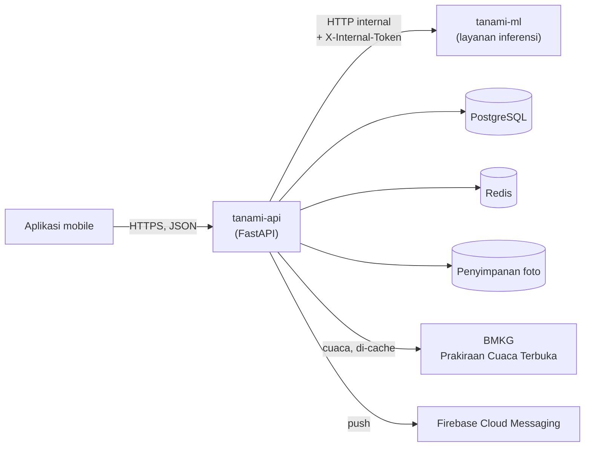

# 🌱 Tanami

**Sahabat digital petani: tahu kapan panen, tahu daun kenapa.**

Tanami adalah aplikasi pendamping petani dan pekebun berbasis *machine learning*. Cukup potret buah atau daun, lalu Tanami memberi tahu **kapan buah siap dipanen** dan **apakah tanaman sehat atau sakit, apa penyebabnya, dan cara menanganinya**.

> **Status: dalam pengembangan (pra-MVP).** Dokumen ini menjelaskan produk dan arah teknisnya. Bagian yang belum jadi ditandai jelas pada [Status dan peta jalan](#status-dan-peta-jalan).

## Daftar isi

- [Masalah yang kami selesaikan](#masalah-yang-kami-selesaikan)
- [Fitur](#fitur)
- [Cara kerja hasil scan](#cara-kerja-hasil-scan)
- [Arsitektur](#arsitektur)
- [Tech stack](#tech-stack)
- [Struktur repositori](#struktur-repositori)
- [Memulai (pengembangan)](#memulai-pengembangan)
- [Dokumentasi](#dokumentasi)
- [Status dan peta jalan](#status-dan-peta-jalan)
- [Berkontribusi](#berkontribusi)
- [Sumber data dan atribusi](#sumber-data-dan-atribusi)
- [Batasan dan privasi](#batasan-dan-privasi)
- [Kesesuaian dengan SDGs](#kesesuaian-dengan-sdgs)
- [Tim](#tim)

## Masalah yang kami selesaikan

- **Panen sering ditebak.** Terlalu cepat membuat kualitas rendah, terlalu lambat membuat buah busuk atau jatuh.
- **Penyakit baru disadari setelah menyebar.** Penyebabnya (jamur, bakteri, virus, hama, atau kekurangan hara) sulit dibedakan, padahal penanganannya berbeda-beda.
- **Akses ke penyuluh terbatas**, dan catatan kebun jarang terdokumentasi.

**Pengguna sasaran:** petani kecil, pemilik kebun, kelompok tani, dan penyuluh pertanian.

## Fitur

| # | Fitur | Ringkasan |
|---|---|---|
| 1 | **Deteksi kapan buah siap panen** (ML #1) | Foto buah menghasilkan tahap kematangan (mentah, mengkal, matang, terlalu matang) dan **rentang** perkiraan hari panen, mis. "4-7 hari lagi". |
| 2 | **Deteksi kesehatan tanaman dari daun** (ML #2) | Foto daun menghasilkan status sehat atau sakit, penyakitnya, dan kategori penyebab, lalu **rekomendasi penanganan** dari basis pengetahuan yang ditinjau ahli. |
| 3 | **Reminder cuaca dan jadwal panen** | Notifikasi berbasis prakiraan cuaca BMKG dan estimasi panen, mis. "hujan lebat sebelum panen, pertimbangkan panen lebih awal". |
| 4 | **Forum** | Diskusi antarpetani per komoditas. Hasil scan bisa dibagikan langsung ke forum, dan ahli terverifikasi bisa menjawab. |
| 5 | **Riwayat pertumbuhan dan status tanaman** | Timeline scan per lahan dan tanaman, grafik kesehatan, serta perbandingan estimasi dengan panen aktual. |

**Komoditas awal MVP:** cabai (`chili`). Komoditas lain menyusul setelah model dan dataset-nya siap.

## Cara kerja hasil scan

Tanami sengaja **jujur soal ketidakpastian**. Model bukan ahli, jadi aplikasi menampilkan hasil sesuai tingkat keyakinan:

| Keyakinan model | Status | Perilaku aplikasi |
|---|---|---|
| ≥ 0,75 | `confident` | Hasil utama dan rekomendasi ditampilkan. |
| 0,50 sampai < 0,75 | `uncertain` | Hasil ditampilkan dengan peringatan "belum yakin", plus tawaran foto ulang atau tanya ahli. |
| < 0,50 | `unknown` | Tidak menyebut satu penyakit atau tahap; meminta foto ulang. |
| Foto bukan daun/buah, terlalu buram, atau terlalu gelap | `invalid_image` | Meminta foto ulang dengan panduan. |

Prinsip yang dijaga:

- **Server yang menentukan status.** Ambang keyakinan hidup di satu tempat (konfigurasi API); aplikasi tidak menghitung ulang.
- **Rekomendasi tidak dikarang model.** Solusi berasal dari tabel `diseases` yang ditulis dan ditinjau ahli. Angka dosis tidak ditampilkan sebelum ada tinjauan.
- **Estimasi panen selalu berupa rentang**, bukan satu angka tunggal.
- Setiap layar hasil memuat: *"Hasil ini perkiraan dan tidak menggantikan ahli."*

## Arsitektur

Kami memilih **dua layanan**, bukan microservice penuh. Dengan tim kecil, biaya jaringan, deployment, dan observabilitas banyak layanan lebih besar daripada manfaatnya. Model ML dipisah karena dependensinya berbeda, siklus rilisnya berbeda, dan bisa di-*rollback* tanpa merilis ulang API.



| Layanan | Tanggung jawab | Tidak melakukan |
|---|---|---|
| **tanami-api** | Satu-satunya yang dipanggil aplikasi. Auth, lahan, tanaman, scan, riwayat, reminder, forum. Menentukan status hasil dan membangun hasil publik. | Tidak menjalankan model. |
| **tanami-ml** | Menerima foto, mengembalikan **keluaran mentah** model (probabilitas, pemeriksaan kualitas foto, estimasi hari). Internal saja. | Tidak mengakses database, tidak menentukan status, tidak dipanggil aplikasi. |

Alur scan: aplikasi mengirim foto ke API → API memvalidasi dan membersihkan foto (metadata EXIF/GPS dibuang) → API memanggil ML → API menerapkan ambang keyakinan, mengambil label dan solusi dari basis pengetahuan, lalu menyimpan dan mengembalikan hasil.

## Tech stack

Pilihan yang sudah terpakai di kode ditandai ✅. Sisanya adalah usulan yang masih bisa diubah lewat prosedur di [TQA](docs/tqa.md).

| Lapisan | Pilihan | |
|---|---|---|
| Backend API | Python 3.12, FastAPI, Pydantic v2 | ✅ |
| Layanan ML | FastAPI + predictor yang bisa diganti (saat ini *stub*, ONNX Runtime menyusul) | ✅ |
| Database | PostgreSQL, SQLAlchemy 2, Alembic | ✅ (dependensi) |
| Cache dan antrean | Redis | ✅ (dependensi) |
| Mutu kode | ruff, mypy (strict), pytest | ✅ |
| Aplikasi mobile | React Native + Expo (TypeScript), atau PWA | usulan |
| Notifikasi | Firebase Cloud Messaging | usulan |
| Penyimpanan foto | Object storage kompatibel S3 | usulan |
| CI/CD | GitHub Actions, Docker | usulan |

## Struktur repositori

```
tanami-backend/
├── services/
│   ├── api/            # tanami-api: API publik (paket tanami_api)
│   │   └── tanami_api/
│   │       ├── core/       # config, error envelope, logging, keamanan, middleware
│   │       ├── schemas/    # kontrak publik (Pydantic): enum, scan, farm, forum, ...
│   │       └── services/   # logika bisnis (sanitasi foto, klien ML, ...)
│   └── ml/             # tanami-ml: layanan inferensi (paket tanami_ml)
├── contracts/          # kontrak lintas layanan (mis. labels.json)
├── docs/               # design.md, tqa.md, catatan keputusan (adr/)
├── scripts/
└── tests/              # tes integrasi lintas layanan
```

## Memulai (pengembangan)

Kebutuhan: Python 3.12 dan [uv](https://docs.astral.sh/uv/).

```bash
# 1. Buat lingkungan dan pasang kedua layanan beserta alat pengembangan
uv venv --python 3.12 .venv
source .venv/bin/activate
uv pip install -e "services/api[dev]" -e "services/ml[dev]"

# 2. Jalankan tes layanan ML
pytest services/ml

# 3. Jalankan layanan ML (port 8001)
uvicorn tanami_ml.main:app --port 8001
```

Coba panggil layanan ML (token bawaan hanya untuk pengembangan lokal, dan ditolak di produksi):

```bash
curl -X POST localhost:8001/v1/predict \
  -H "X-Internal-Token: dev-internal-token" \
  -F scan_type=disease -F commodity_code=chili \
  -F image=@daun.jpg
```

Selama model sungguhan belum ada, layanan ML memakai **StubPredictor**: hasilnya deterministik dari hash berkas foto, **bukan** dari isi daun atau buah. Gunakan hanya untuk membangun dan menguji alur, dan jangan pernah ditampilkan ke pengguna sungguhan. Respons ditandai `"is_stub": true` agar mudah dikenali.

Konfigurasi memakai variabel lingkungan. Layanan ML memakai awalan `ML_` (mis. `ML_INTERNAL_TOKEN`). Mode `production` menolak berjalan dengan token bawaan.

> Menjalankan API dan seluruh *stack* lewat Docker Compose belum tersedia. Lihat [peta jalan](#status-dan-peta-jalan).

## Dokumentasi

| Dokumen | Isi |
|---|---|
| [`docs/design.md`](docs/design.md) | **Kontrak bersama** frontend, backend, dan ML: alur, layar, enum, skema data, API, kontrak output ML, aturan reminder, offline. |
| [`docs/tqa.md`](docs/tqa.md) | **Technical Quality Agreement**: standar kode, pengujian, kualitas ML, keamanan, CI/CD, Definition of Done. |
| [`contracts/labels.json`](contracts/labels.json) | Daftar label ML per komoditas. Dicocokkan dengan kode oleh tes. |

Aturan emas: jika kode berbeda dengan `design.md` pada bagian enum, API, atau kontrak ML, salah satunya harus diperbaiki lewat PR, bukan dibiarkan.

## Status dan peta jalan

| Komponen | Status |
|---|---|
| Layanan ML (kontrak, *stub*, tes) | ✅ Ada, 23 tes lulus |
| Skema kontrak API (enum, scan, lahan, forum, reminder, ...) | ✅ Ada |
| Inti API (error envelope, config, logging, request id, token, rate limit) | ✅ Ada |
| Sanitasi foto, klien ML, penyimpanan media | ✅ Ada |
| Aplikasi API (router, data tiruan stateful, tes API) | ⏳ Sedang dikerjakan |
| Model database dan migrasi Alembic | ⏳ Belum |
| Docker, Docker Compose, CI (GitHub Actions) | ⏳ Belum |
| Model ML sungguhan (ONNX), dataset foto lapangan | ⏳ Belum |

Urutan pengerjaan yang disepakati:

1. **Fondasi:** repo, kontrak API, API tiruan yang bisa dipakai frontend, CI.
2. **MVP:** deteksi daun, deteksi kematangan, riwayat tanaman (satu komoditas).
3. **Reminder:** cuaca BMKG dan jadwal panen (berbasis aturan).
4. **Forum** versi sederhana.
5. **Pasca-MVP:** model di perangkat untuk mode offline, komoditas tambahan.

**Jalur terpanjang proyek ini adalah data, bukan kode:** foto lapangan yang dilabeli dan divalidasi ahli. Pengumpulannya berjalan paralel sejak awal.

## Berkontribusi

Ringkasan aturan tim (detail di [TQA](docs/tqa.md)):

- **Git:** GitHub Flow. `main` diproteksi, cabang kerja `feat/…`, `fix/…`, `docs/…`, `ml/…`, umur maksimal 3 hari kerja.
- **Commit:** [Conventional Commits](https://www.conventionalcommits.org/), mis. `feat(scan): tambah endpoint unggah foto daun`.
- **Pull request:** minimal 1 persetujuan, semua pemeriksaan CI lulus, di-*squash* saat merge. Perubahan kontrak API atau output ML butuh persetujuan dari sisi frontend **dan** backend.
- **Kode:** nama dan komentar dalam bahasa Inggris, teks untuk pengguna dalam bahasa Indonesia. Tanpa rahasia di repo.
- **Sebelum membuka PR**, jalankan:

```bash
ruff check . && ruff format --check .
mypy services/api/tanami_api services/ml/tanami_ml
pytest
```

## Sumber data dan atribusi

- **BMKG (Prakiraan Cuaca Terbuka):** data cuaca per desa/kelurahan. **Wajib menampilkan BMKG sebagai sumber data** di aplikasi. Batas akses 60 permintaan per menit per IP, jadi hanya backend yang memanggil BMKG, dengan *cache*.
- **Open-Meteo (opsional, cadangan):** atribusi wajib. Versi gratisnya hanya untuk penggunaan non-komersial.
- Setiap dataset dan model pra-latih dicatat lisensinya di *data card* sebelum dipakai.

## Batasan dan privasi

- **Bukan pengganti ahli.** Hasil adalah perkiraan. Untuk kasus berat atau menyebar, aplikasi mengarahkan pengguna ke penyuluh.
- Model terlatih pada komoditas dan kelas yang terdaftar saja. Foto di luar itu bisa menghasilkan `unknown` atau `invalid_image`, dan itu perilaku yang diinginkan.
- **Privasi:** data dikumpulkan seminimal mungkin. Metadata lokasi (EXIF/GPS) dibuang dari foto sebelum disimpan, dan lokasi kebun disimpan pada tingkat desa/kelurahan. Foto hanya dipakai untuk melatih model jika pengguna memberi **persetujuan terpisah**, dan persetujuan itu bisa ditarik. Isi forum bersifat publik. Kewajiban rinci sesuai UU No. 27 Tahun 2022 tentang Pelindungan Data Pribadi perlu dikonfirmasi dengan pihak yang paham hukum sebelum rilis publik.

## Kesesuaian dengan SDGs

**Utama:** SDG 2 (Tanpa Kelaparan), SDG 12 (Konsumsi dan Produksi yang Bertanggung Jawab), SDG 9 (Industri, Inovasi dan Infrastruktur).
**Pendukung:** SDG 13 (Penanganan Perubahan Iklim) dan SDG 1 (Tanpa Kemiskinan).

## Tim

| Peran | Fokus |
|---|---|
| Product Manager | Riset petani, prioritas fitur, kemitraan penyuluh, moderasi forum |
| 2 Frontend | Aplikasi mobile: kamera, riwayat, notifikasi, forum, mode offline |
| 2 Backend + ML Engineer | API, database, pipeline data, melatih dan menyajikan model, integrasi BMKG |

## Lisensi

Belum ditentukan. Putuskan bersama tim sebelum repositori dibuka atau dirilis.
