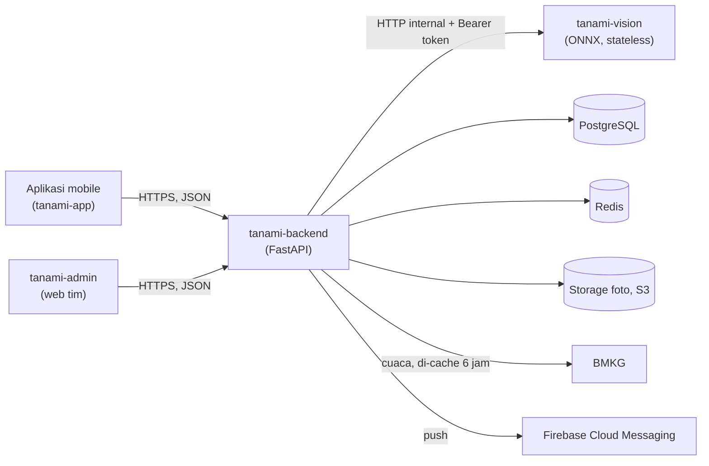

# 🌱 Tanami

**Pendamping petani buah: tahu kapan panen, tahu daun kenapa.**

Tanami membantu petani dan penghobi **mangga, jeruk, dan stroberi** mencatat tanamannya, melihat perkiraan kapan panen berikutnya, mencatat setiap panen, dan memeriksa penyakit daun cukup dari foto.

> **Status: pra-MVP.** Rancangan produk sudah di [`docs/design.md`](docs/design.md) **v2** (fokus 3 tanaman buah). Kode di repo ini **masih mengikuti v0.3** (komoditas cabai, daftar deteksi terpisah). Pekerjaan penyesuaiannya tercatat di lampiran design.md, bagian "Dampak ke Implementasi".

## Daftar isi

- [Fitur](#fitur)
- [Isi repositori](#isi-repositori)
- [Arsitektur](#arsitektur)
- [Menjalankan secara lokal](#menjalankan-secara-lokal)
- [Pemeriksaan sebelum PR](#pemeriksaan-sebelum-pr)
- [Dokumentasi](#dokumentasi)
- [Status](#status)
- [Berkontribusi](#berkontribusi)
- [Data, privasi, dan batasan](#data-privasi-dan-batasan)
- [Tim](#tim)

## Fitur

Sesuai `design.md` v2:

| Fitur | Ringkasan |
|---|---|
| **Kebun dan tanaman** | Daftarkan kebun (indoor/outdoor) dan tanaman: jenis, jenis bibit, tanggal tanam, jumlah. Satu tanaman bisa satu pohon atau satu kelompok/bedengan. |
| **Tracking dan perkiraan panen** | Fase (belum berbuah / masa berbuah), perkiraan panen berikutnya **berupa rentang tanggal**, dan akhir masa produktif. Semua dihitung dari profil agronomi, **bukan model ML**. Panen dicatat bertahap: panen ke-1, ke-2, dan seterusnya. |
| **Scan penyakit daun** | Pilih tanaman, foto daun, lalu dapat nama penyakit, keyakinan (%), gejala, pencegahan, dan penanganan. Penyakit yang dikonfirmasi petani bisa memundurkan perkiraan panen. |
| **Riwayat Tanaman** | Tanaman yang selesai atau dihentikan, dengan status akhir (Selesai / Dihentikan / Gagal panen), jumlah panen, alasan, dan penyakitnya. |
| **Riwayat Scan** | Semua hasil scan dengan filter jenis tanaman, penyakit, dan tanaman. |
| **Pengingat** | Siram, foto, pemantauan, tindak lanjut penyakit, panen sudah dekat, dan cuaca BMKG untuk kebun outdoor. |
| **Forum** | Diskusi per jenis tanaman; hasil scan bisa dibagikan; ahli terverifikasi diberi lencana. |
| **Ruang kerja tim** | Web untuk ahli, moderator, dan admin: tinjau hasil deteksi, basis penyakit, laporan forum, pengguna, pengumuman. |

Prinsip yang dijaga: model **jujur soal ketidakpastian** (`confident`, `uncertain`, `unknown`, `invalid_image`), saran penanganan **hanya** dari basis pengetahuan yang ditinjau ahli, dan backend yang menghitung semua aturan, bukan aplikasi.

## Isi repositori

| Folder | Isi |
|---|---|
| `/` (root) | **`tanami-vision`**: layanan inferensi ML (FastAPI + ONNX Runtime). Stateless, tanpa database. Kodenya di `app/`, tesnya di `tests/` |
| [`tanami-backend/`](tanami-backend/) | **API utama** (FastAPI, PostgreSQL, Redis, Alembic, job terjadwal). Satu-satunya pemilik data |
| [`tanami-admin/`](tanami-admin/) | **Ruang kerja tim** (React + Vite + TypeScript) untuk ahli, moderator, dan admin |
| [`docs/`](docs/) | `design.md` (kontrak produk dan teknis), `tqa.md` (standar kualitas), `architecture.md` |
| [`contracts/`](contracts/) | Kontrak HTTP layanan vision (`API.md`, `openapi.json`) |
| [`models/`](models/) | Artefak model per versi, masing-masing dengan `manifest.json` |
| `scripts/` | Pembuat model stub, ekspor OpenAPI layanan vision |
| `.github/` | CI per komponen (`ci.yml`, `backend-ci.yml`, `admin-ci.yml`) dan template PR |

**Belum ada di repo ini:** aplikasi mobile `tanami-app` dan eksperimen ML `tanami-ml` (repo terpisah, lihat `tqa.md` bagian 4).

## Arsitektur

Backend utama ditambah **satu layanan ML terpisah**. Layanan ML hanya menerima gambar dan mengembalikan hasil, tanpa menyentuh database, storage, atau notifikasi. Dengan begitu model bisa diganti atau di-*rollback* tanpa men-deploy ulang backend.



Alasan dan alur satu scan: [`docs/architecture.md`](docs/architecture.md).

## Menjalankan secara lokal

Kebutuhan: **Python 3.12** dan **Node 20+**. Tidak perlu Docker atau PostgreSQL. Perintah di bawah untuk Windows PowerShell; di macOS/Linux ganti `.venv\Scripts\activate` dengan `source .venv/bin/activate`.

### Cara tercepat: backend dengan data demo + ruang kerja tim

**Terminal 1, backend** (PostgreSQL tertanam, Redis tiruan, model stub, dua minggu data demo):

```powershell
cd tanami-backend
py -3.12 -m venv .venv
.venv\Scripts\activate
pip install -e ".[dev]"
python scripts/dev_server.py
```

API berjalan di http://127.0.0.1:8000, dokumentasi interaktifnya di http://127.0.0.1:8000/docs. Database dibuat ulang setiap kali server dinyalakan; tambahkan `--no-demo` untuk memulai dengan database kosong.

**Terminal 2, ruang kerja tim:**

```powershell
cd tanami-admin
npm install
npm run dev
```

Buka http://localhost:5173 dan masuk dengan `admin`, `ahli`, atau `moderator`, sandi `tanami-demo-123`. Akun demo ini hanya untuk lokal.

### Layanan vision (opsional)

`dev_server.py` sudah memakai model stub, jadi layanan ini hanya dibutuhkan bila backend dijalankan dengan konfigurasi biasa (`uvicorn app.asgi:app`, lihat [`tanami-backend/README.md`](tanami-backend/README.md)) atau saat mengerjakan ML.

```powershell
# di root repo
py -3.12 -m venv .venv
.venv\Scripts\activate
pip install -e ".[dev]"
copy .env.example .env
python scripts/make_stub_models.py --with-shadow
uvicorn app.asgi:app --reload --port 8001
```

Atau dengan Docker: `docker compose up vision`.

Selama model sungguhan belum ada, layanan memakai **stub**: hasilnya deterministik dari hash piksel, **bukan** dari isi daun. Hanya untuk membangun dan menguji alur, dan ditolak saat `VISION_APP_ENV=production`. Kontrak lengkapnya di [`contracts/API.md`](contracts/API.md).

## Pemeriksaan sebelum PR

Jalankan pemeriksaan komponen yang Anda ubah. CI menjalankan hal yang sama.

**tanami-vision** (root):

```powershell
ruff check .; ruff format --check .
mypy
python scripts/export_openapi.py --check
pytest --cov=app --cov-fail-under=85
```

**tanami-backend:**

```powershell
cd tanami-backend
ruff check app tests scripts migrations; ruff format --check app tests scripts migrations
mypy app scripts
python scripts/export_openapi.py
pytest -q --cov=app --cov-fail-under=80
```

**tanami-admin:**

```powershell
cd tanami-admin
npm run build
```

## Dokumentasi

| Dokumen | Isi |
|---|---|
| [`docs/design.md`](docs/design.md) | **Kontrak bersama** frontend, backend, dan ML: alur, layar, enum, aturan perkiraan panen, skema data, API, kontrak output ML. Mulai dari bagian "Apa yang berubah di v2". |
| [`docs/tqa.md`](docs/tqa.md) | **Technical Quality Agreement**: standar kode, pengujian, kualitas ML, keamanan, CI/CD, Definition of Done. |
| [`docs/architecture.md`](docs/architecture.md) | Kenapa layanan ML dipisah dan bagaimana alur satu scan. |
| [`tanami-backend/README.md`](tanami-backend/README.md) | Detail backend: konfigurasi, endpoint, job terjadwal. |
| [`tanami-admin/README.md`](tanami-admin/README.md) | Detail ruang kerja tim: layar, build produksi. |
| [`contracts/API.md`](contracts/API.md) | Kontrak HTTP layanan vision. |

Aturan emas: jika kode berbeda dengan `design.md` pada bagian enum, API, atau kontrak ML, salah satunya diperbaiki lewat PR, bukan dibiarkan.

## Status

| Komponen | Status |
|---|---|
| `tanami-backend`: API R0-R7, database dan migrasi, job, tes, CI | ✅ Ada, mengikuti design v0.3 |
| `tanami-admin`: ruang kerja tim | ✅ Ada, mengikuti design v0.3 |
| `tanami-vision`: kontrak, stub, jalur ONNX, model bayangan, CI, Docker | ✅ Ada, belum ada model sungguhan |
| Penyesuaian ke design v2 (tracking 3 tanaman buah, episode penyakit, riwayat baru) | ⏳ Belum |
| Model ML mangga, jeruk, stroberi + set uji foto lapangan | ⏳ Belum |
| Aplikasi mobile `tanami-app` | ⏳ Belum di repo ini |
| Profil tanaman dan hari keterlambatan per penyakit yang bersumber dan ditinjau ahli | ⏳ Belum |

**Jalur terpanjang proyek ini adalah data, bukan kode:** foto daun lapangan yang dilabeli ahli, serta angka agronomi yang bersumber jelas.

## Berkontribusi

Ringkasan aturan tim (detail di `tqa.md` bagian 4):

- **Branch:** GitHub Flow. `main` diproteksi (tidak boleh push langsung). Cabang kerja `feat/…`, `fix/…`, `chore/…`, `docs/…`, `ml/…`, umur maksimal 3 hari kerja.
- **Commit:** [Conventional Commits](https://www.conventionalcommits.org/), mis. `feat(scan): tambah konfirmasi penyakit`.
- **Pull request:** isi template PR, minimal 1 persetujuan, CI lulus, merge dengan *squash*. Perubahan kontrak API atau output ML butuh persetujuan dari sisi frontend **dan** backend.
- **Kode:** nama dan komentar dalam bahasa Inggris, teks untuk pengguna dalam bahasa Indonesia. Tidak ada rahasia di repo (pakai `.env`, contohnya di `.env.example`).

## Data, privasi, dan batasan

- **Bukan pengganti ahli.** Hasil scan dan perkiraan panen adalah perkiraan. Setiap layar hasil memuat: *"Hasil ini perkiraan dan tidak menggantikan ahli."*
- **BMKG** (Prakiraan Cuaca Terbuka): wajib mencantumkan BMKG sebagai sumber. Hanya backend yang memanggil BMKG, dengan cache.
- **Dataset publik** (MangoLeafBD, Citrus Leaves, PlantVillage, Strawberry Disease) baru kandidat; lisensinya dicek dan dicatat sebelum dipakai (`tqa.md` bagian 13).
- **Privasi:** metadata EXIF/GPS dibuang dari foto, lokasi kebun disimpan setingkat kelurahan, dan foto hanya dipakai melatih model bila pengguna memberi **persetujuan terpisah**. Kewajiban rinci menurut UU No. 27 Tahun 2022 tentang Pelindungan Data Pribadi perlu dikonfirmasi sebelum rilis publik.

## Tim

| Peran | Fokus |
|---|---|
| Product Manager | Riset petani, prioritas fitur, kemitraan penyuluh, moderasi forum |
| 2 Frontend | Aplikasi mobile: kamera, tracking, riwayat, notifikasi, forum, mode offline |
| 2 Backend + ML Engineer | API, database, pipeline data, melatih dan menyajikan model, integrasi BMKG |

**Kesesuaian SDGs:** SDG 2 (Tanpa Kelaparan), SDG 12 (Konsumsi dan Produksi yang Bertanggung Jawab), SDG 9 (Industri, Inovasi dan Infrastruktur); pendukung SDG 13 dan SDG 1.

## Lisensi

Belum ditentukan (`pyproject.toml` menandai *Proprietary*). Putuskan bersama tim sebelum repositori dibuka atau dirilis.
