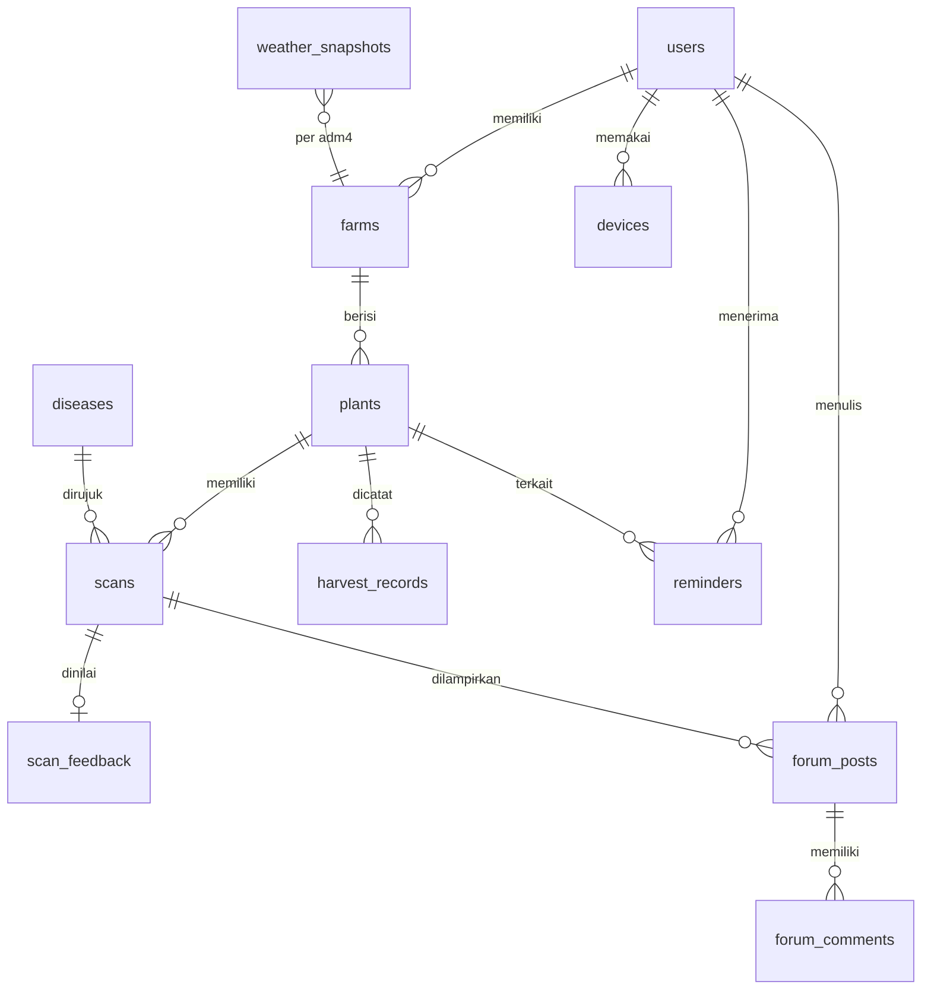

# Tanami - design.md

Dokumen ini adalah **kontrak bersama** antara frontend, backend, dan ML. Tujuannya satu: semua orang membangun hal yang sama dengan istilah, data, dan perilaku yang sama.

| | |
|---|---|
| Versi | 0.1 (draft) |
| Tanggal | 23 Oktober 2026 |
| Dokumen pendamping | `tqa.md` (standar kualitas) |
| Status nilai | Nilai bertanda **[USULAN]** adalah titik awal dan dapat diubah lewat PR yang disetujui pemilik area (lihat `tqa.md` bagian 2 dan 16). |

**Cara memakai dokumen ini**
- Bagian 8 (istilah dan enum), 10 (API), dan 11 (kontrak ML) adalah **sumber kebenaran**. Jika kode berbeda dengan dokumen ini, salah satunya harus diperbaiki lewat PR, bukan dibiarkan.
- Perubahan pada bagian 8, 10, dan 11 harus disetujui oleh satu orang frontend dan satu orang backend/ML.
- Komoditas awal MVP: **cabai** [USULAN]. Daftar kelas penyakit di bagian 11 adalah contoh awal dan **difinalkan bersama ahli**.

---

## 1. Ringkasan Produk dan Prinsip Desain

**Tanami** adalah aplikasi pendamping petani berbasis ML. Pengguna memotret buah atau daun, lalu aplikasi memberi tahu **kapan buah siap panen** dan **apakah tanaman sehat atau sakit** beserta penyebab dan solusinya. Aplikasi juga memberi pengingat cuaca dan panen, menyimpan riwayat pertumbuhan, dan menyediakan forum antarpetani.

**Prinsip desain (jadi pegangan saat ragu):**
1. **Satu tangan, di bawah matahari.** Layar dipakai di kebun: tombol besar, kontras tinggi, sedikit langkah.
2. **Jujur soal ketidakpastian.** Model bukan ahli. Jika tidak yakin, aplikasi bilang tidak yakin dan menawarkan bantuan.
3. **Bahasa petani.** Bahasa Indonesia sederhana. Istilah teknis selalu disertai penjelasan awam.
4. **Hasil lebih dulu, detail belakangan.** Layar hasil menampilkan jawaban utama besar, penjelasan di bawahnya.
5. **Tetap berguna tanpa sinyal.** Data tersimpan bisa dibuka, foto bisa diantre.
6. **Satu sumber kebenaran.** Frontend tidak menebak aturan bisnis; backend yang menentukan, frontend yang menampilkan.

---

## 2. Pengguna

| Persona | Deskripsi | Kebutuhan utama | Catatan desain |
|---|---|---|---|
| **Pak Budi, petani kecil** | 45-60 tahun, HP Android kelas menengah ke bawah, sinyal tidak stabil, kebun 0,2-2 ha | Tahu kapan panen, tahu daun kenapa | Teks besar, ikon jelas, sedikit mengetik, offline |
| **Bu Sari, ketua kelompok tani** | 35-50 tahun, mengelola beberapa lahan | Memantau banyak tanaman, bertanya ke ahli | Daftar lahan, riwayat, forum |
| **Penyuluh/ahli** | Penyuluh pertanian, dosen | Membantu petani, memberi jawaban di forum | Peran terverifikasi di forum |

---

## 3. Cakupan dan Prioritas

| Prioritas | Fitur | Isi MVP |
|---|---|---|
| P0 | **Deteksi kesehatan daun** (ML #2) | Scan daun, hasil + penyebab + solusi, 1 komoditas |
| P0 | **Deteksi kematangan/siap panen** (ML #1) | Scan buah, tahap kematangan, estimasi **rentang hari** |
| P0 | **Riwayat pertumbuhan** | Lahan, tanaman, timeline scan, grafik status |
| P1 | **Reminder cuaca dan panen** | Notifikasi berbasis aturan (bagian 12), data BMKG |
| P2 | **Forum** | Versi sederhana: kategori per komoditas, posting, komentar, bagikan hasil scan |

**Di luar MVP:** banyak komoditas sekaligus, konsultasi video, peta sebaran penyakit, marketplace saprotan, prediksi harga.

---

## 4. Arsitektur Informasi dan Navigasi

**Navigasi bawah (5 tab):**

| Tab | Isi | Fitur |
|---|---|---|
| **Beranda** | Ringkasan hari ini: cuaca kebun, reminder aktif, tanaman butuh perhatian | Reminder |
| **Scan** (tombol tengah, menonjol) | Pilih "Cek Daun" atau "Cek Buah", ambil foto | ML #1 dan #2 |
| **Kebun** | Daftar lahan, tanaman, detail dan riwayat | Riwayat |
| **Forum** | Daftar posting, buat posting | Forum |
| **Akun** | Profil, pengaturan notifikasi, bahasa, bantuan, keluar | |

**Peta layar (ringkas):**
```
Beranda -> Detail Reminder -> Detail Tanaman
Scan -> Pilih Jenis -> Kamera -> Pratinjau -> Memproses -> Hasil (Daun | Buah)
                                                          -> Simpan ke Tanaman
                                                          -> Bagikan ke Forum
Kebun -> Daftar Lahan -> Detail Lahan -> Daftar Tanaman -> Detail Tanaman -> Timeline / Grafik / Detail Scan
Forum -> Daftar Posting -> Detail Posting (komentar) | Buat Posting
Akun -> Profil | Notifikasi | Tentang dan Sumber Data | Hapus Akun
```

---

## 5. Alur Pengguna Utama

### 5.1 Pertama kali memakai (onboarding)
1. Layar sambutan singkat (maks. 3 slide) -> **Daftar/Masuk** (nomor HP atau email dan kata sandi [USULAN]).
2. Persetujuan privasi, termasuk pilihan terpisah: "Izinkan foto saya dipakai untuk meningkatkan Tanami" (boleh ditolak).
3. **Buat lahan pertama:** nama lahan, pilih desa/kelurahan (dari GPS atau pilih manual), jenis tanaman.
4. **Tambah tanaman/blok tanam:** komoditas, tanggal tanam (boleh perkiraan).
5. Selesai -> Beranda dengan ajakan "Coba scan daun pertama Anda".

### 5.2 Scan daun
1. Tab **Scan** -> **Cek Daun** -> pilih tanaman (opsional, bisa "Simpan nanti").
2. Kamera dengan bingkai dan tips ("satu daun, cahaya cukup, tidak buram").
3. Pratinjau -> **Kirim**. Jika offline: foto masuk **antrean** (bagian 14).
4. Layar memproses (maks. sekitar 5 detik) -> **Hasil** sesuai status (bagian 11.4).
5. Dari Hasil: **Simpan ke riwayat**, **Tanya di forum**, **Tandai hasil benar/salah**.

### 5.3 Scan buah
Sama dengan 5.2, dengan hasil tahap kematangan dan estimasi rentang hari panen. Jika tanaman dipilih, estimasi masuk ke reminder panen.

### 5.4 Melihat riwayat tanaman
Kebun -> Lahan -> Tanaman -> **Timeline** (urutan waktu scan dan peristiwa) dan **Grafik** (status kesehatan dan tahap kematangan dari waktu ke waktu). Pengguna dapat mencatat **panen aktual** (tanggal dan kualitas) untuk membandingkan dengan estimasi.

### 5.5 Reminder
Job backend membuat reminder -> push notification -> pengguna membuka -> **Detail Reminder** (penyebab, saran, tanaman terkait) -> tandai "Sudah dibaca" atau "Selesai".

### 5.6 Forum
Forum -> pilih kategori komoditas -> baca posting -> komentar. Buat posting dengan teks, hingga 3 foto, atau lampirkan hasil scan.

---

## 6. Daftar Layar dan Data yang Dibutuhkan

| Kode | Layar | Data dari API | Keadaan khusus |
|---|---|---|---|
| S01 | Sambutan | - | - |
| S02 | Daftar/Masuk | `POST /auth/*` | Galat kredensial, tanpa sinyal |
| S03 | Buat lahan | `POST /farms` | Gagal ambil lokasi -> pilih manual |
| S04 | Beranda | `GET /home` | Kosong (belum ada lahan), offline (data terakhir) |
| S05 | Kamera/Scan | - | Izin kamera ditolak -> panduan membuka pengaturan |
| S06 | Hasil Scan Daun | `POST /scans` (respons) | `confident`, `uncertain`, `unknown`, `invalid_image` |
| S07 | Hasil Scan Buah | `POST /scans` (respons) | Sama dengan S06 |
| S08 | Daftar Kebun | `GET /farms` | Kosong |
| S09 | Detail Lahan | `GET /farms/{id}` + tanaman | |
| S10 | Detail Tanaman | `GET /plants/{id}` | |
| S11 | Timeline dan Grafik | `GET /plants/{id}/timeline`, `/stats` | Belum ada data |
| S12 | Detail Scan | `GET /scans/{id}` | Gambar dihapus |
| S13 | Daftar Reminder | `GET /reminders` | Kosong |
| S14 | Detail Reminder | `GET /reminders/{id}` | |
| S15 | Forum - Daftar | `GET /forum/posts` | Kosong, memuat lagi |
| S16 | Forum - Detail | `GET /forum/posts/{id}` | Dilaporkan/dihapus |
| S17 | Forum - Buat | `POST /forum/posts` | Unggah foto gagal |
| S18 | Akun/Pengaturan | `GET /users/me` | |
| S19 | Info Penyakit | `GET /diseases/{code}` | |
| S20 | Sumber Data | statis | Atribusi BMKG |

**Setiap layar wajib menangani 5 keadaan:** memuat (skeleton), kosong, berhasil, galat (dengan tombol coba lagi), dan offline.

---

## 7. Design System

### 7.1 Warna (design tokens) [USULAN]

| Token | Hex | Penggunaan |
|---|---|---|
| `color.primary` | `#2E7D32` | Tombol utama, elemen aktif |
| `color.primary-dark` | `#1B5E20` | Tekan/hover, header |
| `color.primary-light` | `#E8F5E9` | Latar kartu lembut |
| `color.secondary` | `#8D6E63` | Aksen tanah/lahan |
| `color.accent` | `#F9A825` | Panen, sorotan |
| `color.success` | `#2E7D32` | Sehat, berhasil |
| `color.warning` | `#EF6C00` | Waspada, tidak yakin |
| `color.danger` | `#C62828` | Sakit parah, galat |
| `color.info` | `#1565C0` | Informasi |
| `color.text` | `#1F2A1F` | Teks utama |
| `color.text-muted` | `#5B665B` | Teks sekunder |
| `color.surface` | `#FFFFFF` | Kartu |
| `color.background` | `#F6F8F4` | Latar halaman |
| `color.border` | `#D9E0D5` | Garis |

- Aplikasi **hanya mode terang** di MVP (pemakaian di luar ruangan).
- Kontras teks terhadap latar minimal WCAG AA (4,5:1 untuk teks isi).
- **Warna tidak boleh menjadi satu-satunya pembeda.** Selalu pasangkan dengan ikon dan teks.

### 7.2 Tipografi
- Huruf: **Inter** (cadangan: font sistem).
- Skala:

| Token | Ukuran / tinggi baris | Berat | Penggunaan |
|---|---|---|---|
| `text.display` | 28 / 36 | Bold | Judul hasil utama |
| `text.title` | 22 / 28 | SemiBold | Judul layar |
| `text.heading` | 18 / 24 | SemiBold | Judul bagian |
| `text.body` | 16 / 24 | Regular | Teks isi (minimal) |
| `text.body-strong` | 16 / 24 | SemiBold | Penekanan |
| `text.caption` | 14 / 20 | Regular | Keterangan, tanggal |

- Tidak ada teks isi di bawah 14 sp. Aplikasi menghormati pengaturan ukuran huruf sistem sampai 130%.

### 7.3 Jarak, bentuk, dan bayangan
- Skala jarak (kelipatan 4): `4, 8, 12, 16, 24, 32, 48`. Margin layar 16.
- Radius sudut: kartu 12, tombol 12, chip 999 (bulat).
- Bayangan ringan hanya untuk kartu yang bisa ditekan.
- **Area sentuh minimal 48 x 48 dp.**

### 7.4 Komponen inti

| Komponen | Varian | Catatan |
|---|---|---|
| Tombol | Utama (isi hijau), Sekunder (garis), Teks, Bahaya | Tinggi 52; label kata kerja ("Kirim Foto") |
| Kartu Hasil | `confident`, `uncertain`, `unknown`, `invalid_image` | Lihat 11.4 |
| Lencana Penyebab | `fungus`, `bacteria`, `virus`, `pest`, `nutrient_deficiency`, `healthy`, `unknown` | Ikon + label; lihat 7.5 |
| Meter Keyakinan | Batang 0-100% + kata ("Yakin", "Belum yakin") | Jangan tampilkan angka tanpa kata |
| Kartu Tanaman | Foto terakhir, nama, status kesehatan, tahap tumbuh | |
| Kartu Reminder | Ikon jenis, judul, waktu, tombol aksi | Dibedakan prioritas |
| Item Timeline | Tanggal, ikon jenis, ringkasan, thumbnail | |
| Grafik Status | Garis/titik per waktu | Sumbu mudah dibaca |
| Kartu Posting Forum | Penulis (+ lencana Ahli), judul, ringkasan, jumlah komentar, thumbnail | |
| Panel Cuaca | Suhu, kelembapan, deskripsi, ikon, 3 hari | Atribusi BMKG |
| Keadaan Kosong | Ilustrasi sederhana + 1 kalimat + 1 tombol | |
| Banner Offline | Jelas, tidak mengganggu | "Anda sedang offline. Foto akan dikirim saat ada sinyal." |
| Galat | Pesan manusiawi + "Coba lagi" | Tidak menampilkan kode teknis kecuali di "Detail" |

### 7.5 Penyebab penyakit: pemetaan tampilan (harus sama di semua layar)

| `cause_category` | Label (ID) | Penjelasan awam | Ikon (nama) |
|---|---|---|---|
| `healthy` | Sehat | Daun terlihat normal | `leaf-check` |
| `fungus` | Jamur | Dipicu lembap; sering berupa bercak atau bubuk | `mushroom` |
| `bacteria` | Bakteri | Menyebar lewat air dan alat; bisa layu cepat | `bacteria` |
| `virus` | Virus | Daun keriting/menguning; sering dibawa serangga | `virus` |
| `pest` | Hama | Serangan serangga atau tungau | `bug` |
| `nutrient_deficiency` | Kurang hara | Tanaman kurang pupuk atau unsur tertentu | `sprout` |
| `unknown` | Belum diketahui | Model belum yakin | `help-circle` |

### 7.6 Gaya bahasa (microcopy)
- Sapaan netral dan sopan: "Anda". Kalimat pendek, kata kerja jelas.
- Contoh: "Daun tampak terkena **jamur antraknosa**. Kami cukup yakin (82%)." / "Kami belum yakin. Coba foto ulang dari dekat dengan cahaya cukup."
- **Dilarang**: menyatakan kepastian ("Pasti penyakit X"), memberi angka dosis tanpa tinjauan ahli, bahasa yang menakut-nakuti.
- Semua teks ada di berkas i18n (`id.json`). Kunci menggunakan format `fitur.layar.elemen` (mis. `scan.result.uncertain_title`).

### 7.7 Ikon dan ilustrasi
- Satu set ikon konsisten (garis 2 px). Ilustrasi sederhana, bernuansa kebun Indonesia.

---

## 8. Istilah dan Enum (Sumber Kebenaran)

### 8.1 Glosarium

| Istilah (ID) | Kode/English | Arti |
|---|---|---|
| Pengguna | `user` | Akun di aplikasi |
| Lahan/Kebun | `farm` | Satu lokasi tanam milik pengguna; terhubung ke desa (adm4) |
| Tanaman/Blok tanam | `plant` | Satu kelompok tanaman sejenis di lahan (mis. "Cabai Blok A") dengan tanggal tanam. MVP: satu catatan mewakili satu blok, bukan satu pohon. |
| Scan | `scan` | Satu foto yang dianalisis |
| Diagnosis | `disease` result | Hasil scan daun |
| Kematangan | `ripeness` result | Hasil scan buah |
| Reminder | `reminder` | Pengingat dari sistem |
| Posting | `post` | Isi forum |

### 8.2 Enum (nilai persis, huruf kecil, `snake_case`)

| Enum | Nilai |
|---|---|
| `scan_type` | `disease`, `ripeness` |
| `result_status` | `confident`, `uncertain`, `unknown`, `invalid_image` |
| `cause_category` | `healthy`, `fungus`, `bacteria`, `virus`, `pest`, `nutrient_deficiency`, `unknown` |
| `ripeness_stage` | `unripe`, `turning`, `ripe`, `overripe` |
| `growth_stage` | `seedling`, `vegetative`, `flowering`, `fruiting`, `harvesting`, `finished` |
| `health_status` (tanaman) | `healthy`, `at_risk`, `sick`, `recovering`, `unknown` |
| `reminder_type` | `fungal_risk`, `heavy_rain_harvest`, `harvest_soon`, `heat_stress`, `scan_followup`, `general` |
| `reminder_priority` | `low`, `normal`, `high` |
| `reminder_status` | `unread`, `read`, `done`, `dismissed` |
| `feedback_value` | `correct`, `incorrect` |
| `user_role` | `farmer`, `expert`, `moderator`, `admin` |
| `post_status` | `published`, `hidden`, `removed` |
| `report_reason` | `spam`, `scam`, `abuse`, `wrong_info`, `other` |
| `commodity_code` | MVP: `chili`. Tambahan kelak: `tomato`, `coffee`, dst. |

**Aturan penurunan status tanaman:** `health_status` tanaman diturunkan backend dari scan daun terakhir (maks. 14 hari) dan catatan pengguna:
- scan terakhir `healthy` dan `confident` -> `healthy`
- scan `uncertain` atau penyakit ringan -> `at_risk`
- scan penyakit `confident` -> `sick`
- scan sehat setelah sebelumnya `sick` -> `recovering`, lalu `healthy` setelah 2 scan sehat berturut-turut
- tidak ada scan 14 hari -> `unknown`

Frontend **menampilkan** status ini dan tidak menghitungnya sendiri.

---

## 9. Model Data (Database)

### 9.1 Diagram relasi


### 9.2 Tabel dan kolom penting
Semua tabel punya `id` (UUID), `created_at`, `updated_at` (UTC). Nama kolom `snake_case`.

**users**: `email` atau `phone` (unik), `password_hash`, `display_name`, `role` (`user_role`), `consent_training_data` (bool), `consent_at`, `deleted_at`.

**farms**: `user_id`, `name`, `adm4_code` (kode wilayah desa/kelurahan, mis. `31.71.03.1001`), `lat`, `lon` (opsional), `area_m2` (opsional).

**plants**: `farm_id`, `commodity_code`, `variety` (opsional), `label` (mis. "Cabai Blok A"), `planted_at` (date), `growth_stage` (`growth_stage`), `health_status` (`health_status`), `expected_harvest_min`, `expected_harvest_max` (date, nullable; diisi dari scan buah terakhir), `archived_at`.

**scans**: `plant_id` (nullable bila belum dikaitkan), `user_id`, `scan_type`, `image_key` (kunci di object storage), `client_uuid` (untuk idempoten), `captured_at` (waktu foto diambil di perangkat), `status` (`result_status`), `model_version`, `result` (JSONB, bentuk di bagian 11), `disease_code` (nullable, rujukan `diseases.code`), `quality` (JSONB: blur, brightness, dll.), `created_at`.

**scan_feedback**: `scan_id` (unik), `value` (`feedback_value`), `comment` (opsional), `correct_label` (opsional, untuk ahli).

**harvest_records**: `plant_id`, `harvested_at`, `quality_note`, `quantity_kg` (opsional). Dipakai membandingkan estimasi dan realisasi.

**diseases** (basis pengetahuan, dikelola tim dan ahli): `code` (unik, mis. `anthracnose`), `commodity_code`, `name_id`, `name_latin` (opsional), `cause_category`, `symptoms` (teks awam), `causes_text`, `treatments` (JSONB, lihat 9.3), `prevention` (teks), `severity_note`, `reviewed_by`, `reviewed_at`, `is_active`.

**weather_snapshots**: `adm4_code`, `fetched_at`, `source` (`bmkg`), `forecast` (JSONB), unik per (`adm4_code`, `fetched_at`). **Disimpan untuk arsip data historis.**

**reminders**: `user_id`, `plant_id` (nullable), `farm_id`, `type` (`reminder_type`), `priority`, `status`, `title`, `body`, `payload` (JSONB), `valid_until`, `dedupe_key` (cegah duplikat), `sent_at`, `read_at`.

**devices**: `user_id`, `fcm_token` (unik), `platform`, `last_seen_at`.

**forum_posts**: `user_id`, `commodity_code`, `title`, `body`, `image_keys` (array, maks. 3), `scan_id` (opsional), `status` (`post_status`), `comment_count`.

**forum_comments**: `post_id`, `user_id`, `body`, `status`.

**forum_reports**: `reporter_id`, `target_type` (`post`/`comment`), `target_id`, `reason`, `note`, `resolved_at`.

### 9.3 Bentuk `diseases.treatments` (JSONB)
```json
{
  "first_aid": ["Pisahkan dan buang bagian tanaman yang parah.", "..."],
  "organic": [{"title": "Fungisida nabati", "how": "Ikuti petunjuk produk."}],
  "chemical": [{"title": "Fungisida berbahan aktif ...", "how": "Baca label; jangan melebihi dosis anjuran."}],
  "safety_note": "Gunakan sarung tangan dan masker. Ikuti dosis di label kemasan.",
  "when_to_call_expert": "Jika gejala meluas lebih dari sepertiga tanaman."
}
```
Konten ini **dibuat dan ditinjau ahli**. Tidak ada angka dosis sampai ada tinjauan.

---

## 10. Spesifikasi API

**Basis:** `/api/v1`. Sumber kebenaran sebenarnya adalah OpenAPI yang dibuat dari kode backend; bagian ini adalah ringkasan kesepakatan.

### 10.1 Konvensi umum
- JSON `snake_case`, waktu ISO 8601 UTC, ID UUID.
- Autentikasi: `Authorization: Bearer <access_token>`.
- Header opsional: `Accept-Language: id`.
- **Sukses (objek):**
```json
{ "data": { "id": "..." } }
```
- **Sukses (daftar, paginasi kursor):**
```json
{ "data": [ ... ], "meta": { "next_cursor": "abc123", "has_more": true } }
```
Query: `?limit=20&cursor=abc123` (default 20, maks. 50).
- **Galat:**
```json
{
  "error": {
    "code": "validation_error",
    "message": "Foto terlalu besar.",
    "details": { "field": "image", "max_bytes": 2097152 },
    "request_id": "9f1c..."
  }
}
```
`message` selalu bahasa Indonesia, layak ditampilkan ke pengguna. Frontend menampilkan berdasarkan `code`, bukan menguraikan `message`.

### 10.2 Kode galat (HTTP -> `code`)

| HTTP | `code` | Arti | Tindakan frontend |
|---|---|---|---|
| 400 | `validation_error` | Data tidak valid | Tampilkan pesan, tandai kolom |
| 401 | `unauthorized` | Token tidak ada/kedaluwarsa | Coba refresh, bila gagal arahkan ke masuk |
| 403 | `forbidden` | Bukan milik pengguna | Pesan "tidak ada akses" |
| 404 | `not_found` | Tidak ditemukan | Pesan |
| 409 | `conflict` | Duplikat/versi bentrok | Muat ulang |
| 413 | `payload_too_large` | Berkas terlalu besar | Kompres ulang |
| 415 | `unsupported_media_type` | Tipe berkas tidak didukung | Pesan |
| 422 | `invalid_image` | Gambar tidak dapat diproses | Minta foto ulang |
| 429 | `rate_limited` | Terlalu sering | Tunggu, tampilkan `Retry-After` |
| 500 | `internal_error` | Galat server | "Coba lagi", sertakan `request_id` di Detail |
| 503 | `service_unavailable` | Model/cuaca tidak tersedia | "Coba lagi nanti", antre jika scan |

### 10.3 Rate limit [USULAN]
- Login: 5 percobaan/menit/IP.
- `POST /scans`: 20/menit/pengguna.
- Lainnya: 120/menit/pengguna.

### 10.4 Autentikasi dan pengguna

| Metode | Path | Keterangan |
|---|---|---|
| POST | `/auth/register` | `{ "email"/"phone", "password", "display_name", "consent_training_data" }` |
| POST | `/auth/login` | -> `{ "access_token", "refresh_token", "expires_in" }` |
| POST | `/auth/refresh` | `{ "refresh_token" }` |
| POST | `/auth/logout` | Mencabut refresh token |
| GET | `/users/me` | Profil |
| PATCH | `/users/me` | Ubah nama, persetujuan data |
| DELETE | `/users/me` | Hapus akun (lihat `tqa.md` bagian 9) |
| POST | `/devices` | `{ "fcm_token", "platform" }` daftar token notifikasi |

### 10.5 Lahan dan tanaman

| Metode | Path | Keterangan |
|---|---|---|
| GET/POST | `/farms` | Daftar / buat lahan |
| GET/PATCH/DELETE | `/farms/{farm_id}` | Detail / ubah / arsipkan |
| GET/POST | `/farms/{farm_id}/plants` | Daftar / buat tanaman |
| GET/PATCH/DELETE | `/plants/{plant_id}` | Detail / ubah / arsipkan |
| POST | `/plants/{plant_id}/harvests` | Catat panen aktual |
| GET | `/regions/search?q=` | Cari desa/kelurahan -> `adm4_code` |
| GET | `/regions/resolve?lat=&lon=` | Koordinat -> `adm4_code` |

Contoh buat lahan:
```json
POST /farms
{ "name": "Kebun Belakang", "adm4_code": "32.75.02.1001", "lat": -6.2, "lon": 106.99 }
```

### 10.6 Scan (inti)

**`POST /scans`** (multipart/form-data)

| Bidang | Wajib | Keterangan |
|---|---|---|
| `type` | ya | `disease` atau `ripeness` |
| `image` | ya | JPEG/PNG, maks. 2 MB, sisi terpanjang <= 1280 px (klien mengompres) |
| `plant_id` | tidak | UUID tanaman |
| `client_uuid` | ya | UUID dibuat klien (idempoten) |
| `captured_at` | tidak | Waktu foto, ISO 8601 UTC |

Header: `Idempotency-Key: <client_uuid>`. Mengirim ulang dengan kunci sama mengembalikan hasil yang sama (HTTP 200) tanpa memproses ulang.

Respons `201`:
```json
{
  "data": {
    "id": "b1f0...",
    "type": "disease",
    "status": "confident",
    "model_version": "disease-chili-v0.1.0",
    "image_url": "https://cdn.../scans/b1f0.jpg",
    "plant_id": "7c2a...",
    "captured_at": "2026-10-23T06:04:00Z",
    "result": { "...": "bentuk di bagian 11" },
    "created_at": "2026-10-23T06:04:03Z"
  }
}
```

| Metode | Path | Keterangan |
|---|---|---|
| GET | `/scans?plant_id=&type=&cursor=` | Daftar scan milik pengguna |
| GET | `/scans/{scan_id}` | Detail |
| DELETE | `/scans/{scan_id}` | Hapus scan dan gambar |
| PUT | `/scans/{scan_id}/feedback` | `{ "value": "correct" \| "incorrect", "comment": "..." }` |
| PATCH | `/scans/{scan_id}` | Kaitkan ke tanaman: `{ "plant_id": "..." }` |

### 10.7 Riwayat

| Metode | Path | Keterangan |
|---|---|---|
| GET | `/plants/{id}/timeline?cursor=` | Peristiwa urut waktu: scan, panen, reminder penting |
| GET | `/plants/{id}/stats?from=&to=` | Data grafik |

`/stats` respons:
```json
{
  "data": {
    "health_series": [ { "date": "2026-10-10", "health_status": "at_risk" } ],
    "ripeness_series": [ { "date": "2026-10-20", "stage": "turning", "estimated_days_min": 4, "estimated_days_max": 7 } ],
    "estimate_vs_actual": [ { "estimated_date_min": "2026-10-28", "estimated_date_max": "2026-11-01", "harvested_at": "2026-10-30", "within_range": true } ]
  }
}
```

### 10.8 Cuaca dan reminder

| Metode | Path | Keterangan |
|---|---|---|
| GET | `/home` | Ringkasan Beranda: cuaca kebun utama, reminder aktif, tanaman perlu perhatian |
| GET | `/farms/{id}/weather` | Prakiraan 3 hari dari cache (bagian 12) |
| GET | `/reminders?status=&cursor=` | Daftar reminder |
| GET | `/reminders/{id}` | Detail |
| PATCH | `/reminders/{id}` | `{ "status": "read" \| "done" \| "dismissed" }` |
| GET/PATCH | `/users/me/notification-settings` | Aktif/nonaktif per `reminder_type`, jam tenang |

`/farms/{id}/weather` respons:
```json
{
  "data": {
    "adm4_code": "32.75.02.1001",
    "source": "BMKG",
    "fetched_at": "2026-10-23T05:00:00Z",
    "attribution": "Sumber data: BMKG",
    "days": [
      {
        "date": "2026-10-23",
        "slots": [
          { "local_datetime": "2026-10-23 07:00:00", "t": 28, "hu": 80, "weather_desc": "Berawan", "ws": 8, "wd": "TL" }
        ]
      }
    ]
  }
}
```
Frontend **wajib menampilkan** teks `attribution` di panel cuaca.

### 10.9 Basis pengetahuan penyakit

| Metode | Path | Keterangan |
|---|---|---|
| GET | `/diseases?commodity_code=chili` | Daftar |
| GET | `/diseases/{code}` | Gejala, penyebab, penanganan, pencegahan |

### 10.10 Forum

| Metode | Path | Keterangan |
|---|---|---|
| GET | `/forum/categories` | Kategori = komoditas |
| GET | `/forum/posts?commodity_code=&cursor=&q=` | Daftar posting |
| POST | `/forum/posts` | `{ "commodity_code", "title", "body", "scan_id"?, "image_keys"? }` |
| GET | `/forum/posts/{id}` | Detail + ringkasan komentar |
| DELETE | `/forum/posts/{id}` | Hapus milik sendiri |
| GET/POST | `/forum/posts/{id}/comments` | Komentar |
| POST | `/forum/reports` | `{ "target_type", "target_id", "reason", "note" }` |
| POST | `/uploads/forum-image` | Unggah foto forum -> `{ "image_key" }` |

Aturan: judul 5-120 karakter, isi maks. 5000, foto maks. 3. Frontend memvalidasi lebih dulu, backend tetap memvalidasi ulang.

---

## 11. Kontrak Output ML

Bagian ini mengikat ML, backend, dan frontend. Mengubahnya memerlukan persetujuan ketiganya.

### 11.1 Syarat gambar masukan
- Format JPEG/PNG; sisi terpanjang <= 1280 px; <= 2 MB (klien mengompres).
- **Pemeriksaan kualitas di klien** sebelum kirim (peringatan, bukan penghalang): terlalu buram, terlalu gelap, terlalu kecil.
- **Pemeriksaan di server:** apakah gambar benar-benar daun/buah (deteksi gambar tidak valid). Jika bukan, status `invalid_image`.
- Server membuang metadata EXIF (termasuk GPS) sebelum menyimpan.

### 11.2 Ambang keyakinan (SUMBER TUNGGAL)

| Keyakinan tertinggi | `status` |
|---|---|
| >= 0,75 | `confident` |
| 0,50 sampai < 0,75 | `uncertain` |
| < 0,50 | `unknown` |
| (gagal pemeriksaan gambar) | `invalid_image` |

Backend menentukan `status`. Frontend **tidak** menghitung ulang dari angka keyakinan. Ambang disimpan di konfigurasi backend agar bisa disetel.

### 11.3 Bentuk `result`

**Scan daun (`type = disease`):**
```json
{
  "top": {
    "disease_code": "anthracnose",
    "label": "Antraknosa",
    "cause_category": "fungus",
    "confidence": 0.87
  },
  "alternatives": [
    { "disease_code": "cercospora_leaf_spot", "label": "Bercak Daun Cercospora", "cause_category": "fungus", "confidence": 0.08 }
  ],
  "is_healthy": false,
  "severity": "moderate",
  "advice": {
    "summary": "Daun tampak terkena jamur antraknosa.",
    "disease_detail_url": "/diseases/anthracnose"
  },
  "quality": { "blur": "ok", "brightness": "ok" }
}
```
- Untuk daun sehat: `top.cause_category = "healthy"`, `top.disease_code = "healthy"`, `is_healthy = true`.
- `severity` (opsional di MVP): `mild`, `moderate`, `severe`. Jika model belum mendukung, bernilai `null`.
- Saat `status = unknown` atau `invalid_image`: `top` bernilai `null`; `alternatives` boleh berisi kandidat.
- `advice` hanya diisi dari basis pengetahuan `diseases`, bukan buatan model.

**Scan buah (`type = ripeness`):**
```json
{
  "stage": "turning",
  "stage_label": "Mengkal",
  "confidence": 0.81,
  "estimated_days_min": 4,
  "estimated_days_max": 7,
  "estimate_confidence": "low",
  "estimated_harvest_date_min": "2026-10-27",
  "estimated_harvest_date_max": "2026-10-30",
  "note": "Perkiraan kasar; dipengaruhi cuaca dan varietas."
}
```
- `estimated_days_min/max` selalu berupa **rentang**; aplikasi **tidak menampilkan satu angka tunggal** di MVP.
- `estimate_confidence`: `low`, `medium`, `high`. MVP mayoritas `low` sampai `medium`.
- Untuk `stage = overripe`: `estimated_days_min = 0`, `estimated_days_max = 0`, aplikasi menyarankan "Segera panen".
- Saat `status = unknown` atau `invalid_image`: field `stage` dan estimasi bernilai `null`.

### 11.4 Perilaku UI per `status`

| `status` | Tampilan | Tombol |
|---|---|---|
| `confident` | Hasil utama besar (label + lencana penyebab + meter), solusi ringkas, tautan "Lihat selengkapnya" | Simpan ke riwayat, Tanya di forum, Hasil benar/salah |
| `uncertain` | Hasil dengan banner kuning: "Kami belum sepenuhnya yakin." Tampilkan hingga 2 kemungkinan | Foto ulang, Tanya di forum/ahli, Simpan |
| `unknown` | Tidak menyebut satu penyakit/tahap. Pesan: "Kami belum bisa memastikan." Tips foto | Foto ulang, Tanya di forum/ahli |
| `invalid_image` | "Ini tampaknya bukan foto daun/buah" atau "Foto terlalu buram" + panduan | Foto ulang |

Di semua layar hasil: teks tetap **"Hasil ini perkiraan dan tidak menggantikan ahli."**

### 11.5 Kelas awal [CONTOH, difinalkan dengan ahli] (komoditas: cabai)

**Penyakit daun (`disease_code`)**

| `disease_code` | Nama | `cause_category` |
|---|---|---|
| `healthy` | Sehat | `healthy` |
| `anthracnose` | Antraknosa | `fungus` |
| `cercospora_leaf_spot` | Bercak daun Cercospora | `fungus` |
| `bacterial_wilt` | Layu bakteri | `bacteria` |
| `leaf_curl_virus` | Keriting daun (virus) | `virus` |
| `pest_damage` | Kerusakan akibat hama (mis. kutu, thrips) | `pest` |
| `nutrient_deficiency` | Kekurangan hara | `nutrient_deficiency` |

**Kematangan (`ripeness_stage`) untuk cabai:** `unripe` (hijau), `turning` (mulai berubah warna), `ripe` (merah/matang), `overripe` (keriput/terlalu matang).

> Catatan: penyebab yang labelnya sudah diketahui diselesaikan dengan **klasifikasi**, bukan clustering. Pengelompokan tanpa label (mis. menemukan gejala baru) bisa menjadi riset terpisah di luar MVP.

### 11.6 Versi dan umpan balik
- `model_version` ada di setiap hasil. Frontend menyimpannya bersama scan untuk keperluan pelaporan bug.
- Pengguna dapat menandai `correct`/`incorrect` lewat `PUT /scans/{id}/feedback`. Data ini ditinjau ahli sebelum dipakai melatih ulang (`tqa.md` bagian 8.4).
- Hanya scan dari pengguna dengan `consent_training_data = true` yang boleh masuk dataset latih.

---

## 12. Aturan Cuaca dan Reminder

### 12.1 Sumber dan pengambilan data cuaca
- Sumber utama: **BMKG Prakiraan Cuaca Terbuka** (per desa/kelurahan, 3 hari, per 3 jam; parameter `t`, `hu`, `weather_desc`, `ws`, `wd`).
- Endpoint BMKG: `https://api.bmkg.go.id/publik/prakiraan-cuaca?adm4={adm4_code}`. **Hanya backend** yang memanggil BMKG, tidak pernah aplikasi.
- Batas BMKG: 60 permintaan per menit per IP. Backend mengantre dan mengambil data **hanya untuk desa yang punya lahan aktif**.
- **Cache:** TTL 6 jam [USULAN]; BMKG memutakhirkan 2 kali sehari.
- **Arsip:** setiap pengambilan disimpan ke `weather_snapshots` untuk data historis.
- **Cadangan:** jika BMKG gagal, tampilkan data cache terakhir dengan label "Data terakhir diperbarui <waktu>". Sumber cadangan (mis. Open-Meteo) dapat ditambahkan lewat `WeatherProvider` bila lisensinya sesuai.
- **Atribusi:** aplikasi menampilkan "Sumber data: BMKG" di panel cuaca dan di layar Sumber Data.

### 12.2 Jadwal job
- `fetch_weather`: 2 kali sehari [USULAN: 06:00 dan 18:00 WIB; sesuaikan dengan jam pembaruan BMKG yang sebenarnya].
- `generate_reminders`: berjalan setelah `fetch_weather` selesai.
- `scan_followup`: harian, memeriksa tanaman `sick`/`at_risk` yang belum dipindai ulang.

### 12.3 Aturan reminder awal [USULAN, nilai ambang harus divalidasi ahli agronomi]

| `reminder_type` | Kondisi (dihitung dari prakiraan 3 hari dan data tanaman) | Prioritas | Contoh teks |
|---|---|---|---|
| `fungal_risk` | Kelembapan rata-rata >= 85% selama >= 48 jam berturut-turut **dan** ada hujan atau berawan tebal; naik jadi `high` jika ada riwayat penyakit `fungus` pada tanaman dalam 30 hari | `normal`/`high` | "Kelembapan tinggi 3 hari ke depan. Risiko jamur naik. Periksa daun dan pertimbangkan penyemprotan pencegahan." |
| `heavy_rain_harvest` | `estimated_harvest_date_min` dalam <= 3 hari **dan** prakiraan hujan lebat dalam jendela itu | `high` | "Hujan lebat diperkirakan sebelum panen. Pertimbangkan panen lebih awal." |
| `harvest_soon` | `estimated_harvest_date_min` dalam <= 2 hari | `normal` | "Cabai Blok A diperkirakan siap panen dalam 2-3 hari." |
| `heat_stress` | Suhu >= 35 C pada >= 3 slot berurutan | `normal` | "Cuaca sangat panas. Pastikan tanaman cukup air." |
| `scan_followup` | Tanaman `sick`/`at_risk` dan belum dipindai ulang dalam 5 hari | `normal` | "Sudah 5 hari sejak daun cabai Anda terdeteksi sakit. Yuk cek lagi." |
| `general` | Pesan dari tim (mis. pembaruan fitur) | `low` | |

### 12.4 Aturan pengiriman
- **Deduplikasi:** `dedupe_key` = `<type>:<plant_id atau farm_id>:<tanggal>`; tidak mengirim reminder sama dalam 24 jam.
- **Jam tenang:** 21:00-05:00 waktu lokal pengguna [USULAN]; reminder `high` boleh dikirim, `normal`/`low` ditunda.
- **Batas:** maksimal 3 push per pengguna per hari. Sisanya muncul di daftar Reminder tanpa push.
- **Kedaluwarsa:** reminder punya `valid_until`; setelah lewat, ditandai `dismissed` otomatis.
- Pengguna dapat mematikan tiap jenis reminder di pengaturan.
- Estimasi panen di reminder **berasal dari scan buah terakhir** dan dikurangi/ditambah selisih hari sejak scan.

### 12.5 Penting
Rule engine adalah **kode aturan terstruktur di backend** (konfigurasi), bukan model ML, di MVP. Ambang berada di berkas konfigurasi sehingga bisa disetel tanpa mengubah kode.

---

## 13. Forum

- **Kategori:** satu per komoditas (MVP: Cabai) ditambah "Umum".
- **Posting:** judul, isi, hingga 3 foto, atau lampirkan hasil scan (kartu hasil ditampilkan di posting).
- **Komentar:** datar (tanpa balasan bersarang) di MVP.
- **Peran:** `expert` mendapat lencana "Ahli" setelah diverifikasi PM. `moderator` dapat menyembunyikan konten.
- **Pelaporan:** tombol "Laporkan" di setiap posting dan komentar -> `forum_reports`. Konten dengan >= 3 laporan unik disembunyikan otomatis (`hidden`) sampai ditinjau [USULAN].
- **Aturan komunitas** (ditampilkan sebelum posting pertama): sopan, tanpa promosi/penipuan, tanpa data pribadi, tidak memberi saran dosis berbahaya.
- **Privasi:** pengguna diberi tahu bahwa isi forum bersifat publik. Lokasi detail tidak ditampilkan.
- **Moderasi:** PM atau moderator meninjau laporan paling lambat 2 hari kerja.
- **Penyampaian lampiran scan:** hanya `image_url` dan `result` ringkas yang dibagikan; riwayat pribadi lainnya tidak.

---

## 14. Offline dan Sinkronisasi

**Prinsip:** aplikasi dapat dibuka, data terakhir dapat dibaca, dan foto dapat diambil tanpa sinyal.

| Hal | Perilaku |
|---|---|
| Cache baca | Lahan, tanaman, timeline, reminder, cuaca terakhir disimpan lokal dan ditampilkan saat offline dengan label "Terakhir diperbarui <waktu>". |
| Scan offline | Foto dikompres dan disimpan lokal dengan `client_uuid`, status **"Menunggu dikirim"**. Hasil tidak tersedia sampai terkirim (MVP tidak ada model di perangkat). |
| Antrean | Dikirim otomatis saat ada koneksi; maksimal 20 foto menunggu; urutan pertama masuk pertama keluar. Pengguna dapat membatalkan item. |
| Idempotensi | Setiap pengiriman menyertakan `Idempotency-Key = client_uuid`. Pengiriman ulang aman. |
| Percobaan ulang | Backoff eksponensial (mis. 5 dtk, 30 dtk, 2 mnt, 10 mnt), maksimal 5 percobaan lalu status "Gagal - coba lagi" manual. |
| Notifikasi | Saat antrean selesai diproses, notifikasi lokal: "Hasil scan Anda sudah siap." |
| Pembuatan data offline | Pembuatan lahan/tanaman saat offline **tidak didukung** di MVP (butuh `adm4`); layar menampilkan pesan jelas. |
| Konflik | Server menang untuk data referensi; catatan pengguna memakai `updated_at` terbaru (last-write-wins) di MVP. |
| Pasca-MVP | Pertimbangkan model ringan di perangkat (TFLite/ONNX Mobile) untuk hasil offline. |

---

## 15. Notifikasi Push

Muatan FCM (data):
```json
{
  "type": "reminder",
  "reminder_id": "a3d1...",
  "reminder_type": "fungal_risk",
  "priority": "high",
  "title": "Risiko jamur naik",
  "body": "Kelembapan tinggi 3 hari ke depan. Periksa daun cabai Anda.",
  "deeplink": "tanami://reminders/a3d1..."
}
```

| Tautan dalam (deeplink) | Tujuan |
|---|---|
| `tanami://reminders/{id}` | Detail Reminder |
| `tanami://scans/{id}` | Detail Scan (mis. hasil antrean selesai) |
| `tanami://plants/{id}` | Detail Tanaman |
| `tanami://forum/posts/{id}` | Detail Posting |

Izin notifikasi diminta **setelah** pengguna mengerti manfaatnya (bukan saat pertama membuka aplikasi), dengan penjelasan satu kalimat.

---

## 16. Struktur Proyek yang Disepakati

**Backend (`tanami-backend`)**
```
app/
  api/v1/            # route per fitur: auth, farms, plants, scans, reminders, forum, diseases
  core/              # config, security, logging, errors
  models/            # SQLAlchemy models
  schemas/           # Pydantic (kontrak API)
  services/          # logika bisnis (scan_service, reminder_service, weather_service)
  ml/                # pra-pemrosesan, loader model, inferensi, ambang status
  jobs/              # fetch_weather, generate_reminders, scan_followup
  providers/         # WeatherProvider (bmkg, open_meteo), storage, push
migrations/          # Alembic
tests/
  unit/ integration/ contract/
docs/adr/            # catatan keputusan arsitektur
```

**Frontend (`tanami-app`)**
```
src/
  app/               # rute/layar (expo-router)
  features/          # scan, farms, plants, history, reminders, forum, auth
  components/        # komponen design system
  api/               # klien API + tipe hasil generate dari OpenAPI
  hooks/
  stores/            # Zustand
  offline/           # antrean scan, cache
  theme/             # tokens (warna, tipografi, jarak)
  i18n/              # id.json
  utils/
```

**ML (`tanami-ml`)**
```
data/                # dibawah DVC; data card per dataset
notebooks/           # eksplorasi saja
src/                 # training, evaluasi, ekspor ONNX
configs/
reports/             # model card, hasil evaluasi
```

---

## 17. Pertanyaan Terbuka (perlu keputusan tim)

| # | Pertanyaan | Pemilik | Batas waktu [USULAN] |
|---|---|---|---|
| 1 | Komoditas awal final: cabai atau lainnya? | PM | Sebelum sprint 1 |
| 2 | Aplikasi mobile (React Native) atau PWA? | PM + Frontend | Sebelum sprint 1 |
| 3 | Siapa ahli/penyuluh mitra untuk validasi label dan konten solusi? | PM | Sprint 1 |
| 4 | Metode login: email atau nomor HP (atau keduanya)? | PM + Backend | Sprint 1 |
| 5 | Hosting dan anggaran (VPS/cloud, storage, FCM)? | Backend + PM | Sprint 1 |
| 6 | Bagaimana dan di mana mengumpulkan foto lapangan (target jumlah per kelas)? | ML + PM | Sprint 1 |
| 7 | Apakah Tanami akan komersial? (menentukan lisensi Open-Meteo dan model bisnis) | PM | Sebelum rilis beta |
| 8 | Tingkat detail dosis di rekomendasi kimia, dan siapa penanggung jawab tinjauannya? | PM + Ahli | Sebelum rilis beta |
| 9 | Kebijakan dan lama penyimpanan foto pengguna? | PM + Backend | Sebelum rilis beta |
| 10 | Siapa moderator forum? | PM | Sebelum forum dirilis |

---

## 18. Riwayat Perubahan

| Versi | Tanggal | Perubahan | Oleh |
|---|---|---|---|
| 0.1 | 2026-10-23 | Draf awal | Tim |
