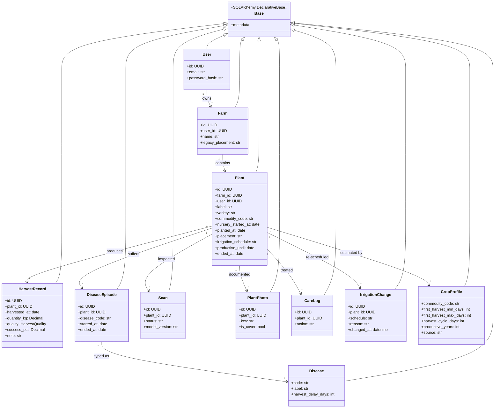
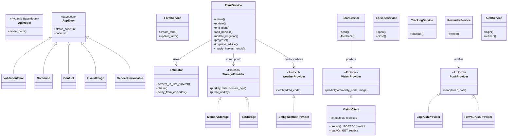
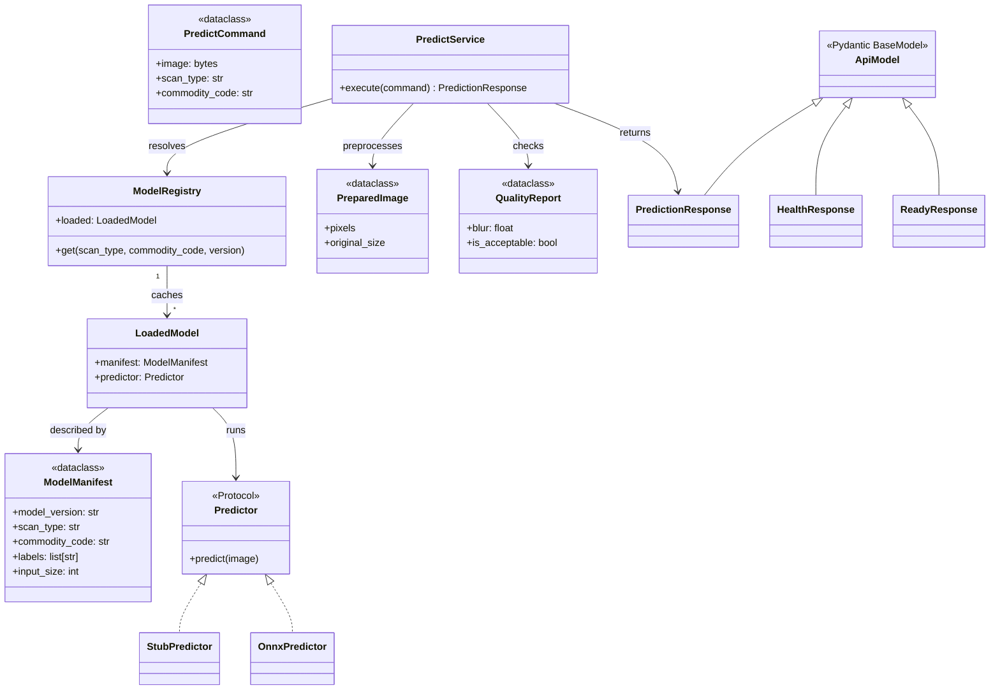

# Class diagram Tanami

Dokumen ini menjelaskan **struktur kode berorientasi objek**, bukan alur data (DFD).
Sumbernya adalah kode yang benar-benar ada di repo — bukan tebakan. Kalau ada class
baru, update diagram ini di commit yang sama.

Ringkasan hasil audit kode: **215 class di 79 file**, dengan rincian 94 turunan
`ApiModel`, 19 `Base` (SQLAlchemy), 30 `StrEnum`, 10 `AppError`, 3 `Protocol`,
dan 15 file `@dataclass`.

## 1. Lapisan yang ada

```
HTTP / Flutter / Admin
        │
        ▼
API router (app/api/v1/*.py) ──► Pydantic schema (app/schemas/*.py)
        │
        ▼
Service (app/services/*.py) ──► Provider (app/providers/*.py)
        │
        ▼
ORM model (app/models/*.py) ──► PostgreSQL
```

Class diagram berikut dipecah supaya tetap terbaca. Mermaid sudah didukung GitHub
dan kebanyakan viewer markdown; kalau tidak render, lihat versi teks di bawah tiap diagram.

## 2. Inti domain (ORM)



Versi teks: `User` punya banyak `Farm`, `Farm` punya banyak `Plant`; satu
`Plant` punya banyak `HarvestRecord`, `DiseaseEpisode`, `Scan`, `PlantPhoto`,
`CareLog`, `IrrigationChange`; `Plant` merujuk `CropProfile`; `DiseaseEpisode`
merujuk `Disease`. Semua turunan `Base`.

## 3. Service dan provider (backend)



Versi teks: `AppError` adalah induk semua error (`ValidationError`, `NotFound`,
`Conflict`, `InvalidImage`, `ServiceUnavailable`, dan lain-lain). Service memakai
`Protocol` sebagai kontrak provider: `VisionClient` implementasi `VisionProvider`,
`S3Storage`/`MemoryStorage` implementasi `StorageProvider`, `BmkgWeatherProvider`
implementasi `WeatherProvider`, `FcmV1PushProvider`/`LogPushProvider`
implementasi `PushProvider`. `PlantService` memakai `Estimator`, `ScanService`
memakai `VisionProvider`.

## 4. Service tanami-vision (ML)



**Detail layanan vision (dari kode, bukan dugaan):**

- `POST /v1/predict` — multipart `type` (hanya `disease`), `image`,
  `commodity_code` (`mango`/`citrus`/`strawberry`, default `mango`), `client_uuid`;
  header `Idempotency-Key` dan `Authorization: Bearer ...`. Respons envelope
  `{ "data": … }` atau `{ "error": … }`.
- `GET /healthz`, `/readyz`, `/livez`, `/metrics`, `GET /v1/models`,
  `POST /v1/models/reload` (admin). Listen di port **8001**.
- `ModelRegistry` menyimpan model **primary + shadow per komoditas**
  (`LoadedModel.is_shadow`); model shadow dijalankan tapi tidak memengaruhi
  respons. `is_ready` bila ketiga komoditas punya primary.
- `known_labels(scan_type, commodity_code)` mengembalikan label komoditas;
  `load_manifest(...)` memvalidasi label **dan** `commodity_code` manifest.
- `decide_status()` di `app/services/decision.py` menentukan
  `confident | uncertain | unknown | invalid_image` dengan ambang
  `confident = 0,75`, `uncertain = 0,50`, dan kualitas gambar menang atas
  confidence. `build_disease_result()` menyusun `result`. Sesuai `design.md`
  11.2: **layanan vision** yang menentukan status; backend hanya menyimpan
  nilainya di `scans`, frontend tidak menghitung ulang.
- `assess_quality()` (varians Laplacian + luminance) dan `decode_and_prepare()`
  membuang EXIF lalu resize ke `input_size` manifest.

Manifest yang **aktif** adalah `disease-mango-v0.1.0`,
`disease-citrus-v0.1.0`, dan `disease-strawberry-v0.1.0` (shadow opsional
`-v0.2.0-rc1`), dengan label per komoditas sesuai `design.md` 11.5 (mango 8,
citrus 5, strawberry 5). `StubPredictor` deterministik dan ditolak di
production; produksi memakai `OnnxPredictor`. Lima kategori ML v2 adalah
pengelompokan training, dipetakan via `ml_labels`. Lihat
`docs/data-integration.md`.

## 5. Kenapa ini OOP, bukan DFD

- **Encapsulation:** state tanaman (umur, placement, jadwal siram) melekat di
  objek `Plant`, bukan variabel global.
- **Inheritance:** `AppError` → 10 turunan dengan status HTTP masing-masing;
  `Base` → semua tabel.
- **Polymorphism:** service menerima `Protocol`, jadi bisa memakai
  `MemoryStorage` saat test dan `S3Storage` saat produksi tanpa mengubah service.
- **Validasi menempel pada data:** `ApiModel` menolak payload salah sebelum
  masuk service.
- **Testability:** provider bisa di-stub, sehingga test tidak butuh BMKG/S3/real ML.
- DFD adalah **alat dokumentasi aliran data**, bukan gaya kode. Diagram alur
  (mermaid `flowchart`) di `design.md` itu DFD-like, tapi kodenya tetap OOP.

## 6. Cara menjaga diagram tetap sinkron

1. Ambil daftar class dari kode, jangan dari ingatan:

   ```bash
   # backend
   cd tanami-backend
   grep -rhn "^class " app/models/*.py app/services/*.py app/providers/*.py \
     app/core/errors.py app/schemas/*.py | sort -u
   # vision
   cd .. && grep -rhn "^class \|^@dataclass" app/inference/*.py \
     app/services/*.py app/schemas/*.py | sort -u
   ```

2. Edit hanya diagram yang berubah, lalu sebutkan di pesan commit yang sama.
3. Kalau class baru hanya turunan `ApiModel`/`Base`, cukup tambahkan ke daftar
   ringkasan; tidak perlu menggambar kotak baru.
