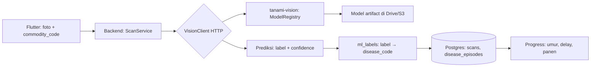

# Integrasi database aplikasi ↔ database/artifact ML

Dokumen ini menjawab: **"database software dan database ML itu disatukan gimana?"**
Status: **proposal desain** — tabel `ml_*` di bawah belum ada di migrasi saat ini.
Bagian yang sudah ada di kode diberi tanda ✅; yang baru diberi tanda 🆕.
Terkait `design.md` 8.3 (profil tanaman), 8.5 (delay), 11.1/11.2 (kontrak &
status), 11.5 (kelas & dataset), 16 (struktur proyek), 17 (keputusan terbuka),
dan **19 (draft 2 ML — rencana, belum runtime)**.

## 1. Fakta kondisi saat ini

| Komponen | Lokasi | Koneksi DB | Keterangan |
|---|---|---|---|
| Backend ✅ | `tanami-backend/app/models/*.py` | PostgreSQL async (SQLAlchemy), migrasi `0001`–`0008` | 20+ tabel: `plants`, `scans`, `disease_episodes`, `crop_profiles`, `diseases`, `harvest_records`, dll. |
| Vision service ✅ | root `app/` (FastAPI) | **tidak ada** | Baca manifest dari folder `models/`, prediksi via ONNX/stub, tidak menyimpan hasil ke DB. |
| Manifest model ✅ | `models/*/manifest.json` | file | `disease-mango-v0.1.0`, `disease-citrus-v0.1.0`, `disease-strawberry-v0.1.0`; `commodity_code` = `mango`/`citrus`/`strawberry`, 8/5/5 label (`design.md` 11.5). |
| Backend ↔ vision ✅ | `tanami-backend/app/providers/vision.py` | HTTP + `Bearer` token | `POST /v1/predict` dengan `image`, `type`, `commodity_code`, `client_uuid`, header `Idempotency-Key`; `GET /readyz`; timeout 6s, retry 2× untuk 502/503/504; port 8001. |
| Desain ML draft 2 ⚠️ | `design.md` bagian 19 | didokumentasikan, **belum diimplementasikan** | Output nama penyakit + status `sehat/sakit/tak_terdeteksi/foto_ditolak`, model per tanaman, tiga lapis tolak, `taxonomy.yaml`, artefak `.joblib` di Drive. Komoditas risetnya berbeda dari runtime (lihat 19.14). |

Masalah yang sudah selesai dan yang masih tertunda:

1. ✅ Komoditas sudah disatukan: backend, runtime vision, dan kontrak memakai
   **mango / citrus / strawberry** (default `mango`).
2. ✅ Sumber kebenaran `status` sudah diputuskan: layanan vision; backend hanya
   menyimpan (lihat §3.3 dan `design.md` 11.2).
3. ⏳ `diseases.harvest_delay_days` masih `0` dan `crop_profiles.source` kosong;
   angka "delay penyakit" dan "target hasil" belum punya asal yang bisa diaudit.
4. ⏳ Draft 2 ML memakai kontrak output yang **berbeda** dengan runtime. Perlu
   keputusan: terjemahkan di backend atau ubah kontrak 11.3 (lihat §3.5).
5. ⏳ Pemetaan resmi `model_label → disease_code` masih perlu diisi di `ml_labels`.

## 2. Prinsip penyatuan

**Postgres tetap satu-satunya sumber kebenaran untuk data master dan hasil prediksi.**
ML tidak boleh punya database sendiri yang berisi salinan `plants`/`farm`.



Aturan:

- **Data master** (komoditas, varietas, penyakit, profil tumbuh) → Postgres.
- **Artefak ML** (`.npy`, `.joblib`, `model.onnx`, `labels_master.csv`, cutout) → file storage
  (Drive saat riset, S3 saat produksi). Postgres hanya menyimpan **URI + hash + metadata**.
- **Hasil prediksi** → tabel `scans` milik backend. Vision service bersifat stateless.
- **Setiap angka** (target kg, delay hari) wajib punya `source` + `reviewed_by`.

## 3. Model data yang diusulkan

### 3.1 ✅ Sudah ada — dipakai sebagai jembatan

| Tabel | Kolom kunci | Peran dalam integrasi |
|---|---|---|
| `crop_profiles` | `commodity_code`, `first_harvest_min_days`, `first_harvest_max_days`, `harvest_cycle_days`, `productive_years`, `source`, `reviewed_by` | Sumber estimasi umur & fase. Diisi dari pedoman + data lapangan. |
| `diseases` | `code`, `label`, `harvest_delay_days` | Master kode penyakit backend. Akan jadi target pemetaan label ML. |
| `disease_episodes` | `plant_id`, `disease_code`, `started_at`, `ended_at` | Catatan penyakit yang mempengaruhi delay panen. |
| `scans` | `plant_id`, `status`, `model_version`, `result`, `raw`, `client_uuid` | Tempat hasil prediksi disimpan. `raw` menyimpan response mentah vision; `client_uuid` dipakai sebagai idempotensi. |

### 3.2 🆕 Tabel baru (usulan migrasi `0008_ml_integration.py`)

```text
ml_models
─────────
id                  uuid PK
model_key            text   -- "disease-mango-v0.1.0" / "disease-citrus-v0.1.0" / "disease-strawberry-v0.1.0"
scan_type            text   -- "disease" (satu-satunya jenis scan)
commodity_code       text   -- FK logis ke crop_profiles.commodity_code
version              text   -- "v2.0.0"
artifact_uri         text   -- s3://tanami-models/... atau path Drive
sha256               text   -- integritas artefak
labels_version       text   -- penunjuk ke ml_labels
macro_f1             numeric(5,4)
trained_at           timestamptz
status               text   -- "shadow" | "active" | "retired"
source               text   -- "ml-v2-notebook" | "legacy-onnx"
created_at           timestamptz

ml_labels
─────────
id                   uuid PK
model_version        text   -- FK logis ke ml_models.version
model_code           text   -- "late_blight" | "mango_anthracnose" | "healthy" (nama penyakit kanonis)
backend_disease_code text   -- "mango_anthracnose" | "citrus_canker" | "strawberry_leaf_scorch" | ... (nullable untuk sehat)
backend_status       text   -- "sehat" | "sakit" | "tak_terdeteksi" | "foto_ditolak" (draft 2)
display_label        text
is_trainable         bool   -- true kecuali "kurang yakin"/"ditolak"
urutan               int

disease_impact  (🆕 menggantikan harvest_delay_days yang masih 0)
───────────────
id                   uuid PK
disease_code         text   -- FK logis ke diseases.code
delay_days           int    -- berapa hari panen mundur
yield_loss_pct       numeric(5,2)
source               text
reviewed_by          text
notes                text

ml_dataset_runs
───────────────
id                   uuid PK
commodity_code       text
label_master_uri     text   -- pointer ke labels_master.csv
audit_matrix_uri     text
n_original_images    int
n_duplicates_removed int
split_strategy       text   -- "group"
reviewed_by          text
created_at           timestamptz
```

`ml_models.status = shadow` penting: model v2 bisa diuji berdampingan dengan model lama
tanpa mengganti jawaban yang dipakai aplikasi (backend sudah punya field
`shadow_model_version`/`shadow_status` di `VisionResult`).

### 3.3 Pemetaan nama penyakit draft 2 → kode backend

Draft 2 **membuang** lima kategori `sehat/jamur/bakteri/virus/lainnya`. Outputnya
adalah **nama penyakit kanonis** dari `taxonomy.yaml` per tanaman. Pemetaan ke
kode runtime `design.md` 11.5 dilakukan lewat `ml_labels`, bukan disamakan.

| Draft 2 | `model_code` contoh | `backend_disease_code` | Catatan |
|---|---|---|---|
| `sehat` | `healthy` | `healthy` | Tidak membuka episode penyakit |
| `sakit` + penyakit | `late_blight`, `anthracnose`, dll. | `mango_anthracnose`, `citrus_black_spot`, `strawberry_leaf_scorch`, dll. | Nama kanonis dari `taxonomy.yaml` → kode berprefiks komoditas |
| `tak_terdeteksi` | `low_confidence`, `far_from_known` | `unknown` + `result.invalid_reason` | Bukan kelas penyakit; jangan dibuka episode |
| `foto_ditolak` | `background_failed`, `no_leaf` | `invalid_image` | Status tolak, bukan penyakit |

Mapping ini **versi-terikat**: jangan pernah menimpa mapping model lama. Model
lama tetap memakai label aslinya sampai di-retire; jangan menimpa baris
`ml_labels`-nya. Nilai `backend_status` mengikuti kontrak draft 2
(`sehat | sakit | tak_terdeteksi | foto_ditolak`) dan diterjemahkan ke status
runtime seperti di §3.5.

✅ **Konflik status sudah diselesaikan:** layanan vision yang menentukan `status`
(`decide_status()` di `app/services/decision.py`: `confident ≥ 0,75`,
`uncertain ≥ 0,50`, kualitas gambar menang). Backend **hanya menyimpan** status
itu di `scans` dan tidak menghitung ulang; frontend juga tidak. Ini mengikuti
`design.md` 11.2 dan `contracts/API.md`. Status draft 2 **belum** dipakai runtime.

### 3.4 Penyelarasan komoditas — SELESAI

Runtime vision dan backend memakai tepat tiga komoditas: `mango`, `citrus`,
`strawberry` (default `mango`). Model primer: `disease-mango-v0.1.0`,
`disease-citrus-v0.1.0`, `disease-strawberry-v0.1.0`; shadow opsional
`-v0.2.0-rc1` per komoditas.

Dataset training di `design.md` 19.4 (tomat/pepaya/zukini/jeruk) adalah
**sumber data latih**, bukan penambah komoditas runtime. Hasilnya dipetakan ke
`backend_category` / `backend_disease_code` lewat `ml_labels` (§3.3).

Daftar komoditas runtime ada di `tanami-backend/app/domain.py::COMMODITIES_V2`;
jangan menambah kode baru diam-diam tanpa perubahan kontrak.


### 3.5 ⚠️ Pemetaan kontrak draft 2 → kontrak runtime

Draft 2 ML (`design.md` 19.10) belum dipakai kode manapun. Kalau nanti dipasang,
backend harus menerjemahkan:

| Draft 2 ML | Runtime sekarang (11.3 / `contracts/API.md`) | Catatan |
|---|---|---|
| `crop: "tomat"` | `commodity_code: "mango"` | Nama tanaman bebas vs kode komoditas tetap. Perlu daftar kanonik. |
| `status: "sehat"` | `status: "confident"` + `result.top.disease_code = "healthy"` | Bukan status yang sama. |
| `status: "sakit"` | `status: "confident"` + `result.top.disease_code = <kode 11.5>` | `disease` harus dipetakan ke kode berprefiks komoditas. |
| `status: "tak_terdeteksi"` | `status: "unknown"` | `rejected_reason: low_confidence/far_from_known` bisa masuk `result.invalid_reason` atau `raw`. |
| `status: "foto_ditolak"` | `status: "invalid_image"` | `background_failed`/`no_leaf` → `invalid_reason`. |
| `disease` | `result.top.disease_code` | Butuh `taxonomy.yaml` → `ml_labels`. |
| `confidence` | `confidence` | Sama. |
| `top_k` | `result.alternatives` | Format beda (`{label,p}` vs `{disease_code,label,cause_category,confidence}`). |
| `rejected_reason` | `result.invalid_reason` / `raw` | Perlu disepakati. |
| envelope diputuskan tim | `{ "data": … }` | Draft 2 belum menyebut envelope. |

**Belum diputuskan:** apakah terjemahan ini dilakukan di backend (disarankan,
kontrak klien tidak berubah) atau kontrak 11.3 diubah mengikuti draft 2.
Lihat `design.md` keputusan terbuka 21.

## 4. Alur data end-to-end (setelah integrasi)

1. Klien create tanaman dengan `variety` → backend menebak `commodity_code`
   (`commodity_from_variety`) dan menyimpannya di `plants`.
2. Klien kirim foto untuk scan → `ScanService` mengirim `(image, commodity_code,
   client_uuid)` lewat `VisionClient` ke `POST /v1/predict` (port 8001). Backend
   selalu mengirim `commodity_code` eksplisit; default layanan adalah `mango`.
3. Vision memilih model primer per komoditas lewat `ModelRegistry`, memuat artefak
   dari folder versi (`manifest.json`).
4. Model menghasilkan `model_code` + `confidence`. `decide_status()` di layanan
   vision menentukan `status` (`confident`/`uncertain`/`unknown`/`invalid_image`),
   dengan ambang per komoditas yang dituning di `04_eval`; backend tidak
   menghitung ulang.
5. `ml_labels` menerjemahkan `model_code` → `backend_disease_code`.
6. Backend menyimpan `scans` (dengan `raw`), dan kalau perlu membuka
   `disease_episodes`. `disease_impact` dipakai untuk menghitung `delay_days`
   pada `GET /plants/{id}/progress`.
7. Penolakan foto (mask kosong/terlalu besar) dicatat sebagai `scans.status =
   invalid_image`, bukan error 500.

## 5. Langkah implementasi (urutan aman)

1. ✅ Komoditas sudah diputuskan (tiga buah); langkah ini selesai.
2. Pastikan kode penyakit `design.md` 11.5 ada di seed `diseases` — jangan ubah
   kode lama yang masih dipakai mapping versi-terikat.
3. Buat migrasi `0008_ml_integration.py` berisi 4 tabel di §3.2. Jalankan
   `test_models_and_migrations_agree` untuk cek drift.
4. Isi `ml_models` + `ml_labels` dari tiga manifest aktif (8/5/5 label sesuai
   11.5) sebagai data pertama — ini menguji mekanisme mapping tanpa mengubah model.
5. Isi `disease_impact` dari literatur/pedoman; kolom `source` wajib diisi.
   Hapus ketergantungan pada `harvest_delay_days` setelah semua baris terisi.
6. Pastikan `VisionClient.predict` mengirim `commodity_code`, dan `ScanService`
   menyimpan `status`/`result` dari vision apa adanya (tanpa hitung ulang).
   Tambah fallback: kalau tidak ada model aktif → jawab "model belum tersedia",
   jangan error.
7. Baru setelah itu latih model v2 Memet, daftarkan sebagai `shadow`, uji, lalu
   naikkan ke `active`.

## 6. Checklist sebelum dokumentasi dianggap selesai

- [ ] Semua angka di `crop_profiles` punya `source`
- [ ] Semua `delay_days` punya `source` (bukan nol diam-diam)
- [ ] Mapping versi-terikat untuk label model lama tetap bisa dibaca (tidak ditimpa)
- [ ] `ml_models.artifact_uri` tidak menunjuk ke file lokal yang hilang
- [ ] Kontrak `openapi.json` diregenerasi setelah endpoint berubah
- [x] Sumber kebenaran `status` = layanan vision (`design.md` 11.2); backend hanya menyimpan
- [ ] `design.md` 8.3, 11.5, 16, dan 17 ikut diperbarui kalau keputusan berubah
- [ ] `design.md` memuat desain software + ML + keputusan komoditas
- [ ] Class diagram sesuai daftar class hasil `grep`
