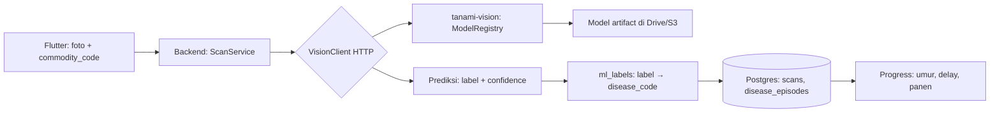

# Integrasi database aplikasi ↔ database/artifact ML

Dokumen ini menjawab: **"database software dan database ML itu disatukan gimana?"**
Status: **proposal desain** — tabel `ml_*` di bawah belum ada di migrasi saat ini.
Bagian yang sudah ada di kode diberi tanda ✅; yang baru diberi tanda 🆕.
Terkait `design.md` 8.3 (profil tanaman), 8.5 (delay), 11.1/11.2 (kontrak &
status), 11.5 (kelas & dataset), 16 (struktur proyek), dan 17 (keputusan terbuka).

## 1. Fakta kondisi saat ini

| Komponen | Lokasi | Koneksi DB | Keterangan |
|---|---|---|---|
| Backend ✅ | `tanami-backend/app/models/*.py` | PostgreSQL async (SQLAlchemy), migrasi `0001`–`0006` | 20+ tabel: `plants`, `scans`, `disease_episodes`, `crop_profiles`, `diseases`, `harvest_records`, dll. |
| Vision service ✅ | root `app/` (FastAPI) | **tidak ada** | Baca manifest dari folder `models/`, prediksi via ONNX/stub, tidak menyimpan hasil ke DB. |
| Manifest model ✅ | `models/*/manifest.json` | file | `disease-chili-v0.2.0-rc1`, `ripeness-chili-v0.2.0-rc1`, `commodity_code = chili`, 7 label. |
| Backend ↔ vision ✅ | `tanami-backend/app/providers/vision.py` | HTTP + `Bearer` token | `POST /v1/predict` dengan `image`, `type`, `commodity_code`, `client_uuid`, header `Idempotency-Key`; `GET /readyz`; timeout 6s, retry 2× untuk 502/503/504; port 8001. |
| Desain ML v2 🆕 | `design (3).md` → akan masuk `design.md` | belum | Model per tanaman, 5 kategori, fitur EfficientNet + handmade, ML klasik, artefak di Drive. |

Masalah yang perlu dibereskan:

1. Backend design v2 hanya mengenal **mango / citrus / strawberry**. Manifest vision masih **`chili`**, dan desain ML v2 Memet memakai **tomat, pepaya, zukini, jeruk** (+ kandidat belum diverifikasi). Satu-satunya yang overlap adalah jeruk/citrus.
2. Label model lama (7 kelas) dan label desain baru (5 kelas) belum dipetakan ke kode penyakit backend.
3. `diseases.harvest_delay_days` ada tapi semua nilainya `0`; `crop_profiles.source` kosong. Jadi angka "delay penyakit" dan "target hasil" belum punya asal yang bisa diaudit.
4. Hasil prediksi tersimpan di `scans`, tapi belum ada pemetaan resmi `model_label → disease_code`.

## 2. Prinsip penyatuan

**Postgres tetap satu-satunya sumber kebenaran untuk data master dan hasil prediksi.**
ML tidak boleh punya database sendiri yang berisi salinan `plants`/`farm`.



Aturan:

- **Data master** (komoditas, varietas, penyakit, profil tumbuh) → Postgres.
- **Artefak ML** (`.npy`, `.joblib`, `model.onnx`, `labels_master.csv`, cutout) → file storage
  (Drive saat riset, S3 saat produksi). Postgres hanya menyimpan **URI + hash + metadata**.
- **Hasil prediksi** → tabel `scans` milik backend. Vision service bersifat stateless.
- **Setiap angka** (target kg, delay hari) wajib punya `source` + `reviewed_by`.

## 3. Model data yang diusulkan

### 3.1 ✅ Sudah ada — dipakai sebagai jembatan

| Tabel | Kolom kunci | Peran dalam integrasi |
|---|---|---|
| `crop_profiles` | `commodity_code`, `first_harvest_min_days`, `first_harvest_max_days`, `harvest_cycle_days`, `productive_years`, `source`, `reviewed_by` | Sumber estimasi umur & fase. Diisi dari pedoman + data lapangan. |
| `diseases` | `code`, `label`, `harvest_delay_days` | Master kode penyakit backend. Akan jadi target pemetaan label ML. |
| `disease_episodes` | `plant_id`, `disease_code`, `started_at`, `ended_at` | Catatan penyakit yang mempengaruhi delay panen. |
| `scans` | `plant_id`, `status`, `model_version`, `result`, `raw`, `client_uuid` | Tempat hasil prediksi disimpan. `raw` menyimpan response mentah vision; `client_uuid` dipakai sebagai idempotensi. |

### 3.2 🆕 Tabel baru (usulan migrasi `0007_ml_integration.py`)

```text
ml_models
─────────
id                  uuid PK
model_key            text   -- "disease-mango-arumanis" / "disease-chili-v0.2.0-rc1"
scan_type            text   -- "disease" | "ripeness"
commodity_code       text   -- FK logis ke crop_profiles.commodity_code
version              text   -- "v2.0.0"
artifact_uri         text   -- s3://tanami-models/... atau path Drive
sha256               text   -- integritas artefak
labels_version       text   -- penunjuk ke ml_labels
macro_f1             numeric(5,4)
trained_at           timestamptz
status               text   -- "shadow" | "active" | "retired"
source               text   -- "ml-v2-notebook" | "legacy-onnx"
created_at           timestamptz

ml_labels
─────────
id                   uuid PK
model_version        text   -- FK logis ke ml_models.version
model_code           text   -- "jamur" | "anthracnose" | "healthy"
backend_disease_code text   -- "cercospora_leaf_spot" | ... (nullable untuk sehat)
backend_category     text   -- "sehat" | "jamur" | "bakteri" | "virus" | "lainnya"
display_label        text
is_trainable         bool   -- true kecuali "kurang yakin"/"ditolak"
urutan               int

disease_impact  (🆕 menggantikan harvest_delay_days yang masih 0)
───────────────
id                   uuid PK
disease_code         text   -- FK logis ke diseases.code
delay_days           int    -- berapa hari panen mundur
yield_loss_pct       numeric(5,2)
source               text
reviewed_by          text
notes                text

ml_dataset_runs
───────────────
id                   uuid PK
commodity_code       text
label_master_uri     text   -- pointer ke labels_master.csv
audit_matrix_uri     text
n_original_images    int
n_duplicates_removed int
split_strategy       text   -- "group"
reviewed_by          text
created_at           timestamptz
```

`ml_models.status = shadow` penting: model v2 bisa diuji berdampingan dengan model lama
tanpa mengganti jawaban yang dipakai aplikasi (backend sudah punya field
`shadow_model_version`/`shadow_status` di `VisionResult`).

### 3.3 Pemetaan label ML v2 → kode backend

| Kategori ML v2 | `model_code` contoh | `backend_disease_code` | Catatan |
|---|---|---|---|
| `sehat` | `sehat` | `healthy` | Tidak membuka episode penyakit |
| `jamur` | `jamur` | `anthracnose`, `cercospora_leaf_spot` | late blight masuk sini (oomycete) |
| `bakteri` | `bakteri` | `bacterial_wilt` | + `citrus_canker`, `greening` kalau didukung |
| `virus` | `virus` | `leaf_curl_virus`, `mosaic_virus` | perlu kode baru di `diseases` |
| `lainnya` | `lainnya` | `pest_damage`, `nutrient_deficiency`, `unknown` | keranjang sampah resmi. `unknown` adalah `CauseCategory` yang sudah ada; kalau mau kode baru `other`, enum harus diubah dulu |

Mapping ini **versi-terikat**: jangan pernah menimpa mapping model lama. Model
`disease-chili-v0.2.0-rc1` tetap memakai 7 label aslinya sampai di-retire.
Nilai `backend_category` harus mengikuti enum yang sudah ada di layanan vision
(`healthy | fungus | bacteria | virus | pest | nutrient_deficiency | unknown`) —
jangan mengarang kategori baru tanpa mengubah enum dan kontrak.

⚠️ **Konflik yang belum disepakati:** `design.md` 11.2 menyatakan backend yang
menentukan `status`, tetapi `app/services/decision.py` di layanan vision yang
menentukannya (`confident ≥ 0,75`, `uncertain ≥ 0,50`, kualitas gambar menang).
Pilih satu sumber kebenaran sebelum langkah 6 di bawah dijalankan.

### 3.4 Penyelarasan komoditas — keputusan yang harus diambil

| Komoditas backend | Komoditas di desain ML v2 | Status |
|---|---|---|
| `mango` | mangga (dinyatakan gugur di sumber publik utama) | ⚠️ tidak ada model |
| `citrus` | jeruk (mode longgar) | ✅ bisa dipakai, tapi virus & sehat kurang |
| `strawberry` | stroberi (gugur di PlantVillage) | ⚠️ tidak ada model lengkap |

Pilihan yang harus disepakati tim:

- **Opsi A (disarankan):** backend menambah komoditas yang benar-benar punya model
  (`tomato`, `papaya`, `zucchini`) supaya fitur deteksi bisa dipakai. `mango`/`strawberry`
  tetap ada untuk tracking, tapi deteksi menjawab "kurang yakin/model belum ada".
- **Opsi B:** ML v2 fokus hanya ke `citrus`, selain itu tidak dipasang.
- **Opsi C:** semua komoditas tetap ada, deteksi hanya untuk yang modelnya siap.

Apapun pilihannya, jangan menambah `commodity_code` baru diam-diam di kode ML —
daftar komoditas ada di `tanami-backend/app/domain.py::COMMODITIES_V2`.

## 4. Alur data end-to-end (setelah integrasi)

1. Klien create tanaman dengan `variety` → backend menebak `commodity_code`
   (`commodity_from_variety`) dan menyimpannya di `plants`.
2. Klien kirim foto untuk scan → `ScanService` mengirim `(image, commodity_code,
   client_uuid)` lewat `VisionClient` ke `POST /v1/predict` (port 8001).
   Endpoint vision punya default `commodity_code = chili`; backend wajib selalu
   mengirim nilai eksplisit supaya default lama tidak terpakai.
3. Vision memilih model aktif di `ml_models` berdasarkan `(scan_type,
   commodity_code, status='active')`, memuat artefak dari `artifact_uri`.
4. Model menghasilkan `model_code` + `confidence`. Kalau `confidence < ambang`,
   backend menjawab **"kurang yakin"** (ambang per komoditas, dituning di `04_eval`).
5. `ml_labels` menerjemahkan `model_code` → `backend_disease_code`.
6. Backend menyimpan `scans` (dengan `raw`), dan kalau perlu membuka
   `disease_episodes`. `disease_impact` dipakai untuk menghitung `delay_days`
   pada `GET /plants/{id}/progress`.
7. Penolakan foto (mask kosong/terlalu besar) dicatat sebagai `scans.status =
   rejected`, bukan error 500.

## 5. Langkah implementasi (urutan aman)

1. Putuskan Opsi A/B/C di atas, tulis hasilnya di `design.md` bagian keputusan.
2. Tambah kode penyakit baru (`mosaic_virus`, `citrus_canker`, `greening`, `other`)
   ke seed `diseases` — jangan ubah kode yang sudah dipakai model lama.
3. Buat migrasi `0007_ml_integration.py` berisi 4 tabel di §3.2. Jalankan
   `test_models_and_migrations_agree` untuk cek drift.
4. Isi `ml_models` + `ml_labels` dari manifest yang ada sekarang (chili, 7 label)
   sebagai data pertama — ini menguji mekanisme mapping tanpa mengubah model.
5. Isi `disease_impact` dari literatur/pedoman; kolom `source` wajib diisi.
   Hapus ketergantungan pada `harvest_delay_days` setelah semua baris terisi.
6. Ubah `VisionClient.predict` untuk mengirim `commodity_code`, dan `ScanService`
   untuk menyimpan hasil mapping. Tambah fallback: kalau tidak ada model aktif →
   jawab "model belum tersedia", jangan error.
7. Baru setelah itu latih model v2 Memet, daftarkan sebagai `shadow`, uji, lalu
   naikkan ke `active`.

## 6. Checklist sebelum dokumentasi dianggap selesai

- [ ] Semua angka di `crop_profiles` punya `source`
- [ ] Semua `delay_days` punya `source` (bukan nol diam-diam)
- [ ] Label model lama masih bisa dibaca (mapping versi-terikat)
- [ ] `ml_models.artifact_uri` tidak menunjuk ke file lokal yang hilang
- [ ] Kontrak `openapi.json` diregenerasi setelah endpoint berubah
- [ ] Sumber kebenaran `status` (backend vs vision) sudah disepakati
- [ ] `design.md` 8.3, 11.5, 16, dan 17 ikut diperbarui kalau keputusan berubah
- [ ] `design.md` memuat desain software + ML + keputusan komoditas
- [ ] Class diagram sesuai daftar class hasil `grep`
