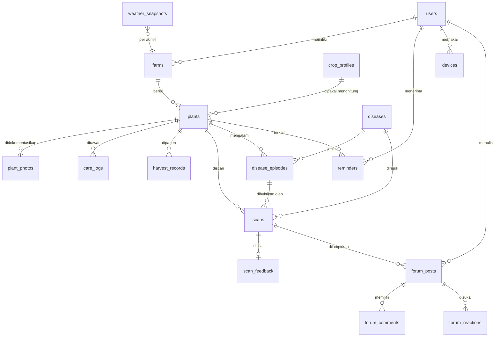

# Tanami - design.md

Dokumen ini adalah **kontrak bersama** antara frontend, backend, dan ML. Tujuannya satu: semua orang membangun hal yang sama dengan istilah, data, dan perilaku yang sama.

| | |
|---|---|
| Versi | **2.0** |
| Tanggal | 9 November 2026 |
| Dasar | Dokumen *Requirements Aplikasi Deteksi dan Tracking Tanaman* (requirement 0-7) + keputusan tim 9 November 2026 (fokus 3 tanaman buah) |
| Dokumen pendamping | `tqa.md` (standar kualitas) |
| Status nilai | Nilai bertanda **[USULAN]** adalah titik awal dan dapat diubah lewat PR yang disetujui pemilik area (lihat `tqa.md` bagian 2 dan 16). Nilai bertanda **[PERLU SUMBER]** wajib diberi rujukan (jurnal, Balitjestro, Kementan) sebelum rilis. |
| Status implementasi | Kode backend, `tanami-admin`, dan layanan vision **masih mengikuti v0.3**. Daftar pekerjaan penyesuaian ada di lampiran "Dampak ke Implementasi". |

**Cara memakai dokumen ini**
- Bagian 8 (istilah, enum, aturan bisnis), 10 (API), dan 11 (kontrak ML) adalah **sumber kebenaran**. Jika kode berbeda dengan dokumen ini, salah satunya harus diperbaiki lewat PR, bukan dibiarkan.
- Daftar endpoint lengkap dan bentuk data persis ada di `tanami-backend/contracts/openapi.json` (dibuat otomatis dari kode). Tes kontrak di backend gagal bila endpoint di bagian 10 hilang.
- Perubahan pada bagian 8, 10, dan 11 harus disetujui oleh satu orang frontend dan satu orang backend/ML.
- Setiap fitur ditandai dengan nomor requirement asalnya, mis. **(R1)** = requirement 1 "Tracking Tanaman".

---

## Apa yang berubah di v2 (baca ini dulu)

v2 mengubah **cara kerja tracking, scan, dan history**. Bagian lain (design system, forum, akun, offline, push) hampir tidak berubah.

| # | Perubahan | Alasan |
|---|---|---|
| 1 | **Fokus 3 tanaman buah:** mangga (`mango`), jeruk (`citrus`), stroberi (`strawberry`). Jenis lain dihapus dari dropdown. | Fokus tim; dataset penyakit daun tersedia untuk ketiganya (11.5). |
| 2 | **Tracking berbasis aturan, bukan ML.** Timeline (umur mulai berbuah, siklus panen, akhir masa produktif) dihitung dari **profil tanaman** (8.3) yang diisi dari literatur agronomi. | Tidak ada dataset "dari bibit sampai panen" untuk melatih model. |
| 3 | **Panen dicatat bertahap:** panen ke-1, ke-2, dst. Perkiraan panen berikutnya selalu berupa **rentang tanggal**. | Pohon buah dipanen berkali-kali, tidak ditebang saat panen. |
| 4 | **Scan wajib memilih tanaman yang terdaftar.** Daftar Tanaman Deteksi (`detection_plants`) **dihapus**; setiap scan tersimpan menempel ke satu tanaman. Ada "Cek cepat" tanpa tanaman yang **tidak disimpan**. | Menghilangkan redundansi dua daftar tanaman; riwayat penyakit otomatis terkelompok per tanaman. |
| 5 | **Penyakit dapat memundurkan perkiraan panen** lewat **episode penyakit** (8.5): hanya dari hasil `confident` yang **dikonfirmasi pengguna**, dihitung **sekali per episode per siklus**, dengan batas maksimum. | Scan daun yang sama berkali-kali tidak boleh menumpuk keterlambatan. |
| 6 | **Akhiri tracking** hanya bisa dilakukan **sebelum masa produktif habis**. Setelah lewat, tracking selesai otomatis. Alasan baru: penyakit (pilih dari riwayat scan tanaman itu), ditebang/dibongkar, mati bukan karena penyakit, lainnya. | Permintaan tim; "ditebang vs sakit" di versi sebelumnya tumpang tindih (tanaman bisa ditebang *karena* sakit). |
| 7 | **Dua history:** **Riwayat Tanaman** (status akhir, jumlah panen, alasan, penyakit) dan **Riwayat Scan** (penyakit, keyakinan %, pencegahan; filter penyakit dan tanaman). "Gagal panen" hanya untuk tanaman yang dihentikan **sebelum panen pertama**. | Pohon yang sudah panen 10 kali lalu ditebang bukan gagal panen. |
| 8 | **Satu tanaman = satu pohon atau satu kelompok** (kolom `quantity`). Stroberi umumnya dicatat per kelompok/bedengan. | Mencatat ratusan tanaman stroberi satu per satu tidak realistis. |
| 9 | **Jenis bibit** (`planting_material`) wajib: okulasi/sambung, biji, anakan (runner), lainnya. | Petani jarang menanam dari biji; umur mulai berbuah sangat berbeda per jenis bibit. |
| 10 | Scan kematangan buah (`ripeness`) dan hasil akhir persentase (`final_result`, `yield_percent`) **dipensiunkan**. | Tidak ada data kematangan untuk 3 komoditas ini; hasil akhir diganti status akhir (8.6). |

**Penyimpangan dari dokumen requirement** (perlu persetujuan pemilik requirement, lihat pertanyaan terbuka #11):

| Requirement | Isi asli | Di v2 |
|---|---|---|
| R1 | Hasil akhir panen (Gagal/Kurang Optimal/Normal/Panen Raya) saat mengakhiri tracking | Diganti status akhir `completed`/`ended_early`/`failed` + jumlah panen; berat per catatan panen tetap opsional |
| R3 | Daftar Tanaman Deteksi terpisah dari tracking, input nama + foto | Scan memilih tanaman yang sudah didaftarkan; tidak ada daftar terpisah |
| R4 | History Deteksi + aktifkan kembali | Diganti Riwayat Scan (filter penyakit/tanaman); tidak ada "aktifkan kembali" karena tidak ada daftar terpisah |

---

## 1. Ringkasan Produk dan Prinsip Desain

**Tanami** adalah aplikasi pendamping petani dan penghobi **tanaman buah (mangga, jeruk, stroberi)**. Pengguna mendaftarkan kebun dan tanamannya, melihat perkiraan kapan tanaman mulai berbuah dan kapan panen berikutnya, mencatat setiap panen, memeriksa penyakit daun dari foto, menerima pengingat, dan berdiskusi di forum.

**Prinsip desain (jadi pegangan saat ragu):**
1. **Satu tangan, di bawah matahari.** Layar dipakai di kebun: tombol besar, kontras tinggi, sedikit langkah.
2. **Jujur soal ketidakpastian.** Model bukan ahli dan perkiraan panen bukan janji. Jika tidak yakin, aplikasi bilang tidak yakin. Tanggal panen selalu ditampilkan sebagai rentang dengan kata "perkiraan".
3. **Bahasa petani.** Bahasa Indonesia sederhana. Istilah teknis selalu disertai penjelasan awam.
4. **Hasil lebih dulu, detail belakangan.** Layar hasil menampilkan jawaban utama besar, penjelasan di bawahnya.
5. **Tetap berguna tanpa sinyal.** Data tersimpan bisa dibuka, foto bisa diantre.
6. **Satu sumber kebenaran.** Frontend tidak menebak aturan bisnis (umur, fase, perkiraan panen, keterlambatan, status kesehatan, status akhir); backend yang menghitung, frontend yang menampilkan.
7. **Riwayat tidak pernah hilang.** Mengakhiri tracking hanya memindahkan tanaman ke Riwayat Tanaman; scan-nya tetap ada di Riwayat Scan.
8. **Pengguna mengonfirmasi, sistem tidak memvonis.** Hasil model hanya mengubah perkiraan panen setelah pengguna menekan "Ya, tanaman ini sakit".

---

## 2. Pengguna

| Persona | Deskripsi | Kebutuhan utama | Catatan desain |
|---|---|---|---|
| **Pak Budi, petani mangga/jeruk** | 45-60 tahun, HP Android kelas menengah ke bawah, sinyal tidak stabil, kebun outdoor 0,2-2 ha, puluhan pohon | Tahu daun kenapa, kapan kira-kira panen, catatan panen tiap musim | Teks besar, ikon jelas, sedikit mengetik, offline |
| **Rina, penghobi tanaman buah** | 20-35 tahun, mangga/jeruk dalam pot, stroberi di polybag | Kapan berbuah, pengingat siram, foto perkembangan | Kebun indoor/outdoor, riwayat foto |
| **Bu Sari, petani stroberi** | 35-50 tahun, beberapa bedengan stroberi | Mencatat panen per bedengan, cek penyakit daun | Tanaman dicatat per kelompok (`quantity`) |
| **Penyuluh/ahli** | Penyuluh pertanian, dosen | Menjawab di forum, meninjau hasil deteksi yang salah, mengisi profil tanaman dan basis penyakit | Peran `expert` terverifikasi |

---

## 3. Cakupan dan Prioritas

| Prioritas | Fitur (requirement) | Isi |
|---|---|---|
| P0 | **Tambah Kebun (R0)** | Nama kebun, lokasi kelurahan (kode adm4), penempatan `indoor`/`outdoor` |
| P0 | **Tracking Tanaman (R1)** | Jenis (mangga/jeruk/stroberi), jenis bibit, tanggal tanam, jumlah, jadwal irigasi, foto, catat perawatan; **timeline otomatis** (fase, perkiraan panen pertama/berikutnya, akhir masa produktif); **catat panen ke-n**; akhiri tracking sebelum masa produktif habis |
| P0 | **Scan Penyakit Daun (R3, diubah)** | Pilih tanaman terdaftar -> foto daun -> nama penyakit, keyakinan %, gejala, pencegahan, penanganan; konfirmasi penyakit -> perkiraan panen bisa mundur |
| P0 | **Riwayat Tanaman (R2)** dan **Riwayat Scan (R4, diubah)** | Riwayat Tanaman: tanaman yang selesai/dihentikan, status akhir, jumlah panen, alasan, penyakit. Riwayat Scan: semua hasil scan dengan filter penyakit, jenis tanaman, dan tanaman |
| P1 | **Notifikasi dan Pengingat (R7)** | Siram, foto, pemantauan, tindak lanjut penyakit, **panen sudah dekat**, **cek catatan panen**, masa produktif hampir habis |
| P1 | **Profil dan Pengaturan (R6)** | Email, username, nama lengkap, ganti password, periode pengingat, logout, hapus akun |
| P2 | **Forum Komunitas (R5)** | Posting (teks + foto), lihat, komentar, suka, laporan dan moderasi |
| P2 | **Cek cepat** | Scan tanpa memilih tanaman (pilih jenis saja); hasil ditampilkan, **tidak disimpan** |
| Tambahan | Reminder cuaca BMKG | Hanya untuk kebun `outdoor`; memakai perkiraan panen dari 8.4 |

**Di luar cakupan:** tanaman selain mangga/jeruk/stroberi, scan kematangan buah, scan penyakit pada buah/bunga (hanya daun), prediksi jumlah panen (kg), konsultasi video, peta sebaran penyakit, marketplace, sensor IoT, perpanjangan masa produktif (mis. peremajaan, sambung ulang, injeksi).

---

## 4. Arsitektur Informasi dan Navigasi

**Navigasi bawah (5 tab) [USULAN]:**

| Tab | Isi | Requirement |
|---|---|---|
| **Beranda** | Pengingat aktif, **panen terdekat**, tanaman perlu perhatian, cuaca kebun outdoor. Ikon profil di header membuka Akun | R7, R6 |
| **Tanaman** | Daftar tanaman aktif per kebun, tambah kebun/tanaman | R0, R1 |
| **Scan** (tombol tengah, menonjol) | Pilih tanaman -> kamera. Tautan kecil "Cek cepat tanpa menyimpan" | R3 |
| **Riwayat** | Dua sub-tab: **Tanaman** dan **Scan** | R2, R4 |
| **Forum** | Daftar posting, buat posting | R5 |

**Peta layar (ringkas):**
```
Beranda -> Detail Pengingat -> Detail Tanaman
        -> (ikon profil) Akun -> Profil | Ganti Password | Notifikasi | Tentang dan Sumber Data | Logout | Hapus Akun
Tanaman -> Tambah Kebun
        -> Daftar Tanaman Aktif -> Tambah Tanaman
                                -> Detail Tanaman -> Timeline Panen (fase, perkiraan, keterlambatan)
                                                  -> Catat Panen | Foto | Catat Perawatan/Siram
                                                  -> Penyakit Tanaman Ini (episode + scan)
                                                  -> Scan daun tanaman ini
                                                  -> Akhiri Tracking (alasan)
Scan    -> Pilih Tanaman -> Kamera -> Memproses -> Hasil -> Konfirmasi penyakit?
        -> Cek Cepat (pilih jenis) -> Kamera -> Hasil (tidak disimpan)
Riwayat -> Tanaman -> Detail Riwayat Tanaman (alasan, panen, penyakit, timeline)
        -> Scan    -> (filter) -> Detail Scan
Forum   -> Daftar Posting -> Detail Posting (komentar, suka, laporkan) | Buat Posting
```

---

## 5. Alur Pengguna Utama

### 5.1 Pertama kali memakai
1. Layar sambutan (maks. 3 slide) -> **Daftar**: email, username, nama lengkap, kata sandi; atau **Masuk** dengan email **atau** username.
2. Persetujuan privasi, termasuk pilihan terpisah "Izinkan foto saya dipakai untuk meningkatkan Tanami" (boleh ditolak).
3. **Tambah kebun pertama (R0):** nama kebun, kelurahan (cari nama atau dari GPS), indoor/outdoor.
4. **Tambah tanaman (R1):** lihat 5.2.
5. Selesai -> Beranda dengan kartu "Perkiraan panen pertama: ..." dan ajakan "Periksa daun pertama Anda".

### 5.2 Mendaftarkan tanaman (R1)
1. Pilih **jenis**: Mangga, Jeruk, Stroberi.
2. Pilih **jenis bibit**: Okulasi/sambung, Biji, Anakan (khusus stroberi), Lainnya. Default per jenis: mangga/jeruk = okulasi, stroberi = anakan.
3. Isi **nama/label** (mis. "Mangga Depan Rumah"), **varietas** (opsional, mis. "Harum Manis"), **tanggal tanam** (boleh perkiraan; tidak boleh di masa depan), **jumlah** (default 1; isi >1 untuk kelompok/bedengan), **jadwal irigasi**.
4. Opsional: foto awal.
5. Backend memberi **kode tanaman** (mis. `MGA-001`) dan langsung menghitung timeline: fase, perkiraan panen pertama, tanggal akhir masa produktif (8.3-8.4).
6. Jika tanaman sudah tua dan **sudah pernah panen** sebelum didaftarkan, layar berikutnya menawarkan "Sudah pernah panen? Catat panen terakhir" agar perkiraan panen berikutnya dihitung dari panen itu.
7. Bila tanggal tanam membuat tanaman sudah lewat masa produktif, pendaftaran ditolak dengan pesan yang menjelaskan alasannya.

### 5.3 Tracking tanaman (R1)
1. **Detail Tanaman** menampilkan: kode, umur, **fase** (Belum berbuah / Masa berbuah), status kesehatan, **jumlah panen**, **perkiraan panen berikutnya** (rentang + keterangan mundur karena penyakit bila ada), akhir masa produktif, jadwal siram berikutnya, foto terbaru.
2. Pengguna menambah **foto perkembangan** dan **catatan perawatan** (siram, pupuk, pengendalian hama, pangkas, siang, lainnya).
3. **Catat panen:** tanggal (default hari ini), berat kg (opsional), catatan kualitas (opsional). Backend memberi nomor urut: "Panen ke-3". Setelah dicatat, perkiraan panen berikutnya dihitung ulang dari tanggal ini.
4. Tombol **Akhiri Tracking** hanya tampil saat tanaman aktif (sebelum masa produktif habis). Lihat 5.6.

### 5.4 Scan penyakit daun (R3)
1. Tab **Scan** -> **pilih tanaman** dari daftar tanaman aktif (pencarian + kode). Dari Detail Tanaman, tanaman sudah terpilih.
2. Kamera dengan bingkai dan tips ("satu daun, cahaya cukup, tidak buram"). Jika offline, foto masuk **antrean** (bagian 14).
3. Backend memanggil model **khusus jenis tanaman itu** (11.1); model hanya memilih di antara penyakit jenis tersebut.
4. **Hasil** (11.4): nama penyakit, keyakinan (%), gejala, **pencegahan**, penanganan. Tombol: Tanya di forum, Hasil benar/salah.
5. Bila hasil `confident` dan bukan sehat: kartu **"Apakah tanaman ini memang sakit?"** dengan keterangan dampaknya, mis. "Jika ya, perkiraan panen mundur sekitar 14 hari." Tombol **Ya, tanaman ini sakit** / **Belum yakin**. "Ya" membuat atau memperbarui **episode penyakit** (8.5).
6. Hasil scan selalu tersimpan di Riwayat Scan dan timeline tanaman, dikonfirmasi atau tidak.
7. **Cek cepat:** pilih jenis tanaman -> foto -> hasil. Banner: "Hasil cek cepat tidak disimpan. Daftarkan tanaman agar riwayatnya tercatat." Tidak ada konfirmasi penyakit dan tidak memengaruhi apa pun.

### 5.5 Episode penyakit (bagian dari R1/R3)
- Detail Tanaman -> **Penyakit tanaman ini**: daftar episode (sedang sakit/sembuh), tanggal mulai, berapa hari memundurkan panen, dan scan-scan terkait.
- **Tandai sembuh** menutup episode. Scan `confident` sehat juga menutup episode terbuka secara otomatis (pengguna diberi tahu di layar hasil).

### 5.6 Akhiri tracking (R1)
1. Pilih alasan:
   - **Mati/dibongkar karena penyakit** (`disease`): aplikasi menampilkan **daftar penyakit dari riwayat tanaman ini** (episode dan scan, terbaru di atas) sebagai pilihan **multi-pilih**, ditambah kolom teks bebas "Penyakit lain / keterangan". Minimal satu penyakit dipilih **atau** teks diisi.
   - **Ditebang/dibongkar karena alasan lain** (`cut_down`), mis. ganti komoditas, lahan dipakai. Catatan opsional.
   - **Mati bukan karena penyakit** (`died_other`): chip saran "Hama", "Banjir", "Kekeringan", "Angin/petir" mengisi kolom teks; boleh diketik bebas.
   - **Lainnya** (`other`): catatan wajib.
2. Konfirmasi: "Tanaman akan dipindahkan ke Riwayat dan tidak bisa diubah lagi."
3. Backend menentukan **status akhir** (8.6). Tanaman pindah ke Riwayat Tanaman; pengingatnya berhenti; episode terbuka ditutup.
4. **Selesai otomatis:** saat tanggal akhir masa produktif tercapai, job harian mengakhiri tracking dengan alasan `productive_period_over` dan mengirim pemberitahuan. Tidak ada tombol perpanjang.

### 5.7 Riwayat Tanaman (R2)
Daftar tanaman yang selesai/dihentikan (terbaru di atas), dengan **lencana status akhir** (Selesai / Dihentikan / Gagal panen), jumlah panen, alasan. Filter: jenis tanaman, status akhir. Detail: kode, nama, jenis, bibit, tanggal tanam, lokasi, tanggal dan alasan pengakhiran, penyakit penyebab (bila ada), daftar panen, daftar episode penyakit, dan timeline lengkap. Hanya-baca.

### 5.8 Riwayat Scan (R4)
Daftar semua scan yang tersimpan (terbaru di atas). Tiap item: foto kecil, **nama penyakit**, **keyakinan %**, tanaman (kode + nama), tanggal, tanda "Dikonfirmasi" bila membuka/menempel ke episode. Detail: foto, hasil lengkap, gejala, **pencegahan**, penanganan, umpan balik.
**Filter:** jenis tanaman, penyakit (daftar mengikuti jenis yang dipilih), tanaman, rentang tanggal. Default menyembunyikan scan `invalid_image`.

### 5.9 Pengingat (R7)
Job backend membuat pengingat -> push notification -> pengguna membuka -> Detail Pengingat -> tombol aksi (mis. "Catat siram", "Catat panen", "Scan daun") -> tandai "Selesai".

### 5.10 Forum (R5)
Daftar posting -> detail -> komentar / suka / laporkan. Buat posting: judul, isi, hingga 3 foto, atau lampirkan hasil scan.

---

## 6. Daftar Layar dan Data yang Dibutuhkan

| Kode | Layar | Data dari API | Keadaan khusus |
|---|---|---|---|
| S01 | Sambutan | - | - |
| S02 | Daftar/Masuk | `POST /auth/register`, `POST /auth/login` | Email/username sudah dipakai, kredensial salah, tanpa sinyal |
| S03 | Tambah/Ubah Kebun | `POST /farms`, `GET /regions/search`, `GET /regions/resolve` | Gagal ambil lokasi -> pilih manual |
| S04 | Beranda | `GET /home` | Belum ada kebun, offline (data terakhir) |
| S05 | Daftar Tanaman Aktif | `GET /plants?status=active` (atau `GET /farms/{id}/plants`) | Kosong |
| S06 | Tambah/Ubah Tanaman | `GET /plant-types`, `POST /farms/{id}/plants`, `PATCH /plants/{id}` | Tanggal tanam di masa depan, tanggal tanam membuat tanaman sudah lewat masa produktif |
| S07 | Detail Tanaman | `GET /plants/{id}`, `GET /plants/{id}/photos`, `GET /plants/{id}/care-logs` | Belum ada foto, belum pernah panen, perkiraan terlewat (`is_overdue`) |
| S08 | Tambah Foto / Catat Perawatan | `POST /plants/{id}/photos`, `POST /plants/{id}/care-logs` | Unggah gagal |
| S09 | Timeline dan Grafik | `GET /plants/{id}/timeline`, `/stats` | Belum ada data |
| S10 | Catat Panen | `POST /plants/{id}/harvests`, `GET /plants/{id}/harvests` | Tanggal panen sebelum tanggal tanam / di masa depan / sebelum panen sebelumnya |
| S11 | Penyakit Tanaman Ini | `GET /plants/{id}/disease-episodes`, `PATCH /disease-episodes/{id}` | Belum ada episode |
| S12 | Akhiri Tracking | `GET /plants/{id}/disease-episodes`, `GET /scans?plant_id=`, `POST /plants/{id}/end` | Alasan `disease` tanpa penyakit dan tanpa teks |
| S13 | Pilih Tanaman untuk Scan | `GET /plants?status=active` | Belum punya tanaman -> ajak daftar atau Cek cepat |
| S14 | Kamera / Memproses | `POST /scans` | Offline -> antre |
| S15 | Hasil Scan | respons `POST /scans`, `POST /scans/{id}/confirm-disease` | `confident`, `uncertain`, `unknown`, `invalid_image`; Cek cepat (`saved: false`) |
| S16 | Riwayat Tanaman | `GET /plants?status=ended&commodity_code=&outcome=` | Kosong |
| S17 | Detail Riwayat Tanaman | `GET /plants/{id}`, `GET /plants/{id}/timeline`, `GET /plants/{id}/harvests`, `GET /plants/{id}/disease-episodes` | Hanya-baca |
| S18 | Riwayat Scan | `GET /scans?commodity_code=&disease_code=&plant_id=&from=&to=`, `GET /diseases?commodity_code=` (isi filter) | Kosong, filter tanpa hasil |
| S19 | Detail Scan | `GET /scans/{id}` | Gambar dihapus |
| S20 | Daftar/Detail Pengingat | `GET /reminders`, `GET /reminders/{id}`, `PATCH /reminders/{id}` | Kosong |
| S21 | Forum - Daftar/Detail/Buat | `/forum/*` | Dilaporkan/dihapus, unggah gagal |
| S22 | Akun dan Pengaturan | `GET/PATCH /users/me`, `POST /users/me/password`, `GET/PATCH /users/me/notification-settings` | |
| S23 | Info Penyakit | `GET /diseases/{code}` | |
| S24 | Sumber Data | `GET /crop-profiles` + statis | Atribusi BMKG, sumber profil tanaman, sumber dataset |

**Setiap layar wajib menangani 5 keadaan:** memuat (skeleton), kosong, berhasil, galat (dengan tombol coba lagi), dan offline.

---

## 7. Design System

### 7.1 Warna (design tokens) [USULAN]

| Token | Hex | Penggunaan |
|---|---|---|
| `color.primary` | `#2E7D32` | Tombol utama, elemen aktif |
| `color.primary-dark` | `#1B5E20` | Tekan/hover, header |
| `color.primary-light` | `#E8F5E9` | Latar kartu lembut |
| `color.secondary` | `#8D6E63` | Aksen tanah/lahan |
| `color.accent` | `#F9A825` | Panen, sorotan |
| `color.success` | `#2E7D32` | Sehat, berhasil |
| `color.warning` | `#EF6C00` | Waspada, tidak yakin, panen mundur |
| `color.danger` | `#C62828` | Sakit parah, galat, gagal panen |
| `color.info` | `#1565C0` | Informasi |
| `color.text` | `#1F2A1F` | Teks utama |
| `color.text-muted` | `#5B665B` | Teks sekunder |
| `color.surface` | `#FFFFFF` | Kartu |
| `color.background` | `#F6F8F4` | Latar halaman |
| `color.border` | `#D9E0D5` | Garis |

- Aplikasi **hanya mode terang** di MVP (pemakaian di luar ruangan).
- Kontras teks terhadap latar minimal WCAG AA (4,5:1 untuk teks isi).
- **Warna tidak boleh menjadi satu-satunya pembeda.** Selalu pasangkan dengan ikon dan teks.

### 7.2 Tipografi
- Huruf: **Inter** (cadangan: font sistem).
- Skala:

| Token | Ukuran / tinggi baris | Berat | Penggunaan |
|---|---|---|---|
| `text.display` | 28 / 36 | Bold | Judul hasil utama |
| `text.title` | 22 / 28 | SemiBold | Judul layar |
| `text.heading` | 18 / 24 | SemiBold | Judul bagian |
| `text.body` | 16 / 24 | Regular | Teks isi (minimal) |
| `text.body-strong` | 16 / 24 | SemiBold | Penekanan |
| `text.caption` | 14 / 20 | Regular | Keterangan, tanggal |

- Tidak ada teks isi di bawah 14 sp. Aplikasi menghormati pengaturan ukuran huruf sistem sampai 130%.

### 7.3 Jarak, bentuk, dan bayangan
- Skala jarak (kelipatan 4): `4, 8, 12, 16, 24, 32, 48`. Margin layar 16.
- Radius sudut: kartu 12, tombol 12, chip 999 (bulat).
- Bayangan ringan hanya untuk kartu yang bisa ditekan.
- **Area sentuh minimal 48 x 48 dp.**

### 7.4 Komponen inti

| Komponen | Varian | Catatan |
|---|---|---|
| Tombol | Utama (isi hijau), Sekunder (garis), Teks, Bahaya | Tinggi 52; label kata kerja ("Catat Panen") |
| Kartu Hasil Scan | `confident`, `uncertain`, `unknown`, `invalid_image`; varian **Cek cepat** dengan banner "tidak disimpan" | Lihat 11.4 |
| Kartu Konfirmasi Penyakit | Pertanyaan + dampak ("panen mundur ±14 hari") + 2 tombol | Hanya untuk `confident` bukan sehat |
| Lencana Penyebab | `fungus`, `bacteria`, `virus`, `pest`, `nutrient_deficiency`, `healthy`, `unknown` | Ikon + label; lihat 7.5 |
| Meter Keyakinan | Batang 0-100% + kata ("Yakin", "Belum yakin") | Jangan tampilkan angka tanpa kata |
| Kartu Tanaman | Foto terakhir, **kode**, nama, jenis, umur, **fase**, status kesehatan, chip "Panen ±19 Nov-28 Jan", jumlah (bila kelompok) | R1 |
| Kartu Perkiraan Panen | Rentang tanggal besar, kata "Perkiraan", baris "Mundur 14 hari karena Antraknosa" (warna `warning` + ikon), tombol "Catat Panen" | Lihat 8.4 |
| Timeline Fase | Garis waktu: Tanam -> Mulai berbuah (rentang) -> Panen ke-1..n -> Akhir masa produktif | R1 |
| Lencana Status Akhir | `completed` hijau "Selesai", `ended_early` oranye "Dihentikan", `failed` merah "Gagal panen"; selalu dengan teks | 8.6 |
| Kartu Riwayat Scan | Foto kecil, penyakit, % keyakinan, kode+nama tanaman, tanggal, tanda "Dikonfirmasi" | R4 |
| Chip Filter | Jenis tanaman, penyakit, tanaman, tanggal; tombol "Hapus filter" | Riwayat |
| Tombol Suka | Ikon hati + jumlah; area sentuh 48 dp | R5 |
| Kartu Reminder | Ikon jenis, judul, waktu, tombol aksi | Dibedakan prioritas |
| Item Timeline | Tanggal, ikon jenis, ringkasan, thumbnail | |
| Grafik Status | Garis/titik per waktu | Sumbu mudah dibaca |
| Kartu Posting Forum | Penulis (+ lencana Ahli), judul, ringkasan, jumlah komentar, thumbnail | |
| Panel Cuaca | Suhu, kelembapan, deskripsi, ikon, 3 hari | Atribusi BMKG |
| Keadaan Kosong | Ilustrasi sederhana + 1 kalimat + 1 tombol | |
| Banner Offline | Jelas, tidak mengganggu | "Anda sedang offline. Foto akan dikirim saat ada sinyal." |
| Galat | Pesan manusiawi + "Coba lagi" | Tidak menampilkan kode teknis kecuali di "Detail" |

### 7.5 Penyebab penyakit: pemetaan tampilan (harus sama di semua layar)

| `cause_category` | Label (ID) | Penjelasan awam | Ikon (nama) |
|---|---|---|---|
| `healthy` | Sehat | Daun terlihat normal | `leaf-check` |
| `fungus` | Jamur | Dipicu lembap; sering berupa bercak atau bubuk | `mushroom` |
| `bacteria` | Bakteri | Menyebar lewat air, alat, atau serangga; bisa menyebar cepat | `bacteria` |
| `virus` | Virus | Daun keriting/menguning; sering dibawa serangga | `virus` |
| `pest` | Hama | Serangan serangga atau tungau | `bug` |
| `nutrient_deficiency` | Kurang hara | Tanaman kurang pupuk atau unsur tertentu | `sprout` |
| `unknown` | Belum diketahui | Model belum yakin | `help-circle` |

### 7.6 Gaya bahasa (microcopy)
- Sapaan netral dan sopan: "Anda". Kalimat pendek, kata kerja jelas.
- Contoh: "Daun tampak terkena **antraknosa**. Kami cukup yakin (82%)." / "Kami belum yakin. Coba foto ulang dari dekat dengan cahaya cukup." / "Perkiraan panen berikutnya **19 Nov 2026 - 28 Jan 2027**. Mundur 14 hari karena antraknosa."
- **Dilarang**: menyatakan kepastian ("Pasti penyakit X", "Panen tanggal 12"), memberi angka dosis tanpa tinjauan ahli, bahasa yang menakut-nakuti.
- Semua teks ada di berkas i18n (`id.json`). Kunci menggunakan format `fitur.layar.elemen` (mis. `scan.result.uncertain_title`).

### 7.7 Ikon dan ilustrasi
- Satu set ikon konsisten (garis 2 px). Ilustrasi sederhana, bernuansa kebun Indonesia.

---

## 8. Istilah, Enum, dan Aturan Bisnis (Sumber Kebenaran)

### 8.1 Glosarium

| Istilah (ID) | Kode/English | Arti |
|---|---|---|
| Pengguna | `user` | Akun: email, username, nama lengkap |
| Kebun | `farm` | Satu lokasi tanam milik pengguna; terhubung ke kelurahan (adm4); `indoor` atau `outdoor` (R0) |
| Tanaman | `plant` | **Satu pohon atau satu kelompok** tanaman sejenis yang ditanam bersamaan (`quantity` >= 1) di sebuah kebun. Punya kode tampilan (`MGA-001`). Aktif bila `ended_at` kosong; selain itu masuk Riwayat Tanaman. |
| Profil tanaman | `crop_profile` | Angka agronomi per jenis tanaman dan jenis bibit: umur mulai berbuah, siklus panen, lama masa produktif (8.3) |
| Fase | `lifecycle_phase` | `juvenile` (belum berbuah) atau `productive` (masa berbuah) |
| Siklus panen | - | Jarak dari panen terakhir (atau dari tanam bila belum pernah panen) ke panen berikutnya |
| Perkiraan panen | `next_harvest` | Rentang tanggal panen berikutnya, sudah termasuk keterlambatan karena penyakit (8.4) |
| Catatan panen | `harvest_record` | Satu kejadian panen; bernomor urut per tanaman (panen ke-n) |
| Foto perkembangan | `plant_photo` | Foto dokumentasi pertumbuhan |
| Catatan perawatan | `care_log` | Satu tindakan: siram, pupuk, dll. Catatan `watering` = riwayat penyiraman |
| Scan | `scan` | Satu foto daun yang dianalisis model; **selalu milik satu tanaman** |
| Cek cepat | quick scan | Scan tanpa tanaman; hasil ditampilkan lalu dibuang, tidak punya `id` |
| Episode penyakit | `disease_episode` | Satu masa sakit suatu tanaman oleh satu penyakit, dibuka saat pengguna mengonfirmasi hasil scan (8.5) |
| Status akhir | `outcome` | Ringkasan cara tracking berakhir: `completed`, `ended_early`, `failed` (8.6) |
| Pengingat | `reminder` | Notifikasi dari sistem |
| Posting | `post` | Isi forum |

### 8.2 Enum (nilai persis, huruf kecil, `snake_case`)

| Enum | Nilai |
|---|---|
| `placement` (R0) | `indoor`, `outdoor` |
| `commodity_code` (R1) | `mango` (Mangga), `citrus` (Jeruk), `strawberry` (Stroberi). Label dari `GET /plant-types`. |
| `planting_material` (R1) | `grafted` (okulasi/sambung), `seed` (biji), `runner` (anakan/stolon, hanya stroberi), `other` (dihitung seperti bibit default jenisnya) |
| `irrigation_schedule` (R1) | `daily` (setiap hari), `every_3_5_days` (setiap 3-5 hari), `weekly` (setiap minggu), `never` (tidak pernah) |
| `lifecycle_phase` | `juvenile` (Belum berbuah), `productive` (Masa berbuah) |
| `tracking_end_reason` (R1) | `productive_period_over` (otomatis oleh sistem), `disease` (mati/dibongkar karena penyakit), `cut_down` (ditebang/dibongkar karena alasan lain), `died_other` (mati bukan karena penyakit), `other` |
| `tracking_outcome` (R2) | `completed` (Selesai: masa produktif habis), `ended_early` (Dihentikan: sudah pernah panen), `failed` (Gagal panen: dihentikan sebelum panen pertama) |
| `disease_episode_status` | `open` (sedang sakit), `resolved` (sembuh/ditutup) |
| `episode_close_reason` | `user_marked_healed`, `healthy_scan`, `tracking_ended` |
| `care_action` (R2) | `watering`, `fertilizing`, `pest_control`, `pruning`, `weeding`, `other` |
| `scan_type` | `disease` (nilai `ripeness` dipensiunkan di v2) |
| `result_status` | `confident`, `uncertain`, `unknown`, `invalid_image` |
| `invalid_reason` | `not_leaf`, `blurry`, `too_dark`, `wrong_commodity` (lihat 11.1) |
| `cause_category` | `healthy`, `fungus`, `bacteria`, `virus`, `pest`, `nutrient_deficiency`, `unknown` |
| `health_status` (tanaman) | `healthy`, `at_risk`, `sick`, `recovering`, `unknown` |
| `reminder_type` | `watering`, `photo`, `monitoring` (R7); `scan_followup`; `harvest_due`, `harvest_check`, `productive_ending`, `tracking_completed`; tambahan cuaca: `fungal_risk`, `heavy_rain_harvest`, `heat_stress`; `general` |
| `reminder_priority` | `low`, `normal`, `high` |
| `reminder_status` | `unread`, `read`, `done`, `dismissed` |
| `feedback_value` | `correct`, `incorrect` |
| `user_role` | `farmer`, `expert`, `moderator`, `admin` |
| `post_status` | `published`, `hidden`, `removed` |
| `report_reason` | `spam`, `scam`, `abuse`, `wrong_info`, `other` |

**Dihapus dari v0.3:** `growth_stage`, `harvest_outcome`/`final_result`, `ripeness_stage`, nilai `tracking_end_reason` lama (`harvested`, `died`, `not_maintained`), `reminder_type` `harvest_soon`, komoditas selain tiga di atas.

**Kode tanaman** = prefiks jenis + nomor urut per pengguna, minimal 3 digit: `MGA-001` (mangga), `JRK-001` (jeruk), `STB-001` (stroberi). Diberikan backend, tidak pernah dipakai ulang, tidak bisa diubah.

**Umur tanaman** (`age_days`) = selisih hari antara `planted_at` dan hari ini (zona `Asia/Jakarta`), atau tanggal pengakhiran bila tracking sudah diakhiri.

### 8.3 Profil tanaman (`crop_profiles`) [USULAN] [PERLU SUMBER]

Profil adalah **data**, bukan kode: disimpan di tabel `crop_profiles`, diisi seed, dapat disunting ahli lewat `tanami-admin`. Satuan hari. Angka di bawah adalah titik awal kasar untuk dataran rendah Indonesia dan **wajib diganti dengan angka bersumber** (Balitjestro / Balitbu / Kementan / jurnal) sebelum rilis; sumbernya disimpan di kolom `source`.

| `commodity_code` | `planting_material` | Mulai berbuah (min-maks) | Siklus panen (min-maks) | Masa produktif | Pola panen |
|---|---|---|---|---|---|
| `mango` | `grafted` | 1095-1460 (3-4 th) | 330-400 | 40 th | Musiman, sekali setahun |
| `mango` | `seed` | 1825-2920 (5-8 th) | 330-400 | 40 th | Musiman, sekali setahun |
| `citrus` | `grafted` | 730-1095 (2-3 th) | 150-210 | 20 th | 1-2 kali setahun (musim raya + selingan) |
| `citrus` | `seed` | 1825-2555 (5-7 th) | 150-210 | 20 th | 1-2 kali setahun |
| `strawberry` | `runner` | 60-90 | 3-7 | 2 th | Terus-menerus selama berbuah (petik tiap beberapa hari) |
| `strawberry` | `seed` | 120-180 | 3-7 | 2 th | Terus-menerus |

Catatan:
- `other` memakai baris bibit default jenisnya: `grafted` untuk mangga/jeruk, `runner` untuk stroberi. `runner` hanya sah untuk stroberi.
- Stroberi dipetik sangat sering. Aplikasi **menyarankan** mencatat panen stroberi **per minggu** (satu catatan untuk semua petikan minggu itu); siklus 3-7 hari tetap dipakai untuk perkiraan.
- Musim mangga di Indonesia terikat musim kemarau. MVP **tidak** mencocokkan perkiraan ke bulan musim per daerah; ini perbaikan pasca-MVP (pertanyaan terbuka #13).

### 8.4 Fase dan perkiraan panen

Semua dihitung backend setiap kali tanaman dibaca atau datanya berubah (tanam, panen, episode). Frontend hanya menampilkan.

**Akhir masa produktif:** `productive_until = planted_at + productive_years` (tahun kalender).

**Fase:**
- `juvenile` bila belum ada catatan panen **dan** `age_days < first_harvest_min_days`.
- `productive` bila sudah ada catatan panen **atau** `age_days >= first_harvest_min_days`.

**Awal siklus berjalan** (`cycle_start`) = tanggal panen terakhir; bila belum pernah panen = `planted_at`.

**Perkiraan dasar:**
- Belum pernah panen: `base_start = planted_at + first_harvest_min_days`, `base_end = planted_at + first_harvest_max_days`.
- Sudah pernah panen: `base_start = last_harvest + harvest_cycle_min_days`, `base_end = last_harvest + harvest_cycle_max_days`.

**Keterlambatan:** `delay_days` = jumlah `delay_days` episode yang dihitung di siklus berjalan (8.5), dibatasi `max_delay_days_per_cycle` (default **60** [USULAN]).

**Perkiraan akhir:** `start = base_start + delay_days`, `end = base_end + delay_days`.

**Aturan tambahan:**
- Bila `end` melewati `productive_until`, perkiraan dipotong ke `productive_until`; bila `start` sudah melewati `productive_until`, `next_harvest` bernilai `null` dan UI menampilkan "Masa produktif hampir habis".
- Bila hari ini sudah lewat `end` tanpa catatan panen, `next_harvest.is_overdue = true`; UI menampilkan "Sudah panen? Catat panen Anda" (aplikasi tidak menggeser tanggal sendiri).
- Mencatat panen **di dalam** atau **di luar** rentang perkiraan sama-sama sah; siklus berikutnya dihitung dari tanggal panen sebenarnya.
- Tanggal panen tidak boleh sebelum `planted_at`, tidak boleh di masa depan, dan tidak boleh sebelum panen sebelumnya.

### 8.5 Episode penyakit dan keterlambatan panen

Tidak ada dataset yang memetakan penyakit ke jumlah hari keterlambatan, jadi keterlambatan adalah **aturan per penyakit** (`diseases.harvest_delay_days`, diisi ahli, 11.5) dan selalu disebut "perkiraan".

**Membuka episode:**
1. Hanya dari scan berstatus `confident`, bukan sehat, milik tanaman aktif.
2. Hanya setelah pengguna menekan **"Ya, tanaman ini sakit"** (`POST /scans/{id}/confirm-disease`).
3. Bila tanaman sudah punya episode `open` untuk **penyakit yang sama**, scan itu **ditempelkan** ke episode tersebut (memperbarui `last_seen_at`); **tidak ada episode baru dan tidak ada keterlambatan tambahan**.
4. Penyakit berbeda membuka episode berbeda.

**Menghitung keterlambatan:**
- Sebuah episode dihitung untuk satu siklus bila episode itu `open` pada suatu waktu di siklus tersebut (dibuka di siklus ini, atau masih terbuka saat siklus ini dimulai).
- Setiap episode dihitung **paling banyak sekali per siklus**, sebesar `delay_days` yang disalin dari `diseases.harvest_delay_days` saat episode dibuka (perubahan basis penyakit kemudian tidak mengubah episode lama).
- Total per siklus dibatasi `max_delay_days_per_cycle`.
- Scan `uncertain`, `unknown`, `invalid_image`, scan yang tidak dikonfirmasi, dan Cek cepat **tidak pernah** menambah keterlambatan.

**Menutup episode:**
- Pengguna menekan "Tandai sembuh" -> `user_marked_healed`.
- Scan `confident` **sehat** pada tanaman itu -> semua episode `open` ditutup dengan `healthy_scan`.
- Tracking diakhiri -> `tracking_ended`.
- Menutup episode **tidak** mengembalikan hari yang sudah ditambahkan pada siklus berjalan.

**Contoh:** mangga okulasi, panen terakhir 10 Des 2025, siklus 330-400 hari -> dasar 5 Nov 2026 - 14 Jan 2027. Antraknosa dikonfirmasi (14 hari) -> **19 Nov 2026 - 28 Jan 2027**. Pengguna memindai daun yang sama tiga kali lagi dan mengonfirmasi -> tetap 14 hari.

### 8.6 Mengakhiri tracking dan status akhir

| Kondisi | `end_reason` | Siapa |
|---|---|---|
| Hari ini >= `productive_until` | `productive_period_over` | Job harian (otomatis) |
| Mati/dibongkar karena penyakit | `disease` | Pengguna; wajib `disease_codes` (>= 1, harus kode penyakit untuk jenis tanaman itu) **atau** `cause_note` |
| Ditebang/dibongkar karena alasan lain | `cut_down` | Pengguna; `cause_note` opsional |
| Mati bukan karena penyakit | `died_other` | Pengguna; `cause_note` opsional (chip saran: hama, banjir, kekeringan, angin/petir) |
| Lainnya | `other` | Pengguna; `note` wajib |

`POST /plants/{id}/end` dengan `productive_period_over` **ditolak** dari klien (hanya sistem). Tanaman yang sudah diakhiri **hanya-baca**: foto, catatan, panen, scan baru, dan ubah ditolak (400).

**Status akhir** (dihitung backend saat diakhiri, disimpan):

| `outcome` | Aturan | Lencana |
|---|---|---|
| `completed` | `end_reason = productive_period_over` | Hijau "Selesai" |
| `ended_early` | Alasan lain **dan** `harvest_count >= 1` | Oranye "Dihentikan" |
| `failed` | Alasan lain **dan** `harvest_count = 0` | Merah "Gagal panen" |

**Penyakit di Riwayat Tanaman:** untuk `end_reason = disease`, detail riwayat menampilkan penyakit yang dipilih saat mengakhiri, ditambah tautan ke episode dan scan terkait sebagai bukti.

### 8.7 Status kesehatan tanaman (`health_status`)

Diturunkan backend dari scan tanaman itu, diputar ulang menurut urutan waktu foto:
- scan penyakit `confident` -> `sick` (bila model menilai ringan, `severity = mild` -> `at_risk`; di MVP `severity` selalu `null`)
- scan `uncertain` -> `at_risk`
- scan sehat `confident` setelah `sick` -> `recovering`; scan sehat berikutnya -> `healthy`
- scan `unknown`/`invalid_image` tidak mengubah status
- tidak ada scan daun 14 hari -> `unknown` (job harian)

Status kesehatan **terpisah** dari episode: status mengikuti hasil model, episode mengikuti konfirmasi pengguna, dan hanya episode yang memengaruhi perkiraan panen.

Frontend **menampilkan** semua nilai turunan di bagian 8 dan tidak menghitungnya sendiri.

---

## 9. Model Data (Database)

Detail kolom, constraint, dan indeks yang benar-benar diimplementasikan ada di `tanami-backend/docs/data-model.md`. **Perubahan v2 memerlukan migrasi baru** (lihat lampiran "Dampak ke Implementasi").

### 9.1 Diagram relasi


### 9.2 Tabel dan kolom penting
Semua tabel punya `id` (UUID), `created_at`, `updated_at` (`timestamptz`, UTC). Nama kolom `snake_case`.

**users** (R6): `email` (unik, wajib), `username` (unik, `[a-z0-9_.]{3,32}`), `full_name`, `password_hash` (Argon2id), `role`, `consent_training_data`, `consent_at`, `notification_settings` (JSONB: sakelar per `reminder_type`, jam tenang, `photo_reminder_days`, `monitoring_reminder_days`), `deleted_at`, **`plant_code_seq`** (baru, JSONB penghitung kode per jenis).

**farms** (R0): tidak berubah. `user_id`, `name`, `adm4_code`, `placement`, `lat`, `lon`, `area_m2`, `archived_at`.

**crop_profiles** (baru): `commodity_code`, `planting_material` (unik bersama), `first_harvest_min_days`, `first_harvest_max_days`, `harvest_cycle_min_days`, `harvest_cycle_max_days`, `productive_years`, `harvest_pattern_note`, `source` (wajib sebelum rilis), `reviewed_by`, `reviewed_at`. Constraint: min <= maks, semua > 0.

**plants** (R1, R2):
- Tetap: `farm_id`, `commodity_code`, `label`, `variety`, `planted_at`, `health_status`, `irrigation_schedule`, `ended_at`, `end_note`.
- **Baru:** `code` (unik per pengguna), `planting_material`, `quantity` (int >= 1, default 1), `productive_until` (date, dihitung saat dibuat atau saat `planted_at`/`planting_material` diubah), `end_reason` (enum baru), `end_disease_codes` (text[], hanya untuk `disease`), `end_cause_note`, `outcome`.
- **Dihapus:** `growth_stage`, `final_result`, `yield_percent`, `expected_harvest_min/max`.
- Nilai turunan (`lifecycle_phase`, `next_harvest`, `harvest_count`) **dihitung saat dibaca**, tidak disimpan, agar tidak basi.
- Constraint: `ended_at`, `end_reason`, dan `outcome` kosong bersamaan atau terisi bersamaan; `end_disease_codes` tidak kosong atau `end_cause_note` terisi bila `end_reason = 'disease'`; `planted_at` tidak di masa depan (dicek di service karena bergantung zona waktu).

**harvest_records**: `plant_id`, `recorded_by`, `harvested_at`, `quantity_kg`, `quality_note`, **`sequence`** (baru; unik per `plant_id`; diberikan backend = panen ke-n berdasarkan urutan `harvested_at`, dinomori ulang bila catatan dihapus atau tanggalnya diubah).

**disease_episodes** (baru): `plant_id`, `disease_code`, `status` (`open`/`resolved`), `opened_at`, `opened_by_scan_id` (boleh null bila scan dihapus), `last_seen_at`, `delay_days` (salinan saat dibuka), `resolved_at`, `close_reason`. Indeks unik parsial: satu episode `open` per (`plant_id`, `disease_code`).

**plant_photos** (R1), **care_logs** (R2): tidak berubah.

**scans**: `user_id`, **`plant_id` wajib (NOT NULL)**, **`disease_episode_id`** (baru, opsional: terisi bila scan ini dikonfirmasi), `commodity_code` (disalin dari tanaman), `scan_type` (`disease`), `image_key`, `client_uuid` (idempoten), `captured_at`, `status`, `model_version`, `result` (JSONB, bagian 11), `disease_code`, `quality`, `confidence`. **Dihapus:** `detection_plant_id`. Cek cepat **tidak** membuat baris di tabel ini.

**detection_plants**: **dihapus** (data lama dimigrasikan, lihat lampiran).

**scan_feedback**: tidak berubah.

**diseases** (basis pengetahuan, ditinjau ahli): `code`, `commodity_code`, `name_id`, `name_latin`, `cause_category`, `symptoms`, `causes_text`, `treatments` (JSONB, 9.3), `prevention` (**ditampilkan di hasil scan dan Riwayat Scan**), `severity_note`, **`harvest_delay_days`** (baru, int >= 0), `reviewed_by`, `reviewed_at`, `is_active`.

**reminders**, **devices**, **forum_***, **weather_snapshots**, **regions**: tidak berubah (nilai `reminder_type` mengikuti 8.2).

### 9.3 Bentuk `diseases.treatments` (JSONB)
```json
{
  "first_aid": ["Pangkas dan musnahkan daun/ranting bergejala.", "..."],
  "organic": [{"title": "Fungisida nabati", "how": "Ikuti petunjuk produk."}],
  "chemical": [{"title": "Fungisida berbahan aktif ...", "how": "Baca label; jangan melebihi dosis anjuran."}],
  "safety_note": "Gunakan sarung tangan dan masker. Ikuti dosis di label kemasan.",
  "when_to_call_expert": "Jika gejala meluas lebih dari sepertiga tajuk."
}
```
Konten ini **dibuat dan ditinjau ahli**. Tidak ada angka dosis sampai ada tinjauan.

---

## 10. Spesifikasi API

**Basis:** `/api/v1`. Sumber kebenaran sebenarnya adalah OpenAPI yang dibuat dari kode backend (`tanami-backend/contracts/openapi.json`); bagian ini adalah ringkasan kesepakatan.

### 10.1 Konvensi umum
- JSON `snake_case`, waktu ISO 8601 UTC, tanggal tanpa jam `YYYY-MM-DD` (zona `Asia/Jakarta`), ID UUID.
- Autentikasi: `Authorization: Bearer <access_token>`.
- **Sukses (objek):** `{ "data": { "id": "..." } }`
- **Sukses (daftar):** `{ "data": [ ... ], "meta": { "next_cursor": "abc123", "has_more": true } }`. Query: `?limit=20&cursor=abc123` (default 20, maks. 50) pada daftar yang berhalaman.
- **Galat:**
```json
{
  "error": {
    "code": "validation_error",
    "message": "Foto terlalu besar.",
    "details": { "field": "image", "max_bytes": 2097152 },
    "request_id": "9f1c..."
  }
}
```
`message` selalu bahasa Indonesia, layak ditampilkan. Frontend menampilkan berdasarkan `code`, bukan menguraikan `message`.

### 10.2 Kode galat (HTTP -> `code`)

| HTTP | `code` | Arti | Tindakan frontend |
|---|---|---|---|
| 400 | `validation_error` | Data tidak valid (termasuk mengubah tanaman yang sudah diakhiri, tanggal panen tidak masuk akal) | Tampilkan pesan, tandai kolom |
| 401 | `unauthorized` | Token tidak ada/kedaluwarsa | Coba refresh, bila gagal arahkan ke masuk |
| 403 | `forbidden` | Peran tidak cukup | Pesan "tidak ada akses" |
| 404 | `not_found` | Tidak ditemukan / bukan milik pengguna | Pesan |
| 405 | `validation_error` | Metode salah | - |
| 409 | `conflict` | Duplikat (email, username, laporan ganda) | Muat ulang / pesan |
| 413 | `payload_too_large` | Berkas terlalu besar | Kompres ulang |
| 415 | `unsupported_media_type` | Tipe berkas tidak didukung | Pesan |
| 422 | `invalid_image` | Gambar tidak dapat diproses | Minta foto ulang |
| 429 | `rate_limited` | Terlalu sering | Tunggu, tampilkan `Retry-After` |
| 500 | `internal_error` | Galat server | "Coba lagi", sertakan `request_id` di Detail |
| 503 | `service_unavailable` | Model/cuaca tidak tersedia | "Coba lagi nanti", antre jika scan |

### 10.3 Rate limit [USULAN]
- Login: 5 percobaan/menit/IP. Daftar: 20/menit/IP.
- `POST /scans` (termasuk Cek cepat): 20/menit/pengguna.
- Lainnya: 120/menit/pengguna.

### 10.4 Autentikasi, profil, dan pengaturan (R6)

| Metode | Path | Keterangan |
|---|---|---|
| POST | `/auth/register` | `{ "email", "username", "full_name", "password", "consent_training_data" }` -> token |
| POST | `/auth/login` | `{ "email" }` **atau** `{ "username" }` + `"password"` -> `{ "access_token", "refresh_token", "expires_in" }` |
| POST | `/auth/refresh` | `{ "refresh_token" }` (token dirotasi) |
| POST | `/auth/logout` | Mencabut refresh token |
| GET/PATCH | `/users/me` | Profil; ubah `email`, `username`, `full_name`, `consent_training_data` |
| POST | `/users/me/password` | `{ "current_password", "new_password" }`; perangkat lain logout, respons berisi token baru |
| DELETE | `/users/me` | Hapus akun (dihapus permanen setelah 30 hari, `tqa.md` 9) |
| GET/PATCH | `/users/me/notification-settings` | `enabled` per `reminder_type`, `quiet_hours_start/end`, `photo_reminder_days` (0-60, 0 = mati), `monitoring_reminder_days` |
| GET/POST | `/devices` | Daftar / daftarkan token FCM `{ "fcm_token", "platform" }` |
| DELETE | `/devices/{id}` | Hapus perangkat |

### 10.5 Kebun, tanaman, panen, dan episode (R0, R1, R2)

| Metode | Path | Keterangan |
|---|---|---|
| GET/POST | `/farms` | Daftar / buat kebun `{ "name", "adm4_code", "placement", "lat"?, "lon"?, "area_m2"? }` |
| GET/PATCH/DELETE | `/farms/{farm_id}` | Detail / ubah / arsipkan (tanaman aktifnya diakhiri dengan alasan `other`, catatan "Kebun diarsipkan") |
| GET | `/plant-types` | `[{ code, label, detection_supported, materials: [{ code, label, is_default }], profile_summary }]` |
| GET/POST | `/farms/{farm_id}/plants` | Daftar / buat tanaman `{ "label", "commodity_code", "planting_material", "planted_at", "quantity"?, "variety"?, "irrigation_schedule" }` |
| GET | `/plants?status=active\|ended&commodity_code=&outcome=&cursor=` | Tanaman aktif (Tracking) atau diakhiri (Riwayat Tanaman) |
| GET/PATCH | `/plants/{plant_id}` | Detail (lihat contoh) / ubah `label`, `variety`, `quantity`, `irrigation_schedule`, `planted_at`, `planting_material` (perkiraan dihitung ulang) |
| POST | `/plants/{plant_id}/end` | `{ "reason", "disease_codes"?, "cause_note"?, "note"? }` (aturan 8.6) -> tanaman dengan `outcome` |
| DELETE | `/plants/{plant_id}` | Singkatan akhiri tracking dengan alasan `other` |
| GET/POST | `/plants/{plant_id}/harvests` | Daftar panen (urut `sequence`) / catat panen `{ "harvested_at"?, "quantity_kg"?, "quality_note"? }` -> `{ id, sequence, ..., "next_harvest": {...} }` |
| PATCH/DELETE | `/plants/{plant_id}/harvests/{harvest_id}` | Ubah / hapus catatan panen (nomor urut dihitung ulang) |
| GET | `/plants/{plant_id}/disease-episodes?status=` | Episode penyakit tanaman, masing-masing dengan `scan_ids` |
| PATCH | `/disease-episodes/{episode_id}` | `{ "status": "resolved" }` -> `close_reason = user_marked_healed` |
| GET/POST | `/plants/{plant_id}/photos` | Foto perkembangan (multipart `image`, `caption`?, `taken_at`?) |
| DELETE | `/plants/{plant_id}/photos/{photo_id}` | Hapus foto |
| GET/POST | `/plants/{plant_id}/care-logs` | Catatan perawatan `{ "action", "note"?, "performed_at"? }`; filter `?action=watering` = riwayat penyiraman |
| DELETE | `/plants/{plant_id}/care-logs/{log_id}` | Hapus catatan |
| GET | `/plants/{plant_id}/timeline?cursor=` | Riwayat: `scan`, `photo`, `care`, `harvest`, `episode_opened`, `episode_resolved`, `reminder`, `ended` |
| GET | `/plants/{plant_id}/stats?from=&to=` | Data grafik: seri kesehatan, seri panen (tanggal + kg), perkiraan vs realisasi tanggal panen |
| GET | `/regions/search?q=` / `/regions/resolve?lat=&lon=` | Cari kelurahan / koordinat -> `adm4_code` |

Potongan `GET /plants/{id}` (tanaman aktif):
```json
{ "data": {
  "id": "7c2a...", "code": "MGA-001", "label": "Mangga Depan Rumah",
  "commodity_code": "mango", "commodity_label": "Mangga", "variety": "Harum Manis",
  "planting_material": "grafted", "quantity": 1,
  "planted_at": "2021-08-01", "age_days": 1926,
  "lifecycle_phase": "productive", "productive_until": "2061-08-01",
  "health_status": "sick",
  "harvest_count": 2, "last_harvest_at": "2025-12-10",
  "next_harvest": {
    "base_start": "2026-11-05", "base_end": "2027-01-14",
    "delay_days": 14,
    "start": "2026-11-19", "end": "2027-01-28",
    "delays": [
      { "episode_id": "e91b...", "disease_code": "mango_anthracnose", "label": "Antraknosa", "days": 14, "status": "open" }
    ],
    "is_overdue": false, "is_estimate": true
  },
  "open_episode_count": 1,
  "irrigation_schedule": "every_3_5_days", "last_watered_at": "2026-11-06T23:10:00Z",
  "next_watering_on": "2026-11-10", "cover_photo_url": "https://...",
  "farm_name": "Kebun Belakang", "placement": "outdoor", "adm4_code": "31.71.03.1001", "village": "Gambir",
  "status": "active", "ended_at": null, "end_reason": null, "outcome": null
} }
```

Potongan tanaman yang diakhiri (Riwayat Tanaman):
```json
{ "data": {
  "id": "b1d0...", "code": "JRK-004", "label": "Jeruk Siam Blok B",
  "commodity_code": "citrus", "status": "ended", "harvest_count": 0,
  "ended_at": "2026-10-02T03:00:00Z", "end_reason": "disease",
  "end_diseases": [ { "code": "citrus_greening", "label": "CVPD (Greening)" } ],
  "end_cause_note": "Daun belang kuning, buah kecil dan pahit",
  "outcome": "failed", "next_harvest": null
} }
```

### 10.6 Scan dan Riwayat Scan (R3, R4)

| Metode | Path | Keterangan |
|---|---|---|
| POST | `/scans` | Scan tersimpan (dengan `plant_id`) atau Cek cepat (dengan `commodity_code`, tanpa `plant_id`) |
| GET | `/scans?plant_id=&commodity_code=&disease_code=&status=&from=&to=&cursor=` | Riwayat Scan. Default tanpa `invalid_image`; `status=all` menampilkan semuanya |
| GET | `/scans/{scan_id}` | Detail + foto + umpan balik + `prevention` dan `treatments` dari basis penyakit |
| DELETE | `/scans/{scan_id}` | Hapus scan dan fotonya (episode yang dibukanya tetap ada; `opened_by_scan_id` menjadi null) |
| POST | `/scans/{scan_id}/confirm-disease` | Konfirmasi penyakit (8.5). **201** episode baru, **200** ditempelkan ke episode terbuka yang sama (`is_new: false`). 400 bila scan bukan `confident`, sehat, atau tanaman sudah diakhiri |
| PUT | `/scans/{scan_id}/feedback` | `{ "value": "correct" \| "incorrect", "comment"? }` |

**Dihapus dari v0.3:** semua `/detection-plants*`, `PATCH /scans/{id}` (mengaitkan scan ke tanaman; kini wajib sejak awal).

**`POST /scans`** (multipart/form-data)

| Bidang | Wajib | Keterangan |
|---|---|---|
| `image` | ya | JPEG/PNG, maks. 2 MB, sisi terpanjang <= 1280 px (klien mengompres) |
| `plant_id` | salah satu | Tanaman **aktif** milik pengguna. Scan disimpan |
| `commodity_code` | salah satu | Hanya untuk **Cek cepat** (tanpa `plant_id`). Scan **tidak** disimpan |
| `client_uuid` | ya bila `plant_id` | UUID dibuat klien (idempoten) |
| `captured_at` | tidak | Waktu foto, ISO 8601 UTC |
| `type` | tidak | Selalu `disease` (bidang dipertahankan agar klien lama tidak rusak) |

Header `Idempotency-Key: <client_uuid>`. **201** untuk scan baru; kirim ulang dengan kunci sama mengembalikan hasil yang sama dengan **200** tanpa memproses ulang (`is_duplicate: true`). Cek cepat selalu **200** dengan `saved: false` dan `id: null`.

Tambahan pada respons scan tersimpan:
```json
{ "data": {
  "id": "5f0e...", "saved": true, "plant_id": "7c2a...", "plant_code": "MGA-001",
  "status": "confident", "model_version": "disease-mango-v1.0.0",
  "result": { "...": "bagian 11.3" },
  "confirmation": {
    "can_confirm": true,
    "existing_episode_id": null,
    "delay_preview_days": 14
  },
  "closed_episode_ids": []
} }
```
- `can_confirm` = `true` hanya bila `confident`, bukan sehat, tanaman aktif.
- `delay_preview_days` = hari yang **akan** ditambahkan ke siklus berjalan bila dikonfirmasi (0 bila penyakit itu sudah dihitung di siklus ini atau batas maksimum tercapai). UI memakai angka ini untuk teks kartu konfirmasi.
- `closed_episode_ids` terisi bila scan sehat `confident` menutup episode (5.5).

Item Riwayat Scan (`GET /scans`):
```json
{ "id": "5f0e...", "captured_at": "2026-11-08T01:22:00Z",
  "plant_id": "7c2a...", "plant_code": "MGA-001", "plant_label": "Mangga Depan Rumah", "plant_ended": false,
  "commodity_code": "mango", "status": "confident",
  "disease_code": "mango_anthracnose", "disease_label": "Antraknosa", "cause_category": "fungus",
  "confidence_percent": 87, "is_healthy": false,
  "prevention_summary": "Pangkas tajuk agar tidak lembap; bersihkan daun gugur.",
  "disease_episode_id": "e91b...", "thumbnail_url": "https://..." }
```

### 10.7 Beranda, pengingat, dan cuaca (R7)

| Metode | Path | Keterangan |
|---|---|---|
| GET | `/home` | Pengingat aktif, jumlah belum dibaca, **3 panen terdekat** (`plant_id`, `code`, `label`, `next_harvest`), tanaman perlu perhatian, cuaca kebun outdoor pertama |
| GET | `/reminders?status=&cursor=` | Daftar pengingat |
| GET/PATCH | `/reminders/{id}` | Detail / `{ "status": "read" \| "done" \| "dismissed" }` |
| GET | `/farms/{id}/weather` | Prakiraan BMKG 3 hari dari cache, selalu dengan `attribution` (tambahan) |

Frontend **wajib menampilkan** teks `attribution` ("Sumber data: BMKG") di panel cuaca.

### 10.8 Basis pengetahuan penyakit dan profil tanaman

| Metode | Path | Keterangan |
|---|---|---|
| GET | `/diseases?commodity_code=mango` | Daftar (juga dipakai mengisi filter Riwayat Scan) |
| GET | `/diseases/{code}` | Gejala, penyebab, pencegahan, penanganan, `harvest_delay_days`, peninjau |
| GET | `/crop-profiles` | Profil tanaman beserta `source`, untuk layar Sumber Data |

### 10.9 Forum (R5)

| Metode | Path | Keterangan |
|---|---|---|
| GET | `/forum/categories` | Kategori = Mangga, Jeruk, Stroberi + "Umum" |
| GET | `/forum/posts?commodity_code=&cursor=&q=` | Daftar posting (publik; `liked_by_me` bila login) |
| POST | `/forum/posts` | `{ "commodity_code", "title", "body", "scan_id"?, "image_keys"? }` |
| GET/DELETE | `/forum/posts/{id}` | Detail + komentar / hapus milik sendiri |
| PUT/DELETE | `/forum/posts/{id}/like` | Suka / batal suka (idempoten) -> `like_count`, `liked_by_me` |
| GET/POST | `/forum/posts/{id}/comments` | Komentar |
| DELETE | `/forum/comments/{id}` | Hapus komentar sendiri (atau moderator) |
| POST | `/forum/reports` | `{ "target_type", "target_id", "reason", "note" }` |
| POST | `/uploads/forum-image` | Unggah foto forum -> `{ "image_key" }` (hanya kunci milik sendiri yang boleh dilampirkan) |

Aturan: judul 5-120 karakter, isi maks. 5000, foto maks. 3. Penulis tampil dengan `username` dan nama lengkap; email tidak pernah ditampilkan. Melampirkan scan hanya membagikan foto dan ringkasan hasil, bukan kode tanaman, kebun, atau lokasi.

### 10.10 Staf (moderator, admin, ahli)

Dipakai oleh ruang kerja tim `tanami-admin` (lihat bagian 10.11). Peran dibaca dari database pada setiap permintaan, jadi penurunan peran langsung berlaku.

| Metode | Path | Peran | Keterangan |
|---|---|---|---|
| GET | `/admin/overview` | expert, moderator, admin | Angka agregat: pengguna per peran, tanaman aktif per jenis, tanaman diakhiri per `outcome` dan `end_reason`, scan 14 hari per hari (zona `TANAMI_TIMEZONE`), status scan dan penyakit terbanyak 30 hari **per jenis tanaman**, episode terbuka, ukuran antrean. Tanpa data pribadi |
| GET | `/moderation/reports` | moderator, admin | Konten dilaporkan, terlama dulu |
| POST | `/moderation/reports/{post\|comment}/{id}/resolve` | moderator, admin | `{ "action": "dismiss" \| "hide" \| "remove" }` |
| PATCH | `/moderation/posts/{id}`, `/moderation/comments/{id}` | moderator, admin | Ubah `status` |
| GET | `/admin/users?q=&role=&include_deleted=&limit=&cursor=` | admin | Cari akun, terbaru dulu, paginasi kursor |
| PATCH | `/admin/users/{id}/role` | admin | Verifikasi ahli, angkat moderator. Admin tidak dapat menurunkan perannya sendiri |
| POST | `/admin/reminders/general` | admin | Pengumuman tim (`general`, prioritas rendah, berlaku 7 hari) ke semua akun atau satu `user_id` |
| GET | `/admin/reminders/general` | admin | Riwayat pengumuman: judul, isi, sasaran, jumlah penerima, jumlah dibaca |
| GET | `/admin/diseases?commodity_code=` | expert, admin | Seluruh basis penyakit, termasuk yang disembunyikan |
| PATCH | `/admin/diseases/{code}` | expert, admin | Sunting teks, penanganan, pencegahan, **`harvest_delay_days`**; penyunting dan tanggal menjadi `reviewed_by`/`reviewed_at`. Saran kimia wajib punya catatan keselamatan dan tanpa dosis. Seed saat startup hanya menimpa baris yang `reviewed_at`-nya lebih lama dari seed |
| GET | `/admin/crop-profiles` | expert, admin | Seluruh profil tanaman |
| PATCH | `/admin/crop-profiles/{commodity_code}/{planting_material}` | expert, admin | Sunting angka profil + `source` (wajib diisi). Berlaku untuk perhitungan berikutnya; `productive_until` tanaman lama **tidak** diubah otomatis |
| GET/PATCH | `/review/feedback`, `/review/feedback/{id}` | expert, admin | Tinjau umpan balik "salah" dan isi label benar (`tqa.md` 8.4). `allowed_labels` mengikuti **jenis tanaman** scan |

### 10.11 Ruang kerja tim (`tanami-admin`)

Aplikasi web terpisah untuk staf; akun petani ditolak saat masuk. Menu yang tampil mengikuti peran.

| Layar | Peran | Isi |
|---|---|---|
| Ringkasan | expert, moderator, admin | Antrean hari ini, grafik scan 14 hari, pengguna per peran, status akhir tanaman, deteksi 30 hari per jenis |
| Laporan forum | moderator, admin | Abaikan laporan (tampilkan lagi), sembunyikan, atau hapus konten |
| Tinjauan deteksi | expert, admin | Foto, jenis tanaman, tebakan model, catatan petani, izin data latih, pilih label benar |
| Basis penyakit | expert, admin | Filter per jenis; sunting gejala, penyebab, pencegahan, penanganan, hari keterlambatan panen, tampil/sembunyikan |
| Profil tanaman | expert, admin | Sunting angka profil dan sumbernya |
| Pengguna | admin | Cari akun, ubah peran, kirim pesan ke satu pengguna |
| Pengumuman | admin | Tulis pengumuman dengan pratinjau notifikasi, riwayat dan jumlah dibaca |

---

## 11. Kontrak Output ML

Bagian ini mengikat ML, backend, dan frontend. Mengubahnya memerlukan persetujuan ketiganya.

### 11.1 Masukan dan pembatasan per jenis tanaman
- Format JPEG/PNG; sisi terpanjang <= 1280 px; <= 2 MB (klien mengompres).
- **Pemeriksaan kualitas di klien** sebelum kirim (peringatan, bukan penghalang): terlalu buram, terlalu gelap, terlalu kecil.
- Server membuang metadata EXIF (termasuk GPS) sebelum menyimpan.
- **Backend selalu mengirim `commodity_code`** ke layanan vision (dari tanaman yang dipilih, atau dari pilihan Cek cepat). Layanan vision **hanya mengembalikan probabilitas untuk kelas jenis tersebut** (11.5), dinormalisasi di antara kelas itu saja. Implementasi bebas (satu model per jenis, atau satu model dengan penyaringan kelas), selama kontrak ini dipenuhi.
- **Pemeriksaan gambar tidak valid** di server -> `status = invalid_image` dengan `invalid_reason`:
  - `not_leaf`: bukan foto daun;
  - `blurry` / `too_dark`: kualitas tidak cukup;
  - `wrong_commodity` [opsional MVP]: daun tampak bukan jenis yang dipilih (mis. daun jeruk dipindai untuk tanaman mangga). Bila belum didukung, jangan diisi.

### 11.2 Ambang keyakinan (SUMBER TUNGGAL)

| Keyakinan tertinggi | `status` |
|---|---|
| >= 0,75 | `confident` |
| 0,50 sampai < 0,75 | `uncertain` |
| < 0,50 | `unknown` |
| (gagal pemeriksaan gambar) | `invalid_image` |

Backend menentukan `status`. Frontend **tidak** menghitung ulang dari angka keyakinan. Ambang disimpan di konfigurasi backend agar bisa disetel, dan **boleh berbeda per jenis tanaman** setelah kalibrasi (11.6).

Karena hanya `confident` yang bisa memundurkan panen, **kalibrasi keyakinan adalah syarat rilis**, bukan pelengkap.

### 11.3 Bentuk `result`

```json
{
  "commodity_code": "mango",
  "top": {
    "disease_code": "mango_anthracnose",
    "label": "Antraknosa",
    "cause_category": "fungus",
    "confidence": 0.87
  },
  "alternatives": [
    { "disease_code": "mango_powdery_mildew", "label": "Embun Tepung", "cause_category": "fungus", "confidence": 0.08 }
  ],
  "is_healthy": false,
  "severity": null,
  "confidence_percent": 87,
  "invalid_reason": null,
  "advice": {
    "summary": "Daun tampak terkena antraknosa.",
    "disease_name": "Antraknosa",
    "symptoms": "Bercak cokelat kehitaman tidak beraturan ...",
    "prevention": "Pangkas tajuk agar tidak lembap; bersihkan daun gugur.",
    "treatments": { "first_aid": ["..."], "organic": [], "chemical": [], "safety_note": "...", "when_to_call_expert": "..." },
    "first_aid": ["Pangkas dan musnahkan ranting bergejala."],
    "harvest_delay_days": 14,
    "reviewed_by": "Tim Agronomi Tanami",
    "reviewed_at": "2026-11-09",
    "disease_detail_url": "/diseases/mango_anthracnose"
  },
  "quality": { "blur": "ok", "brightness": "ok" }
}
```
- Untuk daun sehat: `top.disease_code = "healthy"`, `top.cause_category = "healthy"`, `is_healthy = true`, `advice` berisi saran perawatan umum (boleh kosong).
- `severity` (`mild`, `moderate`, `severe`) **tidak** dihasilkan model di MVP: selalu `null`. Jangan menyamakan keyakinan dengan tingkat keparahan.
- Saat `status = unknown` atau `invalid_image`: `top` bernilai `null`; `alternatives` boleh berisi kandidat (hanya untuk `unknown`).
- `advice` hanya diisi dari basis pengetahuan `diseases` yang sudah ditinjau, bukan buatan model. Kelas yang belum punya baris di basis pengetahuan disimpan tanpa `advice`.
- Layar hasil menampilkan: `advice.disease_name`, `confidence_percent`, `advice.symptoms`, `advice.prevention`, dan saran dari `advice.treatments`.

### 11.4 Perilaku UI per `status`

| `status` | Tampilan | Tombol |
|---|---|---|
| `confident` (penyakit) | Hasil utama besar (label + lencana penyebab + meter), pencegahan dan solusi ringkas, **kartu konfirmasi penyakit** | Ya, tanaman ini sakit / Belum yakin, Tanya di forum, Hasil benar/salah |
| `confident` (sehat) | "Daun tampak sehat." Bila ada episode tertutup otomatis: "Episode antraknosa ditandai sembuh." | Selesai, Hasil benar/salah |
| `uncertain` | Hasil dengan banner kuning: "Kami belum sepenuhnya yakin." Tampilkan hingga 2 kemungkinan. **Tidak ada** kartu konfirmasi | Foto ulang, Tanya di forum/ahli |
| `unknown` | Tidak menyebut satu penyakit. Pesan: "Kami belum bisa memastikan." Tips foto | Foto ulang, Tanya di forum/ahli |
| `invalid_image` | Pesan sesuai `invalid_reason`: "Ini tampaknya bukan foto daun", "Foto terlalu buram/gelap", "Daun ini tampaknya bukan daun mangga" | Foto ulang |

Di semua layar hasil: teks tetap **"Hasil ini perkiraan dan tidak menggantikan ahli."** Cek cepat menampilkan tampilan yang sama tanpa kartu konfirmasi dan dengan banner "tidak disimpan".

### 11.5 Kelas dan sumber data [CONTOH, difinalkan dengan ahli]

Kode penyakit **unik global** dengan prefiks jenis; kelas sehat memakai kode bersama `healthy`. Kolom "Hari mundur" adalah nilai awal `diseases.harvest_delay_days` [USULAN] [PERLU SUMBER] yang wajib divalidasi ahli.

**Mangga (`mango`)**

| `disease_code` | Nama | `cause_category` | Label dataset | Hari mundur |
|---|---|---|---|---|
| `healthy` | Sehat | `healthy` | Healthy | 0 |
| `mango_anthracnose` | Antraknosa | `fungus` | Anthracnose | 14 |
| `mango_bacterial_canker` | Kanker bakteri | `bacteria` | Bacterial Canker | 14 |
| `mango_die_back` | Mati pucuk | `fungus` | Die Back | 21 |
| `mango_powdery_mildew` | Embun tepung | `fungus` | Powdery Mildew | 14 |
| `mango_sooty_mould` | Embun jelaga | `fungus` | Sooty Mould | 7 |
| `mango_gall_midge` | Puru daun (lalat puru) | `pest` | Gall Midge | 7 |
| `mango_cutting_weevil` | Kumbang pemotong pucuk | `pest` | Cutting Weevil | 7 |

**Jeruk (`citrus`)**

| `disease_code` | Nama | `cause_category` | Label dataset | Hari mundur |
|---|---|---|---|---|
| `healthy` | Sehat | `healthy` | Healthy | 0 |
| `citrus_canker` | Kanker jeruk | `bacteria` | Canker | 14 |
| `citrus_greening` | CVPD (Greening/HLB) | `bacteria` | Greening | 30 |
| `citrus_black_spot` | Bercak hitam | `fungus` | Black spot | 7 |
| `citrus_melanose` | Melanosa | `fungus` | Melanose | 7 |

**Stroberi (`strawberry`)** - hanya penyakit daun

| `disease_code` | Nama | `cause_category` | Label dataset | Hari mundur |
|---|---|---|---|---|
| `healthy` | Sehat | `healthy` | healthy (PlantVillage) | 0 |
| `strawberry_leaf_scorch` | Hangus daun | `fungus` | Leaf_scorch (PlantVillage) | 7 |
| `strawberry_leaf_spot` | Bercak daun | `fungus` | Leaf Spot | 7 |
| `strawberry_angular_leaf_spot` | Bercak daun bersudut | `bacteria` | Angular Leafspot | 7 |
| `strawberry_powdery_mildew` | Embun tepung | `fungus` | Powdery Mildew Leaf | 7 |

**Dataset kandidat** (lisensi, jumlah gambar, dan isi kelas **wajib dicek ulang** oleh tim ML di sumber aslinya sebelum dipakai; catat di `tanami-ml/reports/datasets.md`):

| Jenis | Dataset | Catatan risiko |
|---|---|---|
| Mangga | **MangoLeafBD** (Mendeley Data, Bangladesh) | Periksa apakah sebagian gambar hasil augmentasi; bila ya, bagi train/val/test berdasarkan gambar asli agar tidak bocor |
| Jeruk | **Citrus Leaves Dataset**, Rauf dkk. 2019 (Data in Brief / Mendeley, Pakistan) | Kecil dan tidak seimbang; beberapa kelas sangat sedikit -> perlu augmentasi, class weight, dan laporan per kelas. Kelas greening dapat ditambah dari PlantVillage (Orange Haunglongbing) dengan risiko latar seperti di baris stroberi |
| Stroberi | **PlantVillage** (Leaf scorch, healthy) + **Strawberry Disease Detection Dataset**, Afzaal dkk. 2021 (Kaggle) | **Risiko jalan pintas latar:** PlantVillage berlatar polos laboratorium, Afzaal berlatar lapangan. Model bisa belajar "latar polos = sehat/leaf scorch". Mitigasi: potong/segmentasi daun, tambah foto sehat lapangan, cek dengan Grad-CAM |

**Pergeseran domain:** semua dataset berasal dari luar Indonesia dan sebagian difoto di lab. Tim ML **wajib** menyiapkan **set uji foto lapangan Indonesia** (target [USULAN] >= 30 foto per kelas, diberi label oleh ahli) dan melaporkan metrik di set itu terpisah dari set uji dataset publik.

> Penyebab yang labelnya sudah diketahui diselesaikan dengan **klasifikasi**, bukan clustering.

### 11.6 Versi, kalibrasi, dan umpan balik
- `model_version` ada di setiap hasil dan menyebut jenis tanaman, dengan pola `tqa.md` 8.4 (mis. `disease-mango-v1.0.0`). Frontend menyimpannya bersama scan untuk pelaporan bug.
- **Metrik wajib per jenis tanaman** [USULAN]: macro-F1, recall per kelas, matriks kebingungan, dan **kalibrasi** (Expected Calibration Error, diagram reliabilitas). Model dikalibrasi (mis. temperature scaling) di data validasi sebelum ambang 11.2 dipakai.
- Target rilis [USULAN]: macro-F1 >= 0,80 di set uji publik **dan** dilaporkan apa adanya di set uji lapangan; ECE <= 0,05. Bila hasil di set uji lapangan jauh lebih buruk, tim memutuskan bersama apakah rilis dengan ambang `confident` yang lebih tinggi.
- Pengguna dapat menandai `correct`/`incorrect` lewat `PUT /scans/{id}/feedback`. Data ini ditinjau ahli sebelum dipakai melatih ulang (`tqa.md` bagian 8.4).
- Hanya scan dari pengguna dengan `consent_training_data = true` yang boleh masuk dataset latih. Cek cepat tidak disimpan, jadi tidak pernah masuk dataset.

---

## 12. Aturan Pengingat dan Cuaca

### 12.1 Pengingat perawatan dan panen (R7)

Dihitung harian (06:30 WIB) untuk setiap tanaman **aktif** milik akun aktif. Tanaman yang tracking-nya diakhiri tidak pernah mendapat pengingat, dan pengingatnya yang belum dibaca ikut ditutup saat diakhiri.

| `reminder_type` | Kondisi | Prioritas | Contoh teks |
|---|---|---|---|
| `watering` | Hari sejak penyiraman terakhir (atau sejak tracking dimulai) >= interval jadwal: `daily` 1, `every_3_5_days` 3, `weekly` 7; `never` tidak pernah | `normal` | "Waktunya menyiram MGA-001 Mangga Depan Rumah." |
| `photo` | Hari sejak foto perkembangan terakhir >= `photo_reminder_days` (default 7; 0 = mati) | `low` | "Ambil foto MGA-001 hari ini untuk memantau pertumbuhannya." |
| `monitoring` | Hari tanpa aktivitas apa pun (foto, scan, perawatan, panen) >= `monitoring_reminder_days` (default 7; 0 = mati). Tidak dikirim di hari yang sama dengan pengingat foto | `low` | "Sudah 9 hari MGA-001 belum diperiksa." |
| `scan_followup` | Ada episode `open` dan tanaman belum discan 7 hari [USULAN] | `normal` | "Antraknosa pada MGA-001 belum dicek lagi. Yuk foto daunnya." |
| `harvest_due` | `next_harvest.start` <= 3 hari lagi [USULAN] (sekali per siklus) | `normal` | "Perkiraan panen MGA-001 mulai 19 Nov. Sudah panen? Catat di aplikasi." |
| `harvest_check` | Hari ini > `next_harvest.end` dan belum ada catatan panen di siklus ini (sekali per siklus) | `low` | "Belum ada catatan panen untuk MGA-001. Sudah panen atau belum berbuah?" |
| `productive_ending` | 30 hari sebelum `productive_until` | `low` | "Masa produktif STB-002 berakhir 9 Des. Setelah itu tracking selesai otomatis." |
| `tracking_completed` | Job mengakhiri tracking dengan `productive_period_over` | `normal` | "Tracking STB-002 selesai. Lihat ringkasannya di Riwayat." |

**Scan ulang** bersifat **manual**: pengguna menekan "Scan daun tanaman ini"; tidak ada pemeriksaan otomatis.

### 12.2 Cuaca BMKG dan reminder cuaca (tambahan, hanya kebun `outdoor`)
- Sumber: **BMKG Prakiraan Cuaca Terbuka** per kelurahan, 3 hari, per 3 jam (`t`, `hu`, `weather_desc`, `ws`, `wd`, `tp`). Hanya backend yang memanggil BMKG, dengan jeda agar di bawah 60 permintaan/menit/IP.
- Cache 6 jam; setiap pengambilan diarsipkan di `weather_snapshots`; bila BMKG gagal, data terakhir ditampilkan dengan `is_stale: true`.
- Aturan [USULAN, ambang divalidasi ahli agronomi]:

| `reminder_type` | Kondisi | Prioritas |
|---|---|---|
| `fungal_risk` | Kelembapan >= 85% selama >= 48 jam berturut-turut **dan** di periode itu ada hujan/berawan tebal; `high` bila tanaman punya episode penyakit jamur `open` | `normal`/`high` |
| `heavy_rain_harvest` | `next_harvest.start` <= 3 hari **dan** BMKG menyebut "Hujan Lebat/Petir" atau curah hujan harian >= 50 mm sebelum itu | `high` |
| `heat_stress` | Suhu >= 35 C pada >= 3 slot berurutan | `normal` |
| `general` | Pengumuman tim | `low` |

### 12.3 Jadwal job (zona `Asia/Jakarta`, hanya satu instans)
`fetch_weather` 06:00 & 18:00; `generate_reminders` (cuaca) 06:15 & 18:15; `care_reminders` (termasuk panen) 06:30; `scan_followup` 07:00; `complete_productive_period` 00:20; `dispatch_pushes` setiap jam :05; `expire_reminders` 00:15; `decay_health` 00:30; `purge_accounts` 03:00.

### 12.4 Aturan pengiriman
- **Deduplikasi:** `dedupe_key` = `<type>:<plant_id atau farm_id>:<tanggal lokal>`; untuk `harvest_due` dan `harvest_check` = `<type>:<plant_id>:<cycle_start>` (sekali per siklus).
- **Jam tenang:** default 21:00-05:00 waktu lokal, dapat diubah pengguna; `high` tetap dikirim, `normal`/`low` **ditunda** dan dikirim job per jam setelah jam tenang.
- **Batas:** maksimal 3 push per pengguna per hari lokal; sisanya tetap muncul di daftar tanpa push.
- **Kedaluwarsa:** setelah `valid_until`, pengingat menjadi `dismissed` dan tidak di-push lagi.
- Pengguna dapat mematikan tiap jenis pengingat; token FCM yang tidak valid dihapus otomatis.

### 12.5 Penting
Rule engine (pengingat, perkiraan panen, keterlambatan) adalah **kode aturan terstruktur di backend**, bukan model ML. Ambang dan angka profil ada di konfigurasi/tabel sehingga bisa disetel tanpa mengubah kode.

---

## 13. Forum (R5)

- **Kategori:** Mangga, Jeruk, Stroberi, ditambah "Umum".
- **Posting:** judul, isi, hingga 3 foto, atau lampirkan hasil scan (yang dibagikan hanya foto dan ringkasan hasil, bukan data kebun/tanaman).
- **Komentar:** datar (tanpa balasan bersarang).
- **Suka (interaksi pengguna):** satu suka per pengguna per posting; jumlah suka tampil di kartu posting.
- **Peran:** `expert` mendapat lencana "Ahli" setelah diverifikasi admin/PM. `moderator` dapat menyembunyikan atau menghapus konten.
- **Pelaporan:** tombol "Laporkan" di setiap posting dan komentar. Konten dengan >= 3 pelapor unik disembunyikan otomatis (`hidden`) sampai ditinjau [USULAN]. Posting tersembunyi hanya terlihat oleh penulisnya dan moderator.
- **Aturan komunitas** (ditampilkan sebelum posting pertama): sopan, tanpa promosi/penipuan, tanpa data pribadi, tidak memberi saran dosis berbahaya.
- **Privasi:** isi forum bersifat publik; email dan lokasi detail tidak ditampilkan.
- **Moderasi:** laporan ditinjau paling lambat 2 hari kerja.

---

## 14. Offline dan Sinkronisasi

**Prinsip:** aplikasi dapat dibuka, data terakhir dapat dibaca, dan foto dapat diambil tanpa sinyal.

| Hal | Perilaku |
|---|---|
| Cache baca | Kebun, tanaman (termasuk `next_harvest` terakhir), timeline, riwayat scan terakhir, reminder, cuaca terakhir disimpan lokal dan ditampilkan saat offline dengan label "Terakhir diperbarui <waktu>". |
| Scan offline | Hanya untuk tanaman terdaftar (dipilih dari cache). Foto dikompres dan disimpan lokal dengan `client_uuid` dan `plant_id`, status **"Menunggu dikirim"**. Hasil tidak tersedia sampai terkirim. Cek cepat **tidak** tersedia offline. |
| Konfirmasi penyakit | Hanya online (butuh hasil dari server). |
| Antrean | Dikirim otomatis saat ada koneksi; maksimal 20 foto menunggu; urutan pertama masuk pertama keluar. Pengguna dapat membatalkan item. Bila tanaman sudah diakhiri saat antrean terkirim, server menolak (400) dan item ditandai "Tanaman sudah diakhiri". |
| Idempotensi | Setiap pengiriman scan menyertakan `Idempotency-Key = client_uuid`. Pengiriman ulang aman. |
| Percobaan ulang | Backoff eksponensial (mis. 5 dtk, 30 dtk, 2 mnt, 10 mnt), maksimal 5 percobaan lalu status "Gagal - coba lagi" manual. |
| Notifikasi | Saat antrean selesai diproses, notifikasi lokal: "Hasil scan Anda sudah siap." |
| Pembuatan data offline | Pembuatan kebun/tanaman saat offline **tidak didukung** di MVP; catatan perawatan, foto perkembangan, dan **catatan panen** boleh diantre (nomor panen diberikan server saat terkirim). |
| Konflik | Server menang untuk data referensi; catatan pengguna memakai `updated_at` terbaru (last-write-wins) di MVP. |
| Pasca-MVP | Pertimbangkan model ringan di perangkat (TFLite/ONNX Mobile) untuk hasil offline. |

---

## 15. Notifikasi Push

Muatan FCM (data):
```json
{
  "type": "reminder",
  "reminder_id": "a3d1...",
  "reminder_type": "harvest_due",
  "priority": "normal",
  "title": "Panen sudah dekat",
  "body": "Perkiraan panen MGA-001 mulai 19 Nov. Sudah panen? Catat di aplikasi.",
  "deeplink": "tanami://plants/7c2a..."
}
```

| Tautan dalam (deeplink) | Tujuan |
|---|---|
| `tanami://reminders/{id}` | Detail Reminder |
| `tanami://scans/{id}` | Detail Scan (mis. hasil antrean selesai) |
| `tanami://plants/{id}` | Detail Tanaman (atau Detail Riwayat Tanaman bila sudah diakhiri) |
| `tanami://plants/{id}/harvests/new` | Catat Panen |
| `tanami://forum/posts/{id}` | Detail Posting |

Izin notifikasi diminta **setelah** pengguna mengerti manfaatnya (bukan saat pertama membuka aplikasi), dengan penjelasan satu kalimat.

---

## 16. Struktur Proyek yang Disepakati

**Backend (`tanami-backend`)**
```
app/
  api/v1/            # route: auth, farms (kebun + tanaman + panen + episode), scans, reminders,
                     #        weather, diseases, crop_profiles, forum, staff (moderasi/admin/review)
  core/              # config, security, logging, errors, middleware, rate limit
  models/            # SQLAlchemy models (constraint di sini)
  schemas/           # Pydantic (kontrak API)
  services/          # logika bisnis: scan, farm, tracking, harvest_estimate (8.4),
                     # disease_episode (8.5), reminder, care_reminders, weather, forum,
                     # admin, maintenance
  providers/         # vision client, storage, images, push (FCM v1), weather (BMKG)
  jobs/              # scheduler (bagian 12.3)
migrations/          # Alembic 0001-0004 (v0.3) + 0005 (v2)
contracts/           # openapi.json (dibuat otomatis)
tests/
  unit/ integration/ contract/
docs/                # data-model.md, backend-audit.md, adr/
```

**Layanan vision (`tanami-vision`, root repo)**: inferensi stateless, ONNX Runtime, manifest model **per jenis tanaman**; `POST /predict` menerima `commodity_code`.

**Frontend (`tanami-app`)**
```
src/
  app/               # rute/layar (expo-router)
  features/          # auth, gardens, plants (tracking + panen + episode), scan, history, reminders,
                     # forum, profile
  components/        # komponen design system
  api/               # klien API + tipe hasil generate dari openapi.json
  hooks/  stores/  offline/  theme/  i18n/  utils/
```

**ML (`tanami-ml`)**
```
data/  notebooks/  src/  configs/  reports/   # reports/datasets.md wajib (sumber, lisensi, split)
```

---

## 17. Pertanyaan Terbuka (perlu keputusan tim)

| # | Pertanyaan | Status |
|---|---|---|
| 1 | Komoditas | **Diputuskan (v2): mangga, jeruk, stroberi.** |
| 2 | Aplikasi mobile (React Native) atau PWA? | Terbuka (PM + Frontend). |
| 3 | Ahli/penyuluh mitra untuk validasi label, konten solusi, profil tanaman, dan hari keterlambatan? | Terbuka (PM). **Menjadi penghambat rilis** karena 8.3 dan 11.5 bergantung padanya. |
| 4 | Metode login? | **Diputuskan (requirement 6): email atau username + kata sandi.** |
| 5 | Hosting dan anggaran (VPS/cloud, storage, FCM)? | Terbuka (Backend + PM). |
| 6 | Pengumpulan foto lapangan Indonesia untuk set uji model (11.5)? | Terbuka (ML + PM). |
| 7 | Komersial atau tidak (lisensi dataset dan data cuaca)? | Terbuka (PM). Lisensi dataset 11.5 perlu dicek sebelum keputusan. |
| 8 | Tingkat detail dosis di rekomendasi kimia dan penanggung jawab tinjauan? | Terbuka (PM + Ahli). |
| 9 | Kebijakan dan lama penyimpanan foto pengguna? | Usulan: foto dihapus bersama akun (30 hari setelah hapus akun). |
| 10 | Siapa moderator forum? | Terbuka (PM). Admin pertama lewat `TANAMI_BOOTSTRAP_ADMINS`. |
| 11 | Penyimpangan dari requirement R1/R3/R4 (lihat awal dokumen) disetujui pemilik requirement? | **Terbuka (PM), harus diputuskan sebelum implementasi.** |
| 12 | Bolehkah pengguna membatalkan "Akhiri tracking" yang salah tekan (mis. dalam 24 jam)? | Terbuka (PM + Frontend). v2: tidak bisa dibatalkan. |
| 13 | Mencocokkan perkiraan panen mangga/jeruk ke bulan musim per daerah? | Pasca-MVP. |
| 14 | Apakah tanaman yang lewat masa produktif benar-benar diakhiri otomatis, atau cukup ditandai "lewat masa produktif" dan pengguna yang mengakhiri? | v2: otomatis (permintaan tim). Dapat ditinjau ulang setelah uji pengguna. |
| 15 | Perlukah scan penyakit buah/bunga (mis. antraknosa buah mangga, busuk abu-abu stroberi)? | Pasca-MVP; dataset daun lebih tersedia. |

---

## 18. Riwayat Perubahan

| Versi | Tanggal | Perubahan | Oleh |
|---|---|---|---|
| 0.1 | 2026-10-23 | Draf awal | Tim |
| 0.2 | 2026-11-08 | Diselaraskan dengan dokumen requirement (R0-R7). | Tim |
| 0.3 | 2026-11-08 | Ruang kerja tim `tanami-admin` (10.11) dan endpoint staf. | Tim |
| 2.0 | 2026-11-09 | Fokus mangga/jeruk/stroberi. Tracking berbasis profil tanaman (8.3-8.4) dengan panen bertahap dan perkiraan panen berupa rentang. Episode penyakit dan keterlambatan panen (8.5). Akhiri tracking dengan alasan baru dan status akhir (8.6), selesai otomatis saat masa produktif habis. Scan wajib memilih tanaman; `detection_plants` dihapus; Cek cepat tanpa simpan. Riwayat Tanaman + Riwayat Scan dengan filter. Kontrak ML per jenis tanaman, kelas dan dataset baru, kalibrasi wajib (11). Scan kematangan dan `final_result` dipensiunkan. | Tim |

---

## Lampiran: Dampak ke Implementasi

Kode saat ini masih v0.3. Pekerjaan per tim:

| Tim | Pekerjaan |
|---|---|
| **Backend** | Migrasi `0005`: tabel `crop_profiles` dan `disease_episodes`; ubah `plants` (kolom baru/dihapus 9.2), `harvest_records.sequence`, `scans.plant_id` NOT NULL + `disease_episode_id`, `diseases.harvest_delay_days`; hapus `detection_plants` (scan lama tanpa tanaman: dibuatkan tanaman dari detection plant yang tertaut, sisanya dihapus atau diarsipkan; data uji boleh dibuang). Layanan `harvest_estimate` dan `disease_episode` dengan tes unit untuk semua aturan 8.4-8.6. Endpoint 10.5/10.6/10.8/10.10 baru; hapus `/detection-plants*`. Pengingat baru 12.1 dan job `complete_productive_period`. Seed `crop_profiles` dan basis penyakit 11.5. Perbarui `contracts/openapi.json` dan tes kontrak. |
| **Vision/ML** | `POST /predict` menerima `commodity_code`; manifest model per jenis; kelas 11.5; `invalid_reason`. Kumpulkan dan dokumentasikan dataset (`reports/datasets.md`), set uji lapangan, kalibrasi, laporan metrik per jenis. Pensiunkan model cabai dan ripeness. |
| **Frontend (`tanami-app`)** | Navigasi 5 tab baru (bagian 4); layar S06, S07, S10-S18; Kartu Perkiraan Panen, Timeline Fase, Kartu Konfirmasi Penyakit, Lencana Status Akhir, filter Riwayat Scan; hapus layar Daftar/History Deteksi; antrean offline untuk catatan panen. |
| **Admin (`tanami-admin`)** | Ringkasan dengan status akhir dan statistik per jenis; Basis penyakit dengan filter jenis dan `harvest_delay_days`; layar Profil tanaman; `allowed_labels` per jenis di Tinjauan deteksi. |
| **Dokumen** | `tqa.md` dan `architecture.md` sudah selaras dengan v2. Dokumen implementasi (`tanami-backend/README.md`, `tanami-backend/docs/data-model.md`, `contracts/API.md`, `models/README.md`, `tanami-admin/README.md`) diberi catatan status dan isinya diperbarui bersamaan dengan perubahan kodenya. Nomor bagian 1-18 sengaja dipertahankan agar referensi "design 10.6", "design 12.4", dll. di kode tetap menunjuk topik yang sama. |
