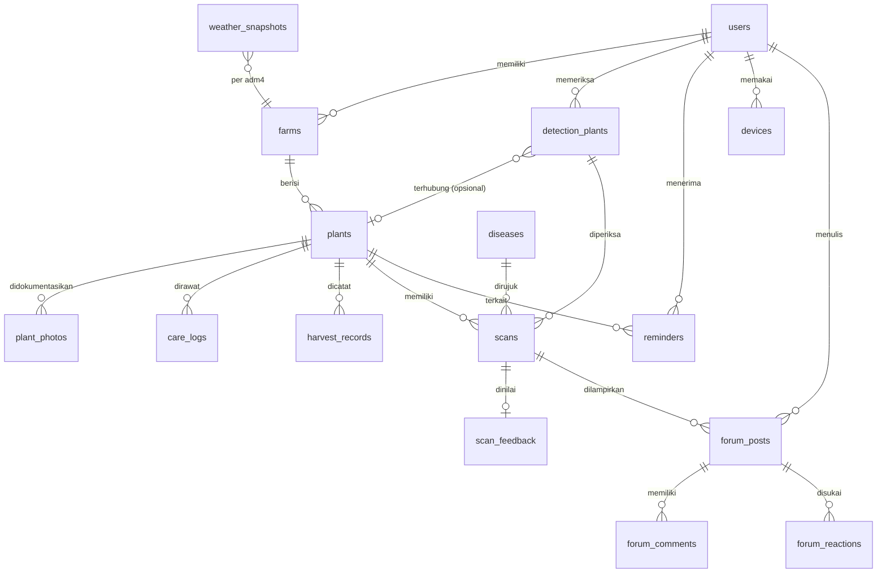

# Tanami - design.md

Dokumen ini adalah **kontrak bersama** antara frontend, backend, dan ML. Tujuannya satu: semua orang membangun hal yang sama dengan istilah, data, dan perilaku yang sama.

| | |
|---|---|
| Versi | 0.3 |
| Tanggal | 8 November 2026 |
| Dasar | Dokumen *Requirements Aplikasi Deteksi dan Tracking Tanaman* (requirement 0-7) |
| Dokumen pendamping | `tqa.md` (standar kualitas) |
| Status nilai | Nilai bertanda **[USULAN]** adalah titik awal dan dapat diubah lewat PR yang disetujui pemilik area (lihat `tqa.md` bagian 2 dan 16). |

**Cara memakai dokumen ini**
- Bagian 8 (istilah dan enum), 10 (API), dan 11 (kontrak ML) adalah **sumber kebenaran**. Jika kode berbeda dengan dokumen ini, salah satunya harus diperbaiki lewat PR, bukan dibiarkan.
- Daftar endpoint lengkap dan bentuk data persis ada di `tanami-backend/contracts/openapi.json` (dibuat otomatis dari kode). Tes kontrak di backend gagal bila endpoint di bagian 10 hilang.
- Perubahan pada bagian 8, 10, dan 11 harus disetujui oleh satu orang frontend dan satu orang backend/ML.
- Setiap fitur ditandai dengan nomor requirement asalnya, mis. **(R1)** = requirement 1 "Tracking Tanaman".

---

## 1. Ringkasan Produk dan Prinsip Desain

**Tanami** adalah aplikasi pendamping petani dan penghobi tanaman. Pengguna mencatat kebun dan tanamannya, memantau pertumbuhan (umur, foto, penyiraman, perawatan), mendeteksi kemungkinan penyakit dari foto daun, menerima pengingat perawatan, dan berdiskusi di forum.

**Prinsip desain (jadi pegangan saat ragu):**
1. **Satu tangan, di bawah matahari.** Layar dipakai di kebun: tombol besar, kontras tinggi, sedikit langkah.
2. **Jujur soal ketidakpastian.** Model bukan ahli. Jika tidak yakin, aplikasi bilang tidak yakin dan menawarkan bantuan.
3. **Bahasa petani.** Bahasa Indonesia sederhana. Istilah teknis selalu disertai penjelasan awam.
4. **Hasil lebih dulu, detail belakangan.** Layar hasil menampilkan jawaban utama besar, penjelasan di bawahnya.
5. **Tetap berguna tanpa sinyal.** Data tersimpan bisa dibuka, foto bisa diantre.
6. **Satu sumber kebenaran.** Frontend tidak menebak aturan bisnis (umur tanaman, jadwal siram berikutnya, status kesehatan, hasil akhir); backend yang menghitung, frontend yang menampilkan.
7. **Riwayat tidak pernah hilang.** Mengakhiri tracking atau deteksi hanya memindahkan data ke History, tidak menghapusnya.

---

## 2. Pengguna

| Persona | Deskripsi | Kebutuhan utama | Catatan desain |
|---|---|---|---|
| **Pak Budi, petani kecil** | 45-60 tahun, HP Android kelas menengah ke bawah, sinyal tidak stabil, kebun outdoor 0,2-2 ha | Tahu daun kenapa, ingat jadwal siram | Teks besar, ikon jelas, sedikit mengetik, offline |
| **Rina, penghobi tanaman rumah** | 20-35 tahun, tanaman pot indoor/outdoor | Mencatat pertumbuhan dengan foto, pengingat siram | Kebun indoor, foto berkala, riwayat |
| **Bu Sari, ketua kelompok tani** | 35-50 tahun, beberapa kebun | Memantau banyak tanaman, bertanya ke ahli | Daftar kebun, riwayat, forum |
| **Penyuluh/ahli** | Penyuluh pertanian, dosen | Menjawab di forum, meninjau hasil deteksi yang salah | Peran `expert` terverifikasi |

---

## 3. Cakupan dan Prioritas

| Prioritas | Fitur (requirement) | Isi |
|---|---|---|
| P0 | **Tambah Kebun (R0)** | Nama kebun, lokasi kelurahan (kode adm4), penempatan `indoor`/`outdoor` |
| P0 | **Tracking Tanaman (R1)** | Jenis tanaman (dropdown), tanggal tanam (umur otomatis), foto, jadwal irigasi, catat perawatan, akhiri tracking + hasil akhir |
| P0 | **Deteksi Penyakit (R3)** | Daftar tanaman deteksi terpisah; input nama + foto; hasil: nama penyakit, keyakinan %, gejala, saran penanganan; riwayat per tanaman; akhiri deteksi |
| P0 | **History Tracking (R2)** dan **History Deteksi (R4)** | Daftar tanaman yang diakhiri, detail, alasan, riwayat lengkap; deteksi bisa diaktifkan kembali |
| P1 | **Notifikasi dan Pengingat (R7)** | Pengingat foto (periode pilihan pengguna), penyiraman (dari jadwal irigasi), pemantauan berkala; berhenti saat tracking diakhiri |
| P1 | **Profil dan Pengaturan (R6)** | Email, username, nama lengkap, ganti password, periode pengingat, logout, hapus akun |
| P2 | **Forum Komunitas (R5)** | Posting (teks + foto), lihat, komentar, suka (like), laporan dan moderasi |
| Tambahan | Scan kematangan buah + estimasi panen, reminder cuaca BMKG | Di luar requirement; dipertahankan karena sudah berjalan. Reminder cuaca hanya untuk kebun `outdoor`. |

**Di luar cakupan:** konsultasi video, peta sebaran penyakit, marketplace saprotan, prediksi harga, sensor IoT.

**Batas model:** deteksi penyakit hanya tersedia untuk jenis tanaman yang punya model (MVP: **cabai**). Tracking berlaku untuk semua jenis di dropdown.

---

## 4. Arsitektur Informasi dan Navigasi

**Navigasi bawah (5 tab):**

| Tab | Isi | Requirement |
|---|---|---|
| **Beranda** | Pengingat aktif (siram, foto, pemantauan), tanaman perlu perhatian, cuaca kebun outdoor | R7 |
| **Tanaman** | Daftar Tracking Tanaman per kebun, tombol "History" | R0, R1, R2 |
| **Deteksi** (tombol tengah, menonjol) | Daftar Tanaman Deteksi, "Periksa tanaman baru", tombol "History" | R3, R4 |
| **Forum** | Daftar posting, buat posting | R5 |
| **Akun** | Profil, ganti password, pengaturan notifikasi, tentang, logout, hapus akun | R6 |

**Peta layar (ringkas):**
```
Beranda -> Detail Pengingat -> Detail Tanaman
Tanaman -> Tambah Kebun
        -> Daftar Tanaman Aktif -> Tambah Tanaman
                                -> Detail Tanaman -> Foto | Catat Perawatan/Siram | Timeline | Grafik
                                                  -> Akhiri Tracking (alasan + hasil akhir)
        -> History Tracking -> Detail History (lokasi, alasan, riwayat perkembangan)
Deteksi -> Daftar Tanaman Deteksi -> Periksa Baru (nama + foto) -> Memproses -> Hasil
                                  -> Detail Tanaman Deteksi -> Riwayat Hasil -> Detail Pemeriksaan
                                                            -> Periksa Ulang | Akhiri Deteksi
        -> History Deteksi -> Detail -> Aktifkan Kembali
Forum -> Daftar Posting -> Detail Posting (komentar, suka, laporkan) | Buat Posting
Akun -> Profil | Ganti Password | Notifikasi | Tentang dan Sumber Data | Logout | Hapus Akun
```

---

## 5. Alur Pengguna Utama

### 5.1 Pertama kali memakai
1. Layar sambutan (maks. 3 slide) -> **Daftar**: email, username, nama lengkap, kata sandi; atau **Masuk** dengan email **atau** username.
2. Persetujuan privasi, termasuk pilihan terpisah "Izinkan foto saya dipakai untuk meningkatkan Tanami" (boleh ditolak).
3. **Tambah kebun pertama (R0):** nama kebun, kelurahan (cari nama atau dari GPS), indoor/outdoor.
4. **Tambah tanaman (R1):** jenis (dropdown), label (mis. "Cabai Blok A"), tanggal tanam, jadwal irigasi, foto awal (opsional).
5. Selesai -> Beranda dengan ajakan "Periksa daun pertama Anda".

### 5.2 Tracking tanaman (R1)
1. Detail Tanaman menampilkan **umur** (hari, dihitung backend), status kesehatan, jadwal irigasi, **jadwal siram berikutnya**, foto terbaru.
2. Pengguna menambah **foto perkembangan** dan mencatat **perawatan** (siram, pupuk, pengendalian hama, pangkas, siang, lainnya). Catatan "siram" adalah riwayat penyiraman.
3. **Akhiri Tracking:** pilih alasan (`harvested` dipanen, `died` mati, `not_maintained` tidak dirawat lagi, `other`), catatan opsional, dan bila dipanen **hasil akhir** (lihat 8.2) atau persentase hasil terhadap target. Tanaman pindah ke History Tracking; pengingatnya berhenti.

### 5.3 History tracking (R2)
Daftar tanaman yang diakhiri (terbaru di atas). Detail: nama, jenis, tanggal tanam, lokasi (kebun, kelurahan, indoor/outdoor), tanggal dan alasan pengakhiran, hasil akhir, serta **riwayat perkembangan** = timeline foto, penyiraman, perawatan, hasil deteksi yang terhubung, panen. Data hanya-baca.

### 5.4 Deteksi penyakit (R3)
1. Tab **Deteksi** -> "Periksa tanaman baru" -> isi **nama tanaman** -> ambil/pilih **foto**. (Opsional: hubungkan ke tanaman yang sedang di-tracking agar hasilnya ikut tampil di riwayat tanaman itu.)
2. Kamera dengan bingkai dan tips ("satu daun, cahaya cukup, tidak buram"). Jika offline, foto masuk **antrean** (bagian 14).
3. **Hasil** (bagian 11.4): nama penyakit, keyakinan (%), gejala, saran penanganan. Tombol: Simpan, Periksa ulang, Tanya di forum, Hasil benar/salah.
4. Detail tanaman deteksi menampilkan **riwayat hasil** semua pemeriksaan. "Periksa ulang" = pemeriksaan manual baru dengan foto baru (R7 "Pengaturan Deteksi").
5. **Akhiri Deteksi** memindahkan tanaman ke History Deteksi; hasilnya tetap tersimpan.

### 5.5 History deteksi (R4)
Daftar tanaman deteksi yang diakhiri: nama, foto terakhir, tanggal pengakhiran. Detail: semua hasil (penyakit, keyakinan, gejala, saran) dan foto yang dianalisis. **Aktifkan kembali** mengembalikan tanaman ke daftar aktif tanpa kehilangan riwayat.

### 5.6 Pengingat (R7)
Job backend membuat pengingat -> push notification -> pengguna membuka -> Detail Pengingat -> tombol aksi (mis. "Catat siram", "Ambil foto") -> tandai "Selesai".

### 5.7 Forum (R5)
Daftar posting -> detail -> komentar / suka / laporkan. Buat posting: judul, isi, hingga 3 foto, atau lampirkan hasil deteksi.

---

## 6. Daftar Layar dan Data yang Dibutuhkan

| Kode | Layar | Data dari API | Keadaan khusus |
|---|---|---|---|
| S01 | Sambutan | - | - |
| S02 | Daftar/Masuk | `POST /auth/register`, `POST /auth/login` | Email/username sudah dipakai, kredensial salah, tanpa sinyal |
| S03 | Tambah/Ubah Kebun | `POST /farms`, `GET /regions/search`, `GET /regions/resolve` | Gagal ambil lokasi -> pilih manual |
| S04 | Beranda | `GET /home` | Belum ada kebun, offline (data terakhir) |
| S05 | Daftar Tanaman Aktif | `GET /plants?status=active` (atau `GET /farms/{id}/plants`) | Kosong |
| S06 | Tambah/Ubah Tanaman | `GET /plant-types`, `POST /farms/{id}/plants`, `PATCH /plants/{id}` | Tanggal tanam di masa depan |
| S07 | Detail Tanaman | `GET /plants/{id}`, `GET /plants/{id}/photos`, `GET /plants/{id}/care-logs` | Belum ada foto |
| S08 | Tambah Foto / Catat Perawatan | `POST /plants/{id}/photos`, `POST /plants/{id}/care-logs` | Unggah gagal |
| S09 | Timeline dan Grafik | `GET /plants/{id}/timeline`, `/stats` | Belum ada data |
| S10 | Akhiri Tracking | `POST /plants/{id}/end` | Hasil akhir wajib bila dipanen |
| S11 | History Tracking | `GET /plants?status=ended` | Kosong |
| S12 | Detail History Tracking | `GET /plants/{id}`, `GET /plants/{id}/timeline` | Hanya-baca |
| S13 | Daftar Tanaman Deteksi | `GET /detection-plants` | Kosong |
| S14 | Periksa Tanaman | `POST /detection-plants`, `POST /scans` | Offline -> antre, jenis tanaman tanpa model |
| S15 | Hasil Deteksi | respons `POST /scans` | `confident`, `uncertain`, `unknown`, `invalid_image` |
| S16 | Detail Tanaman Deteksi | `GET /detection-plants/{id}` | Deteksi sudah diakhiri |
| S17 | Detail Pemeriksaan | `GET /scans/{id}` | Gambar dihapus |
| S18 | History Deteksi | `GET /detection-plants?status=ended`, `POST /detection-plants/{id}/reactivate` | Kosong |
| S19 | Daftar/Detail Pengingat | `GET /reminders`, `GET /reminders/{id}`, `PATCH /reminders/{id}` | Kosong |
| S20 | Forum - Daftar/Detail/Buat | `/forum/*` | Dilaporkan/dihapus, unggah gagal |
| S21 | Akun dan Pengaturan | `GET/PATCH /users/me`, `POST /users/me/password`, `GET/PATCH /users/me/notification-settings` | |
| S22 | Info Penyakit | `GET /diseases/{code}` | |
| S23 | Sumber Data | statis | Atribusi BMKG |

**Setiap layar wajib menangani 5 keadaan:** memuat (skeleton), kosong, berhasil, galat (dengan tombol coba lagi), dan offline.

---

## 7. Design System

### 7.1 Warna (design tokens) [USULAN]

| Token | Hex | Penggunaan |
|---|---|---|
| `color.primary` | `#2E7D32` | Tombol utama, elemen aktif |
| `color.primary-dark` | `#1B5E20` | Tekan/hover, header |
| `color.primary-light` | `#E8F5E9` | Latar kartu lembut |
| `color.secondary` | `#8D6E63` | Aksen tanah/lahan |
| `color.accent` | `#F9A825` | Panen, sorotan |
| `color.success` | `#2E7D32` | Sehat, berhasil |
| `color.warning` | `#EF6C00` | Waspada, tidak yakin |
| `color.danger` | `#C62828` | Sakit parah, galat |
| `color.info` | `#1565C0` | Informasi |
| `color.text` | `#1F2A1F` | Teks utama |
| `color.text-muted` | `#5B665B` | Teks sekunder |
| `color.surface` | `#FFFFFF` | Kartu |
| `color.background` | `#F6F8F4` | Latar halaman |
| `color.border` | `#D9E0D5` | Garis |

- Aplikasi **hanya mode terang** di MVP (pemakaian di luar ruangan).
- Kontras teks terhadap latar minimal WCAG AA (4,5:1 untuk teks isi).
- **Warna tidak boleh menjadi satu-satunya pembeda.** Selalu pasangkan dengan ikon dan teks.

### 7.2 Tipografi
- Huruf: **Inter** (cadangan: font sistem).
- Skala:

| Token | Ukuran / tinggi baris | Berat | Penggunaan |
|---|---|---|---|
| `text.display` | 28 / 36 | Bold | Judul hasil utama |
| `text.title` | 22 / 28 | SemiBold | Judul layar |
| `text.heading` | 18 / 24 | SemiBold | Judul bagian |
| `text.body` | 16 / 24 | Regular | Teks isi (minimal) |
| `text.body-strong` | 16 / 24 | SemiBold | Penekanan |
| `text.caption` | 14 / 20 | Regular | Keterangan, tanggal |

- Tidak ada teks isi di bawah 14 sp. Aplikasi menghormati pengaturan ukuran huruf sistem sampai 130%.

### 7.3 Jarak, bentuk, dan bayangan
- Skala jarak (kelipatan 4): `4, 8, 12, 16, 24, 32, 48`. Margin layar 16.
- Radius sudut: kartu 12, tombol 12, chip 999 (bulat).
- Bayangan ringan hanya untuk kartu yang bisa ditekan.
- **Area sentuh minimal 48 x 48 dp.**

### 7.4 Komponen inti

| Komponen | Varian | Catatan |
|---|---|---|
| Tombol | Utama (isi hijau), Sekunder (garis), Teks, Bahaya | Tinggi 52; label kata kerja ("Kirim Foto") |
| Kartu Hasil | `confident`, `uncertain`, `unknown`, `invalid_image` | Lihat 11.4 |
| Lencana Penyebab | `fungus`, `bacteria`, `virus`, `pest`, `nutrient_deficiency`, `healthy`, `unknown` | Ikon + label; lihat 7.5 |
| Meter Keyakinan | Batang 0-100% + kata ("Yakin", "Belum yakin") | Jangan tampilkan angka tanpa kata |
| Kartu Tanaman | Foto terakhir, nama, jenis, **umur (hari)**, status kesehatan, jadwal siram berikutnya | R1 |
| Kartu Tanaman Deteksi | Foto terakhir, nama, hasil terakhir (penyakit + %), jumlah pemeriksaan | R3 |
| Lencana Hasil Akhir | `failed` merah, `suboptimal` oranye, `normal` hijau, `bumper` emas; selalu dengan teks | R1 |
| Tombol Suka | Ikon hati + jumlah; area sentuh 48 dp | R5 |
| Kartu Reminder | Ikon jenis, judul, waktu, tombol aksi | Dibedakan prioritas |
| Item Timeline | Tanggal, ikon jenis, ringkasan, thumbnail | |
| Grafik Status | Garis/titik per waktu | Sumbu mudah dibaca |
| Kartu Posting Forum | Penulis (+ lencana Ahli), judul, ringkasan, jumlah komentar, thumbnail | |
| Panel Cuaca | Suhu, kelembapan, deskripsi, ikon, 3 hari | Atribusi BMKG |
| Keadaan Kosong | Ilustrasi sederhana + 1 kalimat + 1 tombol | |
| Banner Offline | Jelas, tidak mengganggu | "Anda sedang offline. Foto akan dikirim saat ada sinyal." |
| Galat | Pesan manusiawi + "Coba lagi" | Tidak menampilkan kode teknis kecuali di "Detail" |

### 7.5 Penyebab penyakit: pemetaan tampilan (harus sama di semua layar)

| `cause_category` | Label (ID) | Penjelasan awam | Ikon (nama) |
|---|---|---|---|
| `healthy` | Sehat | Daun terlihat normal | `leaf-check` |
| `fungus` | Jamur | Dipicu lembap; sering berupa bercak atau bubuk | `mushroom` |
| `bacteria` | Bakteri | Menyebar lewat air dan alat; bisa layu cepat | `bacteria` |
| `virus` | Virus | Daun keriting/menguning; sering dibawa serangga | `virus` |
| `pest` | Hama | Serangan serangga atau tungau | `bug` |
| `nutrient_deficiency` | Kurang hara | Tanaman kurang pupuk atau unsur tertentu | `sprout` |
| `unknown` | Belum diketahui | Model belum yakin | `help-circle` |

### 7.6 Gaya bahasa (microcopy)
- Sapaan netral dan sopan: "Anda". Kalimat pendek, kata kerja jelas.
- Contoh: "Daun tampak terkena **jamur antraknosa**. Kami cukup yakin (82%)." / "Kami belum yakin. Coba foto ulang dari dekat dengan cahaya cukup."
- **Dilarang**: menyatakan kepastian ("Pasti penyakit X"), memberi angka dosis tanpa tinjauan ahli, bahasa yang menakut-nakuti.
- Semua teks ada di berkas i18n (`id.json`). Kunci menggunakan format `fitur.layar.elemen` (mis. `scan.result.uncertain_title`).

### 7.7 Ikon dan ilustrasi
- Satu set ikon konsisten (garis 2 px). Ilustrasi sederhana, bernuansa kebun Indonesia.

---

## 8. Istilah dan Enum (Sumber Kebenaran)

### 8.1 Glosarium

| Istilah (ID) | Kode/English | Arti |
|---|---|---|
| Pengguna | `user` | Akun: email, username, nama lengkap |
| Kebun | `farm` | Satu lokasi tanam milik pengguna; terhubung ke kelurahan (adm4); `indoor` atau `outdoor` (R0) |
| Tanaman (tracking) | `plant` | Satu tanaman/blok tanam yang dipantau di sebuah kebun (R1). Aktif bila `ended_at` kosong; selain itu masuk History Tracking (R2). |
| Foto perkembangan | `plant_photo` | Foto dokumentasi pertumbuhan tanaman tracking |
| Catatan perawatan | `care_log` | Satu tindakan: siram, pupuk, dll. Catatan `watering` = riwayat penyiraman |
| Tanaman deteksi | `detection_plant` | Tanaman di daftar Deteksi Penyakit, **terpisah** dari tanaman tracking (R3). Boleh dihubungkan ke satu tanaman tracking. |
| Pemeriksaan / Scan | `scan` | Satu foto yang dianalisis model |
| Diagnosis | `disease` result | Hasil scan daun |
| Kematangan | `ripeness` result | Hasil scan buah (fitur tambahan) |
| Pengingat | `reminder` | Notifikasi dari sistem |
| Posting | `post` | Isi forum |

### 8.2 Enum (nilai persis, huruf kecil, `snake_case`)

| Enum | Nilai |
|---|---|
| `placement` (R0) | `indoor`, `outdoor` |
| `plant_type` / `commodity_code` (R1) | `chili`, `tomato`, `eggplant`, `shallot`, `cucumber`, `long_bean`, `spinach`, `water_spinach`, `mustard_greens`, `lettuce`, `corn`, `rice`, `strawberry`, `other` (label: `GET /plant-types`) |
| `irrigation_schedule` (R1) | `daily` (setiap hari), `every_3_5_days` (setiap 3-5 hari), `weekly` (setiap minggu), `never` (tidak pernah) |
| `tracking_end_reason` (R1) | `harvested` (dipanen), `died` (mati), `not_maintained` (tidak dirawat lagi), `other` |
| `harvest_outcome` / `final_result` (R1) | `failed` (Gagal Panen, < 20%), `suboptimal` (Kurang Optimal, 20% - < 70%), `normal` (Panen Normal / Sesuai Target, 70% - 100%), `bumper` (Panen Raya, > 100%) |
| `care_action` (R2) | `watering`, `fertilizing`, `pest_control`, `pruning`, `weeding`, `other` |
| `scan_type` | `disease`, `ripeness` |
| `result_status` | `confident`, `uncertain`, `unknown`, `invalid_image` |
| `cause_category` | `healthy`, `fungus`, `bacteria`, `virus`, `pest`, `nutrient_deficiency`, `unknown` |
| `ripeness_stage` | `unripe`, `turning`, `ripe`, `overripe` |
| `growth_stage` | `seedling`, `vegetative`, `flowering`, `fruiting`, `harvesting`, `finished` |
| `health_status` (tanaman) | `healthy`, `at_risk`, `sick`, `recovering`, `unknown` |
| `reminder_type` | `watering`, `photo`, `monitoring` (R7); `scan_followup`; tambahan cuaca/panen: `fungal_risk`, `heavy_rain_harvest`, `harvest_soon`, `heat_stress`; `general` |
| `reminder_priority` | `low`, `normal`, `high` |
| `reminder_status` | `unread`, `read`, `done`, `dismissed` |
| `feedback_value` | `correct`, `incorrect` |
| `user_role` | `farmer`, `expert`, `moderator`, `admin` |
| `post_status` | `published`, `hidden`, `removed` |
| `report_reason` | `spam`, `scam`, `abuse`, `wrong_info`, `other` |

**Hasil akhir dari persentase.** Bila pengguna mengisi `yield_percent` (hasil terhadap target), backend memetakan ke `final_result` dengan batas di atas. Mengakhiri dengan alasan `harvested` **wajib** menyertakan `final_result` atau `yield_percent`.

**Umur tanaman** = selisih hari antara `planted_at` dan hari ini (zona `Asia/Jakarta`), atau tanggal pengakhiran bila tracking sudah diakhiri. Dihitung backend (`age_days`).

**Aturan status kesehatan tanaman** (`health_status`, diturunkan backend dari scan daun yang terhubung ke tanaman, diputar ulang menurut urutan waktu foto):
- scan penyakit `confident` -> `sick`; bila model menilai ringan (`severity = mild`) -> `at_risk`
- scan `uncertain` -> `at_risk`
- scan sehat `confident` setelah `sick` -> `recovering`; scan sehat berikutnya -> `healthy`
- scan `unknown`/`invalid_image` tidak mengubah status
- tidak ada scan daun 14 hari -> `unknown` (job harian)

Frontend **menampilkan** semua nilai turunan di atas dan tidak menghitungnya sendiri.

---

## 9. Model Data (Database)

Detail kolom, constraint, dan indeks yang benar-benar diimplementasikan ada di `tanami-backend/docs/data-model.md` (migrasi Alembic `0001`-`0004`).

### 9.1 Diagram relasi


### 9.2 Tabel dan kolom penting
Semua tabel punya `id` (UUID), `created_at`, `updated_at` (`timestamptz`, UTC). Nama kolom `snake_case`.

**users** (R6): `email` (unik, wajib), `username` (unik, `[a-z0-9_.]{3,32}`), `full_name`, `password_hash` (Argon2id), `role`, `consent_training_data`, `consent_at`, `notification_settings` (JSONB: sakelar per `reminder_type`, jam tenang, `photo_reminder_days`, `monitoring_reminder_days`), `deleted_at`.

**farms** (R0): `user_id`, `name`, `adm4_code` (kelurahan, mis. `31.71.03.1001`), `placement` (`indoor`/`outdoor`), `lat`, `lon`, `area_m2` (opsional), `archived_at`.

**plants** (R1, R2): `farm_id`, `commodity_code` (jenis tanaman), `label`, `variety`, `planted_at`, `growth_stage`, `health_status`, `irrigation_schedule`, `expected_harvest_min/max` (dari scan buah, tambahan), `ended_at`, `end_reason`, `end_note`, `final_result`, `yield_percent`. Aktif bila `ended_at` kosong; `ended_at` dan `end_reason` selalu terisi bersamaan.

**plant_photos** (R1): `plant_id`, `user_id`, `image_key`, `caption`, `taken_at`.

**care_logs** (R2): `plant_id`, `user_id`, `action` (`care_action`), `note`, `performed_at`.

**harvest_records**: `plant_id`, `harvested_at`, `quality_note`, `quantity_kg` (panen bertahap sebelum tracking diakhiri).

**detection_plants** (R3, R4): `user_id`, `name`, `commodity_code` (model yang dipakai; MVP `chili`), `plant_id` (opsional, tanaman tracking yang dihubungkan), `ended_at`, `end_note`.

**scans**: `user_id`, `detection_plant_id` (opsional), `plant_id` (opsional), `scan_type`, `image_key`, `client_uuid` (idempoten), `captured_at`, `status`, `model_version`, `result` (JSONB, bagian 11), `disease_code`, `quality`, `confidence`.

**scan_feedback**: `scan_id` (unik), `value`, `comment`, `correct_label`, `reviewed_by`, `reviewed_at`.

**diseases** (basis pengetahuan, ditinjau ahli): `code`, `commodity_code`, `name_id`, `name_latin`, `cause_category`, `symptoms`, `causes_text`, `treatments` (JSONB, 9.3), `prevention`, `severity_note`, `reviewed_by`, `reviewed_at`, `is_active`.

**reminders**: `user_id`, `plant_id`/`farm_id` (boleh kosong untuk `general`), `type`, `priority`, `status`, `title`, `body`, `payload`, `valid_until`, `dedupe_key`, `push_state`, `sent_at`, `read_at`.

**devices**: `user_id`, `fcm_token` (unik), `platform`, `last_seen_at`.

**forum_posts**: `user_id`, `commodity_code`, `title`, `body`, `image_keys` (maks. 3), `scan_id`, `status`, `comment_count`, `like_count`, `report_count`. **forum_comments**: `post_id`, `user_id`, `body`, `status`. **forum_reactions** (R5): `post_id`, `user_id` (unik per pasangan). **forum_reports**: `reporter_id`, `target_type`, `target_id`, `reason`, `note`, `resolved_at`, `resolved_by`.

**weather_snapshots**: `adm4_code`, `fetched_at`, `source`, `forecast` (JSONB), arsip historis. **regions**: kode dan nama desa/kelurahan.

### 9.3 Bentuk `diseases.treatments` (JSONB)
```json
{
  "first_aid": ["Pisahkan dan buang bagian tanaman yang parah.", "..."],
  "organic": [{"title": "Fungisida nabati", "how": "Ikuti petunjuk produk."}],
  "chemical": [{"title": "Fungisida berbahan aktif ...", "how": "Baca label; jangan melebihi dosis anjuran."}],
  "safety_note": "Gunakan sarung tangan dan masker. Ikuti dosis di label kemasan.",
  "when_to_call_expert": "Jika gejala meluas lebih dari sepertiga tanaman."
}
```
Konten ini **dibuat dan ditinjau ahli**. Tidak ada angka dosis sampai ada tinjauan.

---

## 10. Spesifikasi API

**Basis:** `/api/v1`. Sumber kebenaran sebenarnya adalah OpenAPI yang dibuat dari kode backend (`tanami-backend/contracts/openapi.json`); bagian ini adalah ringkasan kesepakatan.

### 10.1 Konvensi umum
- JSON `snake_case`, waktu ISO 8601 UTC, ID UUID.
- Autentikasi: `Authorization: Bearer <access_token>`.
- **Sukses (objek):** `{ "data": { "id": "..." } }`
- **Sukses (daftar):** `{ "data": [ ... ], "meta": { "next_cursor": "abc123", "has_more": true } }`. Query: `?limit=20&cursor=abc123` (default 20, maks. 50) pada daftar yang berhalaman.
- **Galat:**
```json
{
  "error": {
    "code": "validation_error",
    "message": "Foto terlalu besar.",
    "details": { "field": "image", "max_bytes": 2097152 },
    "request_id": "9f1c..."
  }
}
```
`message` selalu bahasa Indonesia, layak ditampilkan. Frontend menampilkan berdasarkan `code`, bukan menguraikan `message`.

### 10.2 Kode galat (HTTP -> `code`)

| HTTP | `code` | Arti | Tindakan frontend |
|---|---|---|---|
| 400 | `validation_error` | Data tidak valid (termasuk mengubah tanaman yang tracking-nya sudah diakhiri) | Tampilkan pesan, tandai kolom |
| 401 | `unauthorized` | Token tidak ada/kedaluwarsa | Coba refresh, bila gagal arahkan ke masuk |
| 403 | `forbidden` | Peran tidak cukup | Pesan "tidak ada akses" |
| 404 | `not_found` | Tidak ditemukan / bukan milik pengguna | Pesan |
| 405 | `validation_error` | Metode salah | - |
| 409 | `conflict` | Duplikat (email, username, laporan ganda) | Muat ulang / pesan |
| 413 | `payload_too_large` | Berkas terlalu besar | Kompres ulang |
| 415 | `unsupported_media_type` | Tipe berkas tidak didukung | Pesan |
| 422 | `invalid_image` | Gambar tidak dapat diproses | Minta foto ulang |
| 429 | `rate_limited` | Terlalu sering | Tunggu, tampilkan `Retry-After` |
| 500 | `internal_error` | Galat server | "Coba lagi", sertakan `request_id` di Detail |
| 503 | `service_unavailable` | Model/cuaca tidak tersedia | "Coba lagi nanti", antre jika scan |

### 10.3 Rate limit [USULAN]
- Login: 5 percobaan/menit/IP. Daftar: 20/menit/IP.
- `POST /scans`: 20/menit/pengguna.
- Lainnya: 120/menit/pengguna.

### 10.4 Autentikasi, profil, dan pengaturan (R6)

| Metode | Path | Keterangan |
|---|---|---|
| POST | `/auth/register` | `{ "email", "username", "full_name", "password", "consent_training_data" }` -> token |
| POST | `/auth/login` | `{ "email" }` **atau** `{ "username" }` + `"password"` -> `{ "access_token", "refresh_token", "expires_in" }` |
| POST | `/auth/refresh` | `{ "refresh_token" }` (token dirotasi) |
| POST | `/auth/logout` | Mencabut refresh token |
| GET/PATCH | `/users/me` | Profil; ubah `email`, `username`, `full_name`, `consent_training_data` |
| POST | `/users/me/password` | `{ "current_password", "new_password" }`; perangkat lain logout, respons berisi token baru |
| DELETE | `/users/me` | Hapus akun (dihapus permanen setelah 30 hari, `tqa.md` 9) |
| GET/PATCH | `/users/me/notification-settings` | `enabled` per `reminder_type`, `quiet_hours_start/end`, `photo_reminder_days` (0-60, 0 = mati), `monitoring_reminder_days` |
| GET/POST | `/devices` | Daftar / daftarkan token FCM `{ "fcm_token", "platform" }` |
| DELETE | `/devices/{id}` | Hapus perangkat |

### 10.5 Kebun dan tracking tanaman (R0, R1, R2)

| Metode | Path | Keterangan |
|---|---|---|
| GET/POST | `/farms` | Daftar / buat kebun `{ "name", "adm4_code", "placement", "lat"?, "lon"?, "area_m2"? }` |
| GET/PATCH/DELETE | `/farms/{farm_id}` | Detail / ubah / arsipkan (tanaman aktifnya diakhiri dengan alasan `other`) |
| GET | `/plant-types` | Dropdown jenis tanaman `{ code, label, detection_supported }` |
| GET/POST | `/farms/{farm_id}/plants` | Daftar / buat tanaman `{ "label", "commodity_code", "planted_at", "irrigation_schedule", "variety"?, "growth_stage"? }` |
| GET | `/plants?status=active\|ended` | Semua tanaman pengguna: aktif (Tracking) atau diakhiri (History Tracking) |
| GET/PATCH | `/plants/{plant_id}` | Detail (umur, lokasi, jadwal siram berikutnya, foto sampul, status akhir) / ubah |
| POST | `/plants/{plant_id}/end` | Akhiri tracking `{ "reason", "note"?, "final_result"?, "yield_percent"? }` |
| DELETE | `/plants/{plant_id}` | Singkatan akhiri tracking dengan alasan `other` |
| GET/POST | `/plants/{plant_id}/photos` | Foto perkembangan (multipart `image`, `caption`?, `taken_at`?) |
| DELETE | `/plants/{plant_id}/photos/{photo_id}` | Hapus foto |
| GET/POST | `/plants/{plant_id}/care-logs` | Catatan perawatan `{ "action", "note"?, "performed_at"? }`; filter `?action=watering` = riwayat penyiraman |
| DELETE | `/plants/{plant_id}/care-logs/{log_id}` | Hapus catatan |
| POST | `/plants/{plant_id}/harvests` | Catat panen bertahap |
| GET | `/plants/{plant_id}/timeline?cursor=` | Riwayat perkembangan: `scan`, `photo`, `care`, `harvest`, `reminder`, `ended` |
| GET | `/plants/{plant_id}/stats?from=&to=` | Data grafik (seri kesehatan, seri kematangan, estimasi vs realisasi) |
| GET | `/regions/search?q=` / `/regions/resolve?lat=&lon=` | Cari kelurahan / koordinat -> `adm4_code` |

Tanaman yang tracking-nya diakhiri **hanya-baca**: foto, catatan, ubah, dan panen ditolak (400).

Potongan `GET /plants/{id}`:
```json
{ "data": {
  "id": "7c2a...", "label": "Cabai Blok A", "commodity_code": "chili", "commodity_label": "Cabai",
  "planted_at": "2026-09-01", "age_days": 68, "health_status": "healthy",
  "irrigation_schedule": "every_3_5_days", "last_watered_at": "2026-11-06T23:10:00Z",
  "next_watering_on": "2026-11-10", "cover_photo_url": "https://...",
  "farm_name": "Kebun Belakang", "placement": "outdoor", "adm4_code": "31.71.03.1001", "village": "Gambir",
  "status": "ended", "ended_at": "2026-11-08T02:00:00Z", "end_reason": "harvested",
  "end_note": "Lumayan", "final_result": "normal", "yield_percent": 85.0
} }
```

### 10.6 Deteksi penyakit dan pemeriksaan (R3, R4)

| Metode | Path | Keterangan |
|---|---|---|
| GET | `/detection-plants?status=active\|ended` | Daftar Tanaman Deteksi / History Deteksi (foto terakhir, jumlah pemeriksaan, hasil terakhir) |
| POST | `/detection-plants` | `{ "name", "commodity_code"? (default `chili`, hanya jenis ber-model), "plant_id"? }` |
| GET/PATCH | `/detection-plants/{id}` | Detail + seluruh riwayat hasil / ubah nama atau tautan |
| POST | `/detection-plants/{id}/end` | Akhiri deteksi `{ "note"? }` |
| POST | `/detection-plants/{id}/reactivate` | Aktifkan kembali tanpa kehilangan riwayat |
| POST | `/scans` | Pemeriksaan (multipart, tabel di bawah) |
| GET | `/scans?detection_plant_id=&plant_id=&type=&cursor=` | Daftar pemeriksaan |
| GET | `/scans/{scan_id}` | Detail pemeriksaan + foto + umpan balik |
| DELETE | `/scans/{scan_id}` | Hapus pemeriksaan dan fotonya |
| PATCH | `/scans/{scan_id}` | Kaitkan ke tanaman tracking `{ "plant_id" }` |
| PUT | `/scans/{scan_id}/feedback` | `{ "value": "correct" \| "incorrect", "comment"? }` |

**`POST /scans`** (multipart/form-data)

| Bidang | Wajib | Keterangan |
|---|---|---|
| `type` | ya | `disease` (deteksi) atau `ripeness` (tambahan) |
| `image` | ya | JPEG/PNG, maks. 2 MB, sisi terpanjang <= 1280 px (klien mengompres) |
| `detection_plant_id` | untuk R3 | Tanaman deteksi yang diperiksa; harus aktif |
| `plant_id` | tidak | Tanaman tracking; bila kosong dipakai tautan milik tanaman deteksi |
| `client_uuid` | ya | UUID dibuat klien (idempoten) |
| `captured_at` | tidak | Waktu foto, ISO 8601 UTC |

Header `Idempotency-Key: <client_uuid>`. **201** untuk pemeriksaan baru; kirim ulang dengan kunci sama mengembalikan hasil yang sama dengan **200** tanpa memproses ulang (`is_duplicate: true`).

### 10.7 Beranda, pengingat, dan cuaca (R7)

| Metode | Path | Keterangan |
|---|---|---|
| GET | `/home` | Pengingat aktif, jumlah belum dibaca, tanaman perlu perhatian, cuaca kebun outdoor pertama |
| GET | `/reminders?status=&cursor=` | Daftar pengingat |
| GET/PATCH | `/reminders/{id}` | Detail / `{ "status": "read" \| "done" \| "dismissed" }` |
| GET | `/farms/{id}/weather` | Prakiraan BMKG 3 hari dari cache, selalu dengan `attribution` (tambahan) |

Frontend **wajib menampilkan** teks `attribution` ("Sumber data: BMKG") di panel cuaca.

### 10.8 Basis pengetahuan penyakit

| Metode | Path | Keterangan |
|---|---|---|
| GET | `/diseases?commodity_code=chili` | Daftar |
| GET | `/diseases/{code}` | Gejala, penyebab, penanganan, pencegahan, peninjau |

### 10.9 Forum (R5)

| Metode | Path | Keterangan |
|---|---|---|
| GET | `/forum/categories` | Kategori = jenis tanaman + "Umum" |
| GET | `/forum/posts?commodity_code=&cursor=&q=` | Daftar posting (publik; `liked_by_me` bila login) |
| POST | `/forum/posts` | `{ "commodity_code", "title", "body", "scan_id"?, "image_keys"? }` |
| GET/DELETE | `/forum/posts/{id}` | Detail + komentar / hapus milik sendiri |
| PUT/DELETE | `/forum/posts/{id}/like` | Suka / batal suka (idempoten) -> `like_count`, `liked_by_me` |
| GET/POST | `/forum/posts/{id}/comments` | Komentar |
| DELETE | `/forum/comments/{id}` | Hapus komentar sendiri (atau moderator) |
| POST | `/forum/reports` | `{ "target_type", "target_id", "reason", "note" }` |
| POST | `/uploads/forum-image` | Unggah foto forum -> `{ "image_key" }` (hanya kunci milik sendiri yang boleh dilampirkan) |

Aturan: judul 5-120 karakter, isi maks. 5000, foto maks. 3. Penulis tampil dengan `username` dan nama lengkap; email tidak pernah ditampilkan.

### 10.10 Staf (moderator, admin, ahli)

Dipakai oleh ruang kerja tim `tanami-admin` (lihat bagian 10.11). Peran dibaca dari database pada setiap permintaan, jadi penurunan peran langsung berlaku.

| Metode | Path | Peran | Keterangan |
|---|---|---|---|
| GET | `/admin/overview` | expert, moderator, admin | Angka agregat untuk beranda dashboard: pengguna per peran, tanaman aktif/selesai dan hasil akhir, scan 14 hari per hari (zona `TANAMI_TIMEZONE`), status scan dan penyakit terbanyak 30 hari, ukuran antrean. Tanpa data pribadi |
| GET | `/moderation/reports` | moderator, admin | Konten dilaporkan, terlama dulu |
| POST | `/moderation/reports/{post\|comment}/{id}/resolve` | moderator, admin | `{ "action": "dismiss" \| "hide" \| "remove" }` |
| PATCH | `/moderation/posts/{id}`, `/moderation/comments/{id}` | moderator, admin | Ubah `status` |
| GET | `/admin/users?q=&role=&include_deleted=&limit=&cursor=` | admin | Cari akun (nama, username, email; wildcard dianggap huruf biasa), terbaru dulu, paginasi kursor |
| PATCH | `/admin/users/{id}/role` | admin | Verifikasi ahli, angkat moderator. Admin tidak dapat menurunkan perannya sendiri |
| POST | `/admin/reminders/general` | admin | Pengumuman tim (`general`, prioritas rendah, berlaku 7 hari) ke semua akun atau satu `user_id` |
| GET | `/admin/reminders/general` | admin | Riwayat pengumuman: judul, isi, sasaran, jumlah penerima, jumlah dibaca |
| GET | `/admin/diseases` | expert, admin | Seluruh basis penyakit, termasuk yang disembunyikan |
| PATCH | `/admin/diseases/{code}` | expert, admin | Sunting teks dan penanganan; penyunting dan tanggal hari ini menjadi `reviewed_by`/`reviewed_at`. Saran kimia wajib punya catatan keselamatan dan tanpa dosis. Seed saat startup hanya menimpa baris yang `reviewed_at`-nya lebih lama dari seed |
| GET/PATCH | `/review/feedback`, `/review/feedback/{id}` | expert, admin | Tinjau umpan balik "salah" dan isi label benar (`tqa.md` 8.4). Setiap item membawa `allowed_labels` untuk jenis scan-nya |

### 10.11 Ruang kerja tim (`tanami-admin`)

Aplikasi web terpisah untuk staf; akun petani ditolak saat masuk. Menu yang tampil mengikuti peran.

| Layar | Peran | Isi |
|---|---|---|
| Ringkasan | expert, moderator, admin | Catatan antrean hari ini, grafik scan 14 hari, pengguna per peran, hasil panen, deteksi 30 hari |
| Laporan forum | moderator, admin | Abaikan laporan (tampilkan lagi), sembunyikan, atau hapus konten |
| Tinjauan deteksi | expert, admin | Foto, tebakan model, catatan petani, izin data latih, pilih label benar |
| Basis penyakit | expert, admin | Sunting gejala, penyebab, pencegahan, penanganan, tampil/sembunyikan |
| Pengguna | admin | Cari akun, ubah peran, kirim pesan ke satu pengguna |
| Pengumuman | admin | Tulis pengumuman dengan pratinjau notifikasi, riwayat dan jumlah dibaca |

---

## 11. Kontrak Output ML

Bagian ini mengikat ML, backend, dan frontend. Mengubahnya memerlukan persetujuan ketiganya.

### 11.1 Syarat gambar masukan
- Format JPEG/PNG; sisi terpanjang <= 1280 px; <= 2 MB (klien mengompres).
- **Pemeriksaan kualitas di klien** sebelum kirim (peringatan, bukan penghalang): terlalu buram, terlalu gelap, terlalu kecil.
- **Pemeriksaan di server:** apakah gambar benar-benar daun/buah (deteksi gambar tidak valid). Jika bukan, status `invalid_image`.
- Server membuang metadata EXIF (termasuk GPS) sebelum menyimpan.

### 11.2 Ambang keyakinan (SUMBER TUNGGAL)

| Keyakinan tertinggi | `status` |
|---|---|
| >= 0,75 | `confident` |
| 0,50 sampai < 0,75 | `uncertain` |
| < 0,50 | `unknown` |
| (gagal pemeriksaan gambar) | `invalid_image` |

Backend menentukan `status`. Frontend **tidak** menghitung ulang dari angka keyakinan. Ambang disimpan di konfigurasi backend agar bisa disetel.

### 11.3 Bentuk `result`

**Scan daun (`type = disease`):**
```json
{
  "top": {
    "disease_code": "anthracnose",
    "label": "Antraknosa",
    "cause_category": "fungus",
    "confidence": 0.87
  },
  "alternatives": [
    { "disease_code": "cercospora_leaf_spot", "label": "Bercak Daun Cercospora", "cause_category": "fungus", "confidence": 0.08 }
  ],
  "is_healthy": false,
  "severity": "moderate",
  "confidence_percent": 87,
  "advice": {
    "summary": "Daun tampak terkena antraknosa.",
    "disease_name": "Antraknosa",
    "symptoms": "Bercak cekung kecokelatan ...",
    "treatments": { "first_aid": ["..."], "organic": [], "chemical": [], "safety_note": "...", "when_to_call_expert": "..." },
    "first_aid": ["Petik dan musnahkan buah serta daun bergejala."],
    "reviewed_by": "Tim Agronomi Tanami",
    "reviewed_at": "2026-09-01",
    "disease_detail_url": "/diseases/anthracnose"
  },
  "quality": { "blur": "ok", "brightness": "ok" }
}
```
- Untuk daun sehat: `top.cause_category = "healthy"`, `top.disease_code = "healthy"`, `is_healthy = true`.
- `severity` (opsional di MVP): `mild`, `moderate`, `severe`. Jika model belum mendukung, bernilai `null`.
- Saat `status = unknown` atau `invalid_image`: `top` bernilai `null`; `alternatives` boleh berisi kandidat.
- `advice` hanya diisi dari basis pengetahuan `diseases` yang sudah ditinjau, bukan buatan model. Kelas yang belum punya baris di basis pengetahuan disimpan tanpa `advice`.
- Hasil Deteksi (R3) menampilkan: `advice.disease_name`, `confidence_percent`, `advice.symptoms`, dan saran dari `advice.treatments`.

**Scan buah (`type = ripeness`, fitur tambahan di luar requirement):**
```json
{
  "stage": "turning",
  "stage_label": "Mengkal",
  "confidence": 0.81,
  "estimated_days_min": 4,
  "estimated_days_max": 7,
  "estimate_confidence": "low",
  "estimated_harvest_date_min": "2026-10-27",
  "estimated_harvest_date_max": "2026-10-30",
  "note": "Perkiraan kasar; dipengaruhi cuaca dan varietas."
}
```
- `estimated_days_min/max` selalu berupa **rentang**; aplikasi **tidak menampilkan satu angka tunggal** di MVP.
- `estimate_confidence`: `low`, `medium`, `high`. MVP mayoritas `low` sampai `medium`.
- Untuk `stage = overripe`: `estimated_days_min = 0`, `estimated_days_max = 0`, aplikasi menyarankan "Segera panen".
- Saat `status = unknown` atau `invalid_image`: field `stage` dan estimasi bernilai `null`.

### 11.4 Perilaku UI per `status`

| `status` | Tampilan | Tombol |
|---|---|---|
| `confident` | Hasil utama besar (label + lencana penyebab + meter), solusi ringkas, tautan "Lihat selengkapnya" | Simpan ke riwayat, Tanya di forum, Hasil benar/salah |
| `uncertain` | Hasil dengan banner kuning: "Kami belum sepenuhnya yakin." Tampilkan hingga 2 kemungkinan | Foto ulang, Tanya di forum/ahli, Simpan |
| `unknown` | Tidak menyebut satu penyakit/tahap. Pesan: "Kami belum bisa memastikan." Tips foto | Foto ulang, Tanya di forum/ahli |
| `invalid_image` | "Ini tampaknya bukan foto daun/buah" atau "Foto terlalu buram" + panduan | Foto ulang |

Di semua layar hasil: teks tetap **"Hasil ini perkiraan dan tidak menggantikan ahli."**

### 11.5 Kelas awal [CONTOH, difinalkan dengan ahli] (komoditas: cabai)

**Penyakit daun (`disease_code`)**

| `disease_code` | Nama | `cause_category` |
|---|---|---|
| `healthy` | Sehat | `healthy` |
| `anthracnose` | Antraknosa | `fungus` |
| `cercospora_leaf_spot` | Bercak daun Cercospora | `fungus` |
| `bacterial_wilt` | Layu bakteri | `bacteria` |
| `leaf_curl_virus` | Keriting daun (virus) | `virus` |
| `pest_damage` | Kerusakan akibat hama (mis. kutu, thrips) | `pest` |
| `nutrient_deficiency` | Kekurangan hara | `nutrient_deficiency` |

**Kematangan (`ripeness_stage`) untuk cabai:** `unripe` (hijau), `turning` (mulai berubah warna), `ripe` (merah/matang), `overripe` (keriput/terlalu matang).

> Catatan: penyebab yang labelnya sudah diketahui diselesaikan dengan **klasifikasi**, bukan clustering. Pengelompokan tanpa label (mis. menemukan gejala baru) bisa menjadi riset terpisah di luar MVP.

### 11.6 Versi dan umpan balik
- `model_version` ada di setiap hasil. Frontend menyimpannya bersama scan untuk keperluan pelaporan bug.
- Pengguna dapat menandai `correct`/`incorrect` lewat `PUT /scans/{id}/feedback`. Data ini ditinjau ahli sebelum dipakai melatih ulang (`tqa.md` bagian 8.4).
- Hanya scan dari pengguna dengan `consent_training_data = true` yang boleh masuk dataset latih.

---

## 12. Aturan Pengingat dan Cuaca

### 12.1 Pengingat perawatan (R7)

Dihitung harian (06:30 WIB) untuk setiap tanaman **aktif** milik akun aktif. Tanaman yang tracking-nya diakhiri tidak pernah mendapat pengingat, dan pengingatnya yang belum dibaca ikut ditutup saat diakhiri.

| `reminder_type` | Kondisi | Prioritas | Contoh teks |
|---|---|---|---|
| `watering` | Hari sejak penyiraman terakhir (catatan `watering`, atau sejak tracking dimulai) >= interval jadwal: `daily` 1, `every_3_5_days` 3, `weekly` 7; `never` tidak pernah | `normal` | "Waktunya menyiram Cabai Blok A (jadwal setiap 3-5 hari)." |
| `photo` | Hari sejak foto perkembangan terakhir >= `photo_reminder_days` pengguna (default 7; 0 = mati) | `low` | "Ambil foto Cabai Blok A hari ini untuk memantau pertumbuhannya." |
| `monitoring` | Hari tanpa aktivitas apa pun (foto, scan, catatan perawatan) >= `monitoring_reminder_days` (default 7; 0 = mati). Tidak dikirim di hari yang sama dengan pengingat foto. | `low` | "Sudah 9 hari Cabai Blok A belum diperiksa." |
| `scan_followup` | Tanaman `sick`/`at_risk` belum dipindai ulang 5 hari | `normal` | "Sudah 5 hari sejak daun Cabai Blok A terdeteksi sakit. Yuk cek lagi." |

**Deteksi ulang** pada daftar Deteksi bersifat **manual** (R7 "Pengaturan Deteksi"): pengguna menekan "Periksa ulang" dan mengirim foto baru; tidak ada pemeriksaan otomatis.

### 12.2 Cuaca BMKG dan reminder cuaca (tambahan, hanya kebun `outdoor`)
- Sumber: **BMKG Prakiraan Cuaca Terbuka** per kelurahan, 3 hari, per 3 jam (`t`, `hu`, `weather_desc`, `ws`, `wd`, `tp`). Hanya backend yang memanggil BMKG, dengan jeda agar di bawah 60 permintaan/menit/IP.
- Cache 6 jam; setiap pengambilan diarsipkan di `weather_snapshots`; bila BMKG gagal, data terakhir ditampilkan dengan `is_stale: true`.
- Aturan [USULAN, ambang divalidasi ahli agronomi]:

| `reminder_type` | Kondisi | Prioritas |
|---|---|---|
| `fungal_risk` | Kelembapan >= 85% selama >= 48 jam berturut-turut **dan** di periode itu ada hujan/berawan tebal; `high` bila ada penyakit jamur dalam 30 hari | `normal`/`high` |
| `heavy_rain_harvest` | Awal estimasi panen <= 3 hari **dan** sebelum itu BMKG menyebut "Hujan Lebat/Petir" atau curah hujan harian >= 50 mm | `high` |
| `harvest_soon` | Awal estimasi panen (dari scan buah) <= 2 hari dan jendela panen belum lewat | `normal` |
| `heat_stress` | Suhu >= 35 C pada >= 3 slot berurutan | `normal` |
| `general` | Pengumuman tim | `low` |

### 12.3 Jadwal job (zona `Asia/Jakarta`, hanya satu instans)
`fetch_weather` 06:00 & 18:00; `generate_reminders` (cuaca) 06:15 & 18:15; `care_reminders` 06:30; `scan_followup` 07:00; `dispatch_pushes` setiap jam :05; `expire_reminders` 00:15; `decay_health` 00:30; `purge_accounts` 03:00.

### 12.4 Aturan pengiriman
- **Deduplikasi:** `dedupe_key` = `<type>:<plant_id atau farm_id>:<tanggal lokal>`.
- **Jam tenang:** default 21:00-05:00 waktu lokal, dapat diubah pengguna; `high` tetap dikirim, `normal`/`low` **ditunda** dan dikirim job per jam setelah jam tenang.
- **Batas:** maksimal 3 push per pengguna per hari lokal; sisanya tetap muncul di daftar tanpa push.
- **Kedaluwarsa:** setelah `valid_until`, pengingat menjadi `dismissed` dan tidak di-push lagi.
- Pengguna dapat mematikan tiap jenis pengingat; token FCM yang tidak valid dihapus otomatis.

### 12.5 Penting
Rule engine adalah **kode aturan terstruktur di backend**, bukan model ML. Ambang ada di konfigurasi sehingga bisa disetel tanpa mengubah kode.

---

## 13. Forum (R5)

- **Kategori:** satu per jenis tanaman ditambah "Umum".
- **Posting:** judul, isi, hingga 3 foto, atau lampirkan hasil deteksi (yang dibagikan hanya foto dan ringkasan hasil, bukan data kebun/tanaman).
- **Komentar:** datar (tanpa balasan bersarang).
- **Suka (interaksi pengguna):** satu suka per pengguna per posting; jumlah suka tampil di kartu posting.
- **Peran:** `expert` mendapat lencana "Ahli" setelah diverifikasi admin/PM. `moderator` dapat menyembunyikan atau menghapus konten.
- **Pelaporan:** tombol "Laporkan" di setiap posting dan komentar. Konten dengan >= 3 pelapor unik disembunyikan otomatis (`hidden`) sampai ditinjau [USULAN]. Posting tersembunyi hanya terlihat oleh penulisnya dan moderator.
- **Aturan komunitas** (ditampilkan sebelum posting pertama): sopan, tanpa promosi/penipuan, tanpa data pribadi, tidak memberi saran dosis berbahaya.
- **Privasi:** isi forum bersifat publik; email dan lokasi detail tidak ditampilkan.
- **Moderasi:** laporan ditinjau paling lambat 2 hari kerja.

---

## 14. Offline dan Sinkronisasi

**Prinsip:** aplikasi dapat dibuka, data terakhir dapat dibaca, dan foto dapat diambil tanpa sinyal.

| Hal | Perilaku |
|---|---|
| Cache baca | Lahan, tanaman, timeline, reminder, cuaca terakhir disimpan lokal dan ditampilkan saat offline dengan label "Terakhir diperbarui <waktu>". |
| Scan offline | Foto dikompres dan disimpan lokal dengan `client_uuid`, status **"Menunggu dikirim"**. Hasil tidak tersedia sampai terkirim (MVP tidak ada model di perangkat). |
| Antrean | Dikirim otomatis saat ada koneksi; maksimal 20 foto menunggu; urutan pertama masuk pertama keluar. Pengguna dapat membatalkan item. |
| Idempotensi | Setiap pengiriman menyertakan `Idempotency-Key = client_uuid`. Pengiriman ulang aman. |
| Percobaan ulang | Backoff eksponensial (mis. 5 dtk, 30 dtk, 2 mnt, 10 mnt), maksimal 5 percobaan lalu status "Gagal - coba lagi" manual. |
| Notifikasi | Saat antrean selesai diproses, notifikasi lokal: "Hasil scan Anda sudah siap." |
| Pembuatan data offline | Pembuatan kebun/tanaman/tanaman deteksi saat offline **tidak didukung** di MVP; catatan perawatan dan foto perkembangan boleh diantre seperti scan. |
| Konflik | Server menang untuk data referensi; catatan pengguna memakai `updated_at` terbaru (last-write-wins) di MVP. |
| Pasca-MVP | Pertimbangkan model ringan di perangkat (TFLite/ONNX Mobile) untuk hasil offline. |

---

## 15. Notifikasi Push

Muatan FCM (data):
```json
{
  "type": "reminder",
  "reminder_id": "a3d1...",
  "reminder_type": "watering",
  "priority": "high",
  "title": "Risiko jamur naik",
  "body": "Kelembapan tinggi 3 hari ke depan. Periksa daun cabai Anda.",
  "deeplink": "tanami://reminders/a3d1..."
}
```

| Tautan dalam (deeplink) | Tujuan |
|---|---|
| `tanami://reminders/{id}` | Detail Reminder |
| `tanami://scans/{id}` | Detail Scan (mis. hasil antrean selesai) |
| `tanami://plants/{id}` | Detail Tanaman |
| `tanami://forum/posts/{id}` | Detail Posting |
| `tanami://detection-plants/{id}` | Detail Tanaman Deteksi |

Izin notifikasi diminta **setelah** pengguna mengerti manfaatnya (bukan saat pertama membuka aplikasi), dengan penjelasan satu kalimat.

---

## 16. Struktur Proyek yang Disepakati

**Backend (`tanami-backend`)**
```
app/
  api/v1/            # route: auth, farms (kebun + tracking), detections, scans, reminders,
                     #        weather, diseases, forum, staff (moderasi/admin/review)
  core/              # config, security, logging, errors, middleware, rate limit
  models/            # SQLAlchemy models (constraint di sini)
  schemas/           # Pydantic (kontrak API)
  services/          # logika bisnis: scan, farm, tracking, detection, reminder,
                     # care_reminders, weather, forum, admin, maintenance
  providers/         # vision client, storage, images, push (FCM v1), weather (BMKG)
  jobs/              # scheduler (bagian 12.3)
migrations/          # Alembic 0001-0004
contracts/           # openapi.json (dibuat otomatis)
tests/
  unit/ integration/ contract/
docs/                # data-model.md, backend-audit.md, adr/
```

**Layanan vision (`tanami-vision`, root repo)**: inferensi stateless, ONNX Runtime, manifest model.

**Frontend (`tanami-app`)**
```
src/
  app/               # rute/layar (expo-router)
  features/          # auth, gardens, tracking, history, detection, reminders, forum, profile
  components/        # komponen design system
  api/               # klien API + tipe hasil generate dari openapi.json
  hooks/  stores/  offline/  theme/  i18n/  utils/
```

**ML (`tanami-ml`)**
```
data/  notebooks/  src/  configs/  reports/
```

---

## 17. Pertanyaan Terbuka (perlu keputusan tim)

| # | Pertanyaan | Status |
|---|---|---|
| 1 | Komoditas awal deteksi: cabai saja, atau tambah model tomat? | Tracking sudah mendukung banyak jenis; **deteksi masih cabai** sampai ada model lain. |
| 2 | Aplikasi mobile (React Native) atau PWA? | Terbuka (PM + Frontend). |
| 3 | Ahli/penyuluh mitra untuk validasi label dan konten solusi? | Terbuka (PM). |
| 4 | Metode login? | **Diputuskan (requirement 6): email atau username + kata sandi.** Nomor HP tidak dipakai. |
| 5 | Hosting dan anggaran (VPS/cloud, storage, FCM)? | Terbuka (Backend + PM). |
| 6 | Pengumpulan foto lapangan untuk model? | Terbuka (ML + PM). |
| 7 | Komersial atau tidak (lisensi Open-Meteo, model bisnis)? | Terbuka (PM). |
| 8 | Tingkat detail dosis di rekomendasi kimia dan penanggung jawab tinjauan? | Terbuka (PM + Ahli). |
| 9 | Kebijakan dan lama penyimpanan foto pengguna? | Usulan: foto dihapus bersama akun (30 hari setelah hapus akun). |
| 10 | Siapa moderator forum? | Terbuka (PM). Admin pertama lewat `TANAMI_BOOTSTRAP_ADMINS`. |
| 11 | Apakah scan kematangan buah dan reminder cuaca tetap dirilis? (tidak ada di requirement) | Terbuka (PM). Saat ini dipertahankan sebagai fitur tambahan. |
| 12 | Target hasil panen untuk `yield_percent`: diisi pengguna sendiri atau dari standar per jenis tanaman? | Terbuka (PM). Saat ini pengguna memilih `final_result` atau mengisi persentase. |

---

## 18. Riwayat Perubahan

| Versi | Tanggal | Perubahan | Oleh |
|---|---|---|---|
| 0.1 | 2026-10-23 | Draf awal | Tim |
| 0.2 | 2026-11-08 | Diselaraskan dengan dokumen requirement (R0-R7): kebun indoor/outdoor, tracking (jadwal irigasi, foto, catatan perawatan, akhiri tracking + hasil akhir), History Tracking, daftar Deteksi terpisah + History Deteksi + aktifkan kembali, profil email/username/nama lengkap, suka di forum, pengingat siram/foto/pemantauan. Ripeness dan cuaca ditandai fitur tambahan. API dan model data disesuaikan dengan implementasi backend. | Tim |
| 0.3 | 2026-11-08 | Ruang kerja tim `tanami-admin` (10.11) dan endpoint staf baru: ringkasan, cari pengguna, riwayat pengumuman, sunting basis penyakit, `allowed_labels` pada tinjauan. Suntingan ahli tidak lagi tertimpa seed saat startup. | Tim |
