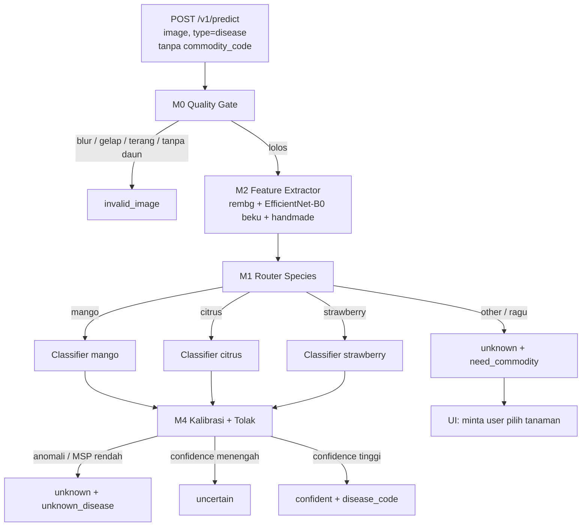

# Arsitektur ML — Jalur 2 (Cek cepat tanpa tanaman dipilih)

Status: draft  
Pemilik: Hebert (backend) + tim ML  
Berdasarkan: diskusi 18 Nov 2026; `design.md` 11.3, 11.5, 19; ringkasan literatur internal Tanami  
Berlaku untuk: **Jalur 2 — scan tanpa tanaman dipilih**. Jalur 1 (user memilih tanaman di form) tidak diubah.

> 🆕 Seluruh komponen bertanda 🆕 di dokumen ini **belum diimplementasikan**.
> ✅ menandakan fakta runtime yang sudah ada. ⚠️ menandakan konflik/keputusan tim.

---

## 1. Ringkasan

Jalur 2 menerima satu foto daun tanpa `commodity_code` dari klien. Sistem harus menjawab: apakah foto bisa dipakai, tanaman apa, dan penyakit apa. Jawaban dihasilkan oleh **lima tahap berurutan**:

```text
foto → quality gate → ekstraksi fitur → router tanaman → classifier penyakit → kalibrasi + tolak → status
```

Prinsip yang membedakan arsitektur ini:

1. **Deep learning hanya untuk ekstraksi fitur.** `rembg` dan EfficientNet-B0 beku, tidak pernah dilatih.
2. **Semua yang dilatih adalah machine learning klasik.** Router, classifier penyakit, dan modul tolak semuanya ML/statistik.
3. **Satu embedding dipakai dua kali.** Router tanaman dan classifier penyakit memakan fitur yang sama, sehingga biaya ekstraksi tetap satu kali per foto.
4. **Tiga model penyakit, bukan satu model universal.** Satu classifier per komoditas: `mango`, `citrus`, `strawberry`.
5. **Jika router ragu, sistem bertanya ke user**, bukan memaksakan classifier.

---

## 2. Keputusan arsitektur

| # | Keputusan | Status |
|---|---|---|
| 1 | ✅ Runtime sudah punya `POST /v1/predict`, port 8001, stateless, tiga komoditas, label 8/5/5 (`design.md` 11.5), `decide_status()` sebagai penentu status. | ✅ |
| 2 | Status runtime yang benar adalah `confident`, `uncertain`, `unknown`, `invalid_image` (`app/domain.py::ResultStatus`), bukan `sehat/sakit/tak_terdeteksi` milik draft 2. | ✅ |
| 3 | Jalur 2 menambah **M0 quality gate** sebelum model dipanggil. | 🆕 |
| 4 | Jalur 2 menambah **M1 router species** dengan 3 kelas + `other`. | 🆕 |
| 5 | Router dan classifier memakai **satu embedding EfficientNet-B0 beku** yang sama. | 🆕 |
| 6 | Classifier penyakit ada **tiga**, satu per komoditas, berupa ML klasik. | 🆕 |
| 7 | **M4 tolak eksplisit**: MSP threshold + skor anomali + kalibrasi temperature. | 🆕 |
| 8 | Aturan gabungan tolak adalah **OR**: salah satu memicu → tolak. | 🆕 |
| 9 | Model global semua daun dikotil tetap **shadow experiment**, bukan jalur rilis. | 🆕 |
| 10 | Kontrak response lama dipertahankan; field baru hanya ditambah setelah skema diubah. | ⚠️ |

---

## 3. Diagram alur



Versi teks: `foto → M0 → M2 → M1 → (E1|E2|E3) → M4 → {confident|uncertain|unknown|invalid_image}`.

---

## 4. Tahap dan tanggung jawab

| Tahap | Nama | Input | Output | Implementasi |
|---|---|---|---|---|
| M0 | Quality gate | file gambar | `ok` / `invalid_image` | ✅ memakai `QualityStatus` yang sudah ada; 🆕 tambah cek `rembg` mask |
| M1 | Router species | embedding | `mango` / `citrus` / `strawberry` / `other` | 🆕 ML klasik |
| M2 | Feature extractor | gambar | embedding 1280-d + fitur handmade | 🆕 DL beku + fitur klasik |
| M3 | Classifier penyakit | embedding + komoditas | probabilitas label 11.5 | 🆕 3 model ML klasik |
| M4 | Kalibrasi + tolak | probabilitas + embedding | terima/tolak + alasan | 🆕 MSP + anomali + temperature |
| M5 | Decision | hasil M4 | `ResultStatus` + `DiseaseResult` | ✅ `decide_status()` diperluas |

### 4.1 M0 — Quality gate

Cek yang dilakukan sebelum model berat dipanggil:

- ukuran file dan decode berhasil;
- `blur` → varians Laplacian;
- `brightness` → terlalu gelap/terlalu terang;
- `rembg` → mask kosong, daun <10% frame, atau background gagal dipisah.

Output gagal dipetakan ke `invalid_image` dengan `details.reason` salah satu: `too_blurry`, `too_dark`, `too_bright`, `no_leaf`, `bad_mask`.

### 4.2 M1 — Router species

Router **hanya dipakai di Jalur 2**. Di Jalur 1, `commodity_code` sudah dikirim klien, sehingga router berubah menjadi verifikasi (`wrong_commodity`), bukan prediksi.

- Input: embedding dari M2.
- Kelas: `mango`, `citrus`, `strawberry`, `other`.
- Model: Logistic Regression atau SVM-RBF.
- Threshold `τ_route` dituning dari validasi.
- Kalau `max(prob) < τ_route` atau kelas terpilih `other` → `unknown + need_commodity`.

### 4.3 M2 — Feature extractor (satu kali)

```text
gambar
  → rembg (mask)                 DL, beku
  → crop sesuai mask
  → resize 224x224
  → EfficientNet-B0 ImageNet     DL, beku, tanpa fine-tuning
  → embedding 1280-d
  → fitur handmade:
       histogram HSV, persentase bercak, tekstur GLCM, bentuk daun
  → concat + StandardScaler
  → vektor fitur akhir
```

Vektor akhir ini dipakai oleh M1 **dan** M3. Tidak ada inferensi DL kedua.

### 4.4 M3 — Classifier per komoditas

| Komoditas | Jumlah label | Sumber label |
|---|---|---|
| `mango` | 8 | `design.md` 11.5 |
| `citrus` | 5 | `design.md` 11.5 |
| `strawberry` | 5 | `design.md` 11.5 |

Kandidat model yang dibandingkan per komoditas: Random Forest, SVM-RBF, LightGBM, Logistic Regression. Pemilihan berdasarkan **macro-F1 per komoditas**, bukan akurasi agregat.

### 4.5 M4 — Kalibrasi dan tolak

Tiga lapis, digabung dengan **OR**:

1. **MSP** — `max(prob) < τ_p` → tolak.
2. **Anomali** — jarak Mahalanobis embedding ke kelas terdekat > `τ_a` → tolak. Opsi lain: One-Class SVM per kelas.
3. **Hard-negative** — probabilitas kelas `unknown` > `τ_h` → tolak (opsional, menyusul setelah ada data).

`temperature scaling` diterapkan per classifier sebelum threshold dituning.

Alasan tolak yang dicatat:

| Alasan | Status runtime | Catatan |
|---|---|---|
| `need_commodity` | `unknown` | Router ragu; UI meminta user memilih tanaman |
| `unknown_disease` | `unknown` | Penyakit di luar daftar |
| `wrong_commodity` | `unknown` | Dipakai di Jalur 1 |
| `too_blurry`, `too_dark`, `too_bright`, `no_leaf` | `invalid_image` | Berasal dari M0 |

---

## 5. Aturan DL vs ML

Ini bagian yang tidak boleh dilanggar saat implementasi.

| Komponen | Kategori | Dilatih? | Catatan |
|---|---|---|---|
| `rembg` | Deep learning | **Tidak** | Pretrained, dipakai sebagai preprocessing |
| EfficientNet-B0 | Deep learning | **Tidak** | `frozen`, tanpa optimizer, tanpa fine-tuning |
| Router species | ML klasik | Ya | LogReg / SVM-RBF |
| Classifier `mango` | ML klasik | Ya | `mango.joblib` |
| Classifier `citrus` | ML klasik | Ya | `citrus.joblib` |
| Classifier `strawberry` | ML klasik | Ya | `strawberry.joblib` |
| Anomali + kalibrasi | ML/statistik | Ya/difit | Mahalanobis atau OCSVM + temperature |

Ringkasnya: **DL hanya mata, ML klasik yang berpikir.** Tidak ada file `*.pt` yang dilatih; artefak terlatih berbentuk `*.joblib` dan `config.json`.

---

## 6. Training pipeline dan artefak

```text
00_audit      → hitung gambar per penyakit, hasilkan taxonomy.yaml
01_features   → rembg + EfficientNet beku + handmade → feature .npz
02_train      → router.joblib + 3 classifier.joblib
03_calibrate  → calibration.json + anomaly.joblib + threshold τ_route, τ_p, τ_a
04_eval       → macro-F1 per komoditas, leave-one-disease-out, uji foto petani
```

Aturan data:

- minimal 100 gambar asli per penyakit (draft 2);
- sertakan kelas `healthy` untuk tiap komoditas;
- penyakit di bawah ambang masuk `hard-negative`, bukan kelas sendiri;
- **split by `source_id`/lokasi**, jangan random per gambar;
- uji `leave-one-disease-out` untuk penyakit baru.

Struktur artefak:

```text
models/disease-router-v0.1.0-ml/
├── config.json            # versi, sha256, label map, threshold
├── taxonomy.yaml
├── feature_pipeline.joblib
├── router.joblib
├── calibration.json
├── anomaly.joblib
└── classifiers/
    ├── mango.joblib
    ├── citrus.joblib
    └── strawberry.joblib
```

Manifest mengikuti pola aktif/shadow yang sudah ada: `disease-<komoditas>-v0.1.0` untuk runtime saat ini, `...-v0.2.0-ml` untuk kandidat baru.

---

## 7. Kontrak dan status

Request Jalur 2 tidak mengirim `commodity_code`:

```http
POST /v1/predict
type=disease
image=@daun.jpg
```

Response lama tetap dipertahankan:

```json
{
  "data": {
    "type": "disease",
    "status": "confident",
    "model_version": "disease-mango-v0.2.0-ml",
    "commodity_code": "mango",
    "confidence": 0.91,
    "quality": { "blur": "ok", "brightness": "ok" },
    "result": {
      "top": {
        "disease_code": "mango_anthracnose",
        "label": "Antraknosa",
        "cause_category": "fungus",
        "confidence": 0.91
      },
      "alternatives": [],
      "is_healthy": false,
      "severity": null
    },
    "inference_ms": 42.0
  }
}
```

⚠️ `PredictionData` memakai `extra="forbid"` (`app/schemas/prediction.py`). Field tambahan seperti `commodity_source`, `rejected_reason`, atau `top_k` **tidak boleh dikirim** sebelum skema diubah dan kontrak diregenerasi. Sementara itu, alasan tolak ditaruh di `ErrorBody.details` atau field `details` dari response error.

Pemetaan status internal → runtime:

| Internal | `ResultStatus` runtime |
|---|---|
| lolos, confidence tinggi | `confident` |
| lolos, confidence menengah | `uncertain` |
| router ragu / penyakit tak dikenal | `unknown` |
| foto buruk | `invalid_image` |
| draft 2 `sehat` | `confident` + `result.top.disease_code = "healthy"` |
| draft 2 `sakit` | `confident` + `disease_code` penyakit |
| draft 2 `foto_ditolak` | `invalid_image` |
| draft 2 `tak_terdeteksi` | `unknown` |

---

## 8. Target evaluasi (usulan, belum disepakati)

| Metrik | Target |
|---|---|
| macro-F1 per komoditas | ≥ 0,80 |
| ECE setelah kalibrasi | ≤ 0,05 |
| Rejection precision pada data dikenal | ≥ 0,95 |
| AUROC OOD | ≥ 0,90 |
| Latensi p95 CPU | < 1,5 s |
| Akurasi router species | ≥ 0,95 |

Test set utama harus **foto petani sendiri**. Data PlantVillage/PlantDoc/PlantWild hanya sebagai uji eksternal.

---

## 9. Hubungan dengan dokumen lain

- `design.md` 11.3 — kontrak output; tidak diubah tanpa keputusan tim.
- `design.md` 11.5 — daftar label 8/5/5; sumber kebenaran classifier.
- `design.md` 19 — draft 2 Memet; tetap rencana riset, bukan kontrak runtime.
- `docs/data-integration.md` §3.5 — pemetaan draft 2 ke runtime.
- `docs/api-changelog.md` — harus diperbarui jika response schema berubah.
- `docs/panduan-dokumentasi.md` — konvensi ✅/🆕/⚠️ dan checklist commit.

---

## 10. Masih terbuka

1. Apakah `need_commodity` menjadi status baru atau tetap `unknown` + detail? ⚠️
2. Apakah field baru boleh ditambah ke `PredictionData`, atau cukup lewat `details`? ⚠️
3. Threshold awal `τ_route`, `τ_p`, `τ_a` berapa? ⚠️
4. Hard-negative wajib atau opsional untuk rilis pertama? ⚠️
5. Izinkan `rembg` + EfficientNet-B0 sebagai ekstraksi (terkait `design.md` open question 17). ⚠️

---

## 11. Cara memperbarui dokumen ini

1. Jalankan perubahan kode di service vision dengan test.
2. Ubah penanda 🆕 menjadi ✅ hanya setelah test dan kontrak hijau.
3. Regenerate `contracts/openapi.json` jika field response berubah.
4. Catat perubahan di `docs/api-changelog.md`.
5. Tambah baris baru di `design.md` 18 Riwayat Perubahan.

---

## Dasar literatur

- Model per tanaman dipilih user: https://irejournals.com/formatedpaper/1713011.pdf
- Quality gate → tanaman → penyakit sebagai tahap terpisah (preprint): https://arxiv.org/html/2609.21651
- Frozen backbone + classifier SVM: https://frontiersin.org/journals/plant-science/articles/10.3389/fpls.2025.1499909/full
- Router + adapter per tanaman, kalibrasi, OOD (preprint): https://arxiv.org/html/2608.08808v1
- Hierarki tanaman → penyakit (preprint): https://arxiv.org/abs/2610.04456
- Penolakan penyakit tidak dikenal: https://www.frontiersin.org/journals/plant-science/articles/10.3389/fpls.2022.989086/full
- Gap lab vs lapangan: https://arxiv.org/html/1911.10317 , https://tqwei05.github.io/PlantWild
