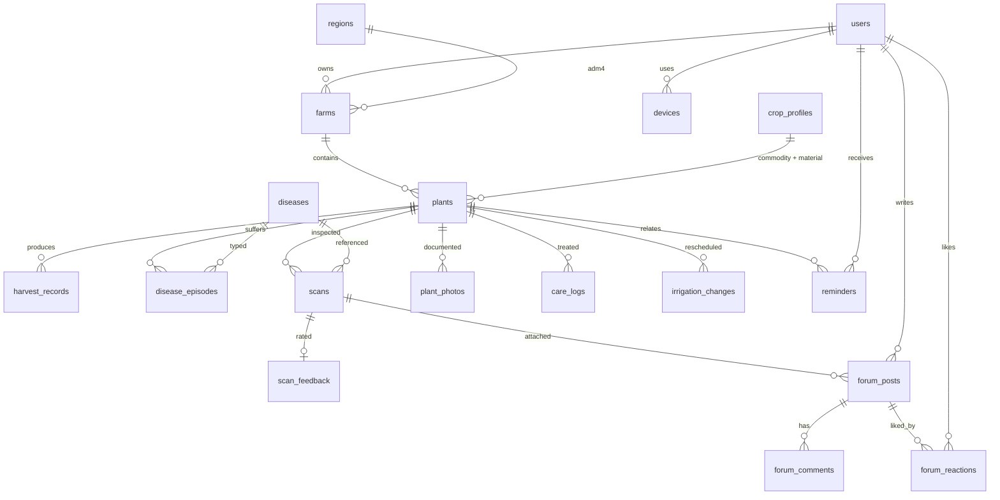

# Data model reference

> **Status:** mengikuti `docs/design.md` v2 + perubahan pasca-rapat 17 Nov 2026. Sumber kebenaran: `app/models/*.py` dan `Base.metadata`; migrasi aktif `0001`–`0008`. Kolom warisan yang tidak dipakai API tetap ada bila diperlukan migrasi/downgrade.

Dokumen ini mencatat tabel, kolom, kunci asing, indeks, dan constraint yang benar-benar ada di kode. Kalau model berubah, regenerate dari `Base.metadata` — jangan menyalin dari `design.md`.

## Conventions

- Setiap tabel punya `id` UUID (`gen_random_uuid()`), `created_at` timestamptz (`now()`), dan umumnya `updated_at`. `weather_snapshots` append-only tanpa `updated_at`; `irrigation_changes` hanya `created_at`.

- Semua timestamp adalah `timestamptz` (UTC). Migrasi `0002` memperbaiki kolom naive warisan `0001`.

- Enum disimpan sebagai `VARCHAR` + `CHECK`, bukan tipe enum PostgreSQL, supaya penambahan nilai tidak butuh `ALTER TYPE` (lihat `app/models/columns.py::enum_check`).

- FK memakai `ON DELETE CASCADE` kecuali dinyatakan lain. `scans.plant_id`, `harvest_records.recorded_by`, `forum_posts.scan_id`, dan `forum_reports.resolved_by` memakai `SET NULL`.

## Enumerations (stored values)

| Enum | Values |
|---|---|
| `UserRole` | `farmer`, `expert`, `moderator`, `admin` |
| `ScanType` | `disease` |
| `ResultStatus` | `confident`, `uncertain`, `unknown`, `invalid_image` |
| `CauseCategory` | `healthy`, `fungus`, `bacteria`, `virus`, `pest`, `nutrient_deficiency`, `unknown` |
| `HealthStatus` | `healthy`, `at_risk`, `sick`, `recovering`, `unknown` |
| `Placement` | `indoor`, `outdoor` |
| `PlantingMaterial` | `grafted`, `seed`, `other` |
| `IrrigationSchedule` | `daily`, `every_3_5_days`, `weekly`, `never` |
| `LifecyclePhase` | `juvenile`, `productive` |
| `TrackingEndReason` | `productive_period_over`, `disease`, `cut_down`, `died_other`, `other`; legacy: `harvested`, `died`, `not_maintained` |
| `TrackingOutcome` | `completed`, `ended_early`, `failed` |
| `HarvestQuality` | `gagal`, `kurang_optimal`, `normal`, `panen_raya` |
| `HarvestOutcome` | `failed`, `suboptimal`, `normal`, `bumper` (legacy) |
| `EpisodeStatus` | `open`, `resolved` |
| `EpisodeCloseReason` | `user_marked_healed`, `healthy_scan`, `tracking_ended` |
| `ReminderType` | `watering`, `photo`, `monitoring`, `fungal_risk`, `heavy_rain_harvest`, `harvest_soon`, `heat_stress`, `harvest_due`, `harvest_check`, `productive_ending`, `tracking_completed`, `scan_followup`, `general` |
| `ReminderPriority` | `low`, `normal`, `high` |
| `ReminderStatus` | `unread`, `read`, `done`, `dismissed` |
| `PushState` | `pending`, `sent`, `no_device`, `disabled`, `skipped_cap`, `failed`, `expired` |
| `Platform` | `android`, `ios`, `web` |
| `FeedbackValue` | `correct`, `incorrect` |
| `PostStatus` | `published`, `hidden`, `removed` |
| `ReportReason` | `spam`, `scam`, `abuse`, `wrong_info`, `other` |
| `ReportTargetType` | `post`, `comment` |
| `QualityStatus` | `ok`, `too_blurry`, `too_dark`, `too_bright` |
| `Severity` | `mild`, `moderate`, `severe` |
| `EstimateConfidence` | `low`, `medium`, `high` |
| `CareAction` | `watering`, `fertilizing`, `pest_control`, `pruning`, `weeding`, `other` |

`GrowthStage` masih ada di `app/domain.py` sebagai enum, tetapi **tidak dipakai kolom aktif** setelah `growth_stage` dihapus (migrasi `0005`).

## Relationship diagram

## Tables

### `users`

| Column | Type | Null | Default | Notes |
|---|---|---|---|---|
| `id` | UUID | no | gen_random_uuid() | PK |
| `email` | VARCHAR(254) | no |  |  |
| `username` | VARCHAR(32) | no |  |  |
| `full_name` | VARCHAR(80) | no |  |  |
| `password_hash` | VARCHAR(255) | no |  |  |
| `role` | VARCHAR(16) | no | farmer |  |
| `consent_training_data` | BOOLEAN | no | false |  |
| `consent_at` | timestamptz | yes |  |  |
| `notification_settings` | JSONB | no | '{}'::jsonb |  |
| `avatar_key` | VARCHAR(512) | yes |  | Object key foto profil; `avatar_url` diturunkan API |
| `plant_code_seq` | JSONB | no | '{}'::jsonb |  |
| `deleted_at` | timestamptz | yes |  |  |
| `created_at` | timestamptz | no | now() |  |
| `updated_at` | timestamptz | no | now() |  |

**Constraints:** `ck_users_role`: `role IN ('farmer', 'expert', 'moderator', 'admin')`; `ck_users_username_format`: `username ~ '^[a-z0-9_.]{3,32}$'`.

**Indexes:** `uq_users_username` (`username`, unique); `uq_users_email` (`email`, unique).

**Foto profil:** `users.avatar_key` menyimpan object key di storage (bukan URL); `avatar_url` di response `UserOut` diturunkan oleh storage provider saat membaca. Foto tanaman tetap di `plant_photos`, terpisah dari foto pengguna.

### `farms`

| Column | Type | Null | Default | Notes |
|---|---|---|---|---|
| `id` | UUID | no | gen_random_uuid() | PK |
| `user_id` | UUID | no |  | FK → `users.id` |
| `name` | VARCHAR(120) | no |  |  |
| `adm4_code` | VARCHAR(16) | no |  |  |
| `lat` | NUMERIC(9, 6) | yes |  |  |
| `lon` | NUMERIC(9, 6) | yes |  |  |
| `area_m2` | NUMERIC(12, 2) | yes |  |  |
| `placement` | VARCHAR(16) | no | outdoor |  |
| `archived_at` | timestamptz | yes |  |  |
| `created_at` | timestamptz | no | now() |  |
| `updated_at` | timestamptz | no | now() |  |

**Constraints:** `ck_farms_lon_range`: `lon IS NULL OR (lon >= -180 AND lon <= 180)`; `ck_farms_name_not_blank`: `length(trim(name)) > 0`; `ck_farms_area_positive`: `area_m2 IS NULL OR area_m2 > 0`; `ck_farms_placement`: `placement IN ('indoor', 'outdoor')`; `ck_farms_lat_range`: `lat IS NULL OR (lat >= -90 AND lat <= 90)`.

**Indexes:** `ix_farms_user_created` (`user_id, created_at`); `ix_farms_user_id` (`user_id`); `ix_farms_adm4_code` (`adm4_code`).

### `plants`

| Column | Type | Null | Default | Notes |
|---|---|---|---|---|
| `id` | UUID | no | gen_random_uuid() | PK |
| `farm_id` | UUID | no |  | FK → `farms.id` |
| `user_id` | UUID | no |  | FK → `users.id` |
| `code` | VARCHAR(16) | no |  |  |
| `commodity_code` | VARCHAR(32) | no |  |  |
| `planting_material` | VARCHAR(16) | no |  |  |
| `variety` | VARCHAR(80) | yes |  |  |
| `label` | VARCHAR(120) | no |  |  |
| `nursery_started_at` | DATE | no |  |  |
| `planted_at` | DATE | no |  |  |
| `placement` | VARCHAR(16) | no | outdoor |  |
| `quantity` | INTEGER | no | 1 |  |
| `productive_until` | DATE | no |  |  |
| `health_status` | VARCHAR(16) | no | unknown |  |
| `irrigation_schedule` | VARCHAR(16) | no | every_3_5_days |  |
| `ended_at` | timestamptz | yes |  |  |
| `end_reason` | VARCHAR(24) | yes |  |  |
| `end_note` | TEXT | yes |  |  |
| `end_disease_codes` | VARCHAR(64)[] | yes |  | hanya untuk `end_reason=disease` |
| `end_cause_note` | TEXT | yes |  |  |
| `outcome` | VARCHAR(16) | yes |  |  |
| `created_at` | timestamptz | no | now() |  |
| `updated_at` | timestamptz | no | now() |  |

**Constraints:** `ck_plants_quantity_positive`: `quantity >= 1`; `ck_plants_irrigation_schedule`: `irrigation_schedule IN ('daily', 'every_3_5_days', 'weekly', 'never')`; `ck_plants_outcome`: `outcome IN ('completed', 'ended_early', 'failed')`; `ck_plants_commodity_code`: `commodity_code IN ('mango', 'citrus', 'tomato')`; `ck_plants_end_reason`: `end_reason IN ('productive_period_over', 'disease', 'cut_down', 'died_other', 'other')`; `ck_plants_disease_end_has_cause`: `end_reason IS DISTINCT FROM 'disease' OR cardinality(coalesce(end_disease_codes, '{}')) > 0 OR btrim(coalesce(end_cause_note, '')) <> ''`; `ck_plants_ended_with_outcome`: `(ended_at IS NULL) = (outcome IS NULL)`; `ck_plants_ended_with_reason`: `(ended_at IS NULL) = (end_reason IS NULL)`; `ck_plants_planting_material`: `planting_material IN ('grafted', 'seed', 'other')`; `ck_plants_placement`: `placement IN ('indoor', 'outdoor')`; `ck_plants_health_status`: `health_status IN ('healthy', 'at_risk', 'sick', 'recovering', 'unknown')`; unique `uq_plants_user_code` (`user_id, code`).

**Indexes:** `ix_plants_commodity_code` (`commodity_code`); `ix_plants_farm_id` (`farm_id`); `ix_plants_user_ended` (`user_id, ended_at`); `ix_plants_placement` (`placement`); `ix_plants_user_id` (`user_id`); `ix_plants_health_status` (`health_status`); `ix_plants_farm_ended` (`farm_id, ended_at`).

### `harvest_records`

| Column | Type | Null | Default | Notes |
|---|---|---|---|---|
| `id` | UUID | no | gen_random_uuid() | PK |
| `plant_id` | UUID | no |  | FK → `plants.id` |
| `recorded_by` | UUID | yes |  | FK → `users.id` |
| `harvested_at` | timestamptz | no |  |  |
| `sequence` | INTEGER | no |  |  |
| `quality_note` | TEXT | yes |  | legacy; API baru memakai `quality` |
| `quality` | VARCHAR(24) | yes |  |  |
| `success_pct` | NUMERIC(6, 2) | yes |  |  |
| `quantity_kg` | NUMERIC(10, 2) | yes |  |  |
| `created_at` | timestamptz | no | now() |  |
| `updated_at` | timestamptz | no | now() |  |

**Constraints:** `ck_harvest_records_sequence_positive`: `sequence >= 1`; `ck_harvest_records_quantity_non_negative`: `quantity_kg IS NULL OR quantity_kg >= 0`; unique `uq_harvest_records_plant_sequence` (`plant_id, sequence`).

**Indexes:** `ix_harvest_records_plant_harvested` (`plant_id, harvested_at`); `ix_harvest_records_plant_id` (`plant_id`).

### `disease_episodes`

| Column | Type | Null | Default | Notes |
|---|---|---|---|---|
| `id` | UUID | no | gen_random_uuid() | PK |
| `plant_id` | UUID | no |  | FK → `plants.id` |
| `disease_code` | VARCHAR(64) | no |  | FK → `diseases.code` |
| `status` | VARCHAR(16) | no | open |  |
| `opened_at` | timestamptz | no |  |  |
| `opened_by_scan_id` | UUID | yes |  | FK → `scans.id` |
| `last_seen_at` | timestamptz | no |  |  |
| `delay_days` | INTEGER | no | 0 |  |
| `resolved_at` | timestamptz | yes |  |  |
| `close_reason` | VARCHAR(24) | yes |  |  |
| `created_at` | timestamptz | no | now() |  |
| `updated_at` | timestamptz | no | now() |  |

**Constraints:** `ck_disease_episodes_close_reason`: `close_reason IS NULL OR close_reason IN ('user_marked_healed', 'healthy_scan', 'tracking_ended')`; `ck_disease_episodes_delay_non_negative`: `delay_days >= 0`; `ck_disease_episodes_resolution_matches_status`: `(status = 'open') = (resolved_at IS NULL) AND (status = 'open') = (close_reason IS NULL)`; `ck_disease_episodes_status`: `status IN ('open', 'resolved')`.

**Indexes:** `ix_disease_episodes_plant_opened` (`plant_id`).

### `scans`

| Column | Type | Null | Default | Notes |
|---|---|---|---|---|
| `id` | UUID | no | gen_random_uuid() | PK |
| `user_id` | UUID | no |  | FK → `users.id` |
| `plant_id` | UUID | no |  | FK → `plants.id` |
| `disease_episode_id` | UUID | yes |  | FK → `disease_episodes.id` |
| `scan_type` | VARCHAR(16) | no |  |  |
| `image_key` | VARCHAR(255) | no |  |  |
| `image_content_type` | VARCHAR(64) | no |  |  |
| `client_uuid` | UUID | no |  |  |
| `captured_at` | timestamptz | no |  |  |
| `status` | VARCHAR(16) | no |  |  |
| `model_version` | VARCHAR(64) | no |  |  |
| `result` | JSONB | no |  |  |
| `disease_code` | VARCHAR(64) | yes |  | FK → `diseases.code` |
| `quality` | JSONB | no |  |  |
| `confidence` | FLOAT | yes |  |  |
| `commodity_code` | VARCHAR(32) | no | mango |  |
| `inference_ms` | FLOAT | yes |  |  |
| `created_at` | timestamptz | no | now() |  |

**Constraints:** `ck_scans_status`: `status IN ('confident', 'uncertain', 'unknown', 'invalid_image')`; `ck_scans_scan_type`: `scan_type IN ('disease')`; `ck_scans_disease_code_only_when_named`: `status IN ('confident', 'uncertain') OR disease_code IS NULL`; `ck_scans_confidence_range`: `confidence IS NULL OR (confidence >= 0 AND confidence <= 1)`; unique `uq_scans_user_client_uuid` (`user_id, client_uuid`).

**Indexes:** `ix_scans_user_plant_created` (`user_id, plant_id`); `ix_scans_plant_captured` (`plant_id`); `ix_scans_status` (`status`); `ix_scans_disease_episode_id` (`disease_episode_id`); `ix_scans_user_created` (`user_id`); `ix_scans_disease_code` (`disease_code`).

### `scan_feedback`

| Column | Type | Null | Default | Notes |
|---|---|---|---|---|
| `id` | UUID | no | gen_random_uuid() | PK |
| `scan_id` | UUID | no |  | FK → `scans.id` |
| `user_id` | UUID | no |  | FK → `users.id` |
| `value` | VARCHAR(16) | no |  |  |
| `comment` | TEXT | yes |  |  |
| `correct_label` | VARCHAR(64) | yes |  |  |
| `reviewed_at` | timestamptz | yes |  |  |
| `reviewed_by` | UUID | yes |  | FK → `users.id` |
| `created_at` | timestamptz | no | now() |  |
| `updated_at` | timestamptz | no | now() |  |

**Constraints:** `ck_scan_feedback_value`: `value IN ('correct', 'incorrect')`; unique `uq_scan_feedback_scan_id` (`scan_id`).

**Indexes:** `ix_scan_feedback_user_id` (`user_id`).

### `diseases`

| Column | Type | Null | Default | Notes |
|---|---|---|---|---|
| `id` | UUID | no | gen_random_uuid() | PK |
| `code` | VARCHAR(64) | no |  |  |
| `commodity_code` | VARCHAR(32) | no |  |  |
| `name_id` | VARCHAR(120) | no |  |  |
| `name_latin` | VARCHAR(160) | yes |  |  |
| `cause_category` | VARCHAR(32) | no |  |  |
| `symptoms` | TEXT | no |  |  |
| `causes_text` | TEXT | no |  |  |
| `prevention` | TEXT | no |  |  |
| `severity_note` | TEXT | yes |  |  |
| `harvest_delay_days` | INTEGER | no | 0 |  |
| `treatments` | JSONB | no | '{}'::jsonb |  |
| `reviewed_by` | VARCHAR(120) | yes |  |  |
| `reviewed_at` | DATE | yes |  |  |
| `is_active` | BOOLEAN | no | true |  |
| `created_at` | timestamptz | no | now() |  |
| `updated_at` | timestamptz | no | now() |  |

**Constraints:** `ck_diseases_treatments_object`: `jsonb_typeof(treatments) = 'object'`; `ck_diseases_active_requires_review`: `NOT is_active OR (reviewed_by IS NOT NULL AND reviewed_at IS NOT NULL)`; `ck_diseases_cause_category`: `cause_category IN ('healthy', 'fungus', 'bacteria', 'virus', 'pest', 'nutrient_deficiency', 'unknown')`; `ck_diseases_harvest_delay_non_negative`: `harvest_delay_days >= 0`; unique `uq_diseases_commodity_code` (`commodity_code, code`); unique `uq_diseases_code` (`code`).

**Indexes:** `ix_diseases_active_commodity` (`commodity_code, is_active`); `ix_diseases_commodity_code` (`commodity_code`).

### `crop_profiles`

| Column | Type | Null | Default | Notes |
|---|---|---|---|---|
| `id` | UUID | no | gen_random_uuid() | PK |
| `commodity_code` | VARCHAR(32) | no |  |  |
| `planting_material` | VARCHAR(16) | no |  |  |
| `first_harvest_min_days` | INTEGER | no |  |  |
| `first_harvest_max_days` | INTEGER | no |  |  |
| `harvest_cycle_min_days` | INTEGER | no |  |  |
| `harvest_cycle_max_days` | INTEGER | no |  |  |
| `productive_years` | INTEGER | no |  |  |
| `harvest_pattern_note` | TEXT | yes |  |  |
| `source` | TEXT | yes |  |  |
| `reviewed_by` | VARCHAR(120) | yes |  |  |
| `reviewed_at` | DATE | yes |  |  |
| `created_at` | timestamptz | no | now() |  |
| `updated_at` | timestamptz | no | now() |  |

**Constraints:** `ck_crop_profiles_commodity_code`: `commodity_code IN ('mango', 'citrus', 'tomato')`; `ck_crop_profiles_harvest_cycle_range`: `harvest_cycle_min_days > 0 AND harvest_cycle_min_days <= harvest_cycle_max_days`; `ck_crop_profiles_first_harvest_range`: `first_harvest_min_days > 0 AND first_harvest_min_days <= first_harvest_max_days`; `ck_crop_profiles_planting_material`: `planting_material IN ('grafted', 'seed', 'other')`; `ck_crop_profiles_productive_years_positive`: `productive_years > 0`; unique `uq_crop_profiles_material` (`commodity_code, planting_material`).

### `plant_photos`

| Column | Type | Null | Default | Notes |
|---|---|---|---|---|
| `id` | UUID | no | gen_random_uuid() | PK |
| `plant_id` | UUID | no |  | FK → `plants.id` |
| `user_id` | UUID | no |  | FK → `users.id` |
| `image_key` | VARCHAR(255) | no |  |  |
| `caption` | VARCHAR(280) | yes |  |  |
| `taken_at` | timestamptz | no |  |  |
| `created_at` | timestamptz | no | now() |  |
| `updated_at` | timestamptz | no | now() |  |

**Indexes:** `ix_plant_photos_plant_taken` (`plant_id`); `ix_plant_photos_user_id` (`user_id`).

### `care_logs`

| Column | Type | Null | Default | Notes |
|---|---|---|---|---|
| `id` | UUID | no | gen_random_uuid() | PK |
| `plant_id` | UUID | no |  | FK → `plants.id` |
| `user_id` | UUID | yes |  | FK → `users.id` |
| `action` | VARCHAR(16) | no |  |  |
| `note` | TEXT | yes |  |  |
| `performed_at` | timestamptz | no |  |  |
| `created_at` | timestamptz | no | now() |  |
| `updated_at` | timestamptz | no | now() |  |

**Constraints:** `ck_care_logs_action`: `action IN ('watering', 'fertilizing', 'pest_control', 'pruning', 'weeding', 'other')`; `ck_care_logs_note_length`: `note IS NULL OR char_length(note) <= 1000`.

**Indexes:** `ix_care_logs_plant_action` (`plant_id, action`); `ix_care_logs_plant_performed` (`plant_id`).

### `irrigation_changes`

| Column | Type | Null | Default | Notes |
|---|---|---|---|---|
| `id` | UUID | no | gen_random_uuid() | PK |
| `plant_id` | UUID | no |  | FK → `plants.id` |
| `changed_by` | UUID | yes |  | FK → `users.id` |
| `changed_at` | timestamptz | no |  |  |
| `from_schedule` | VARCHAR(16) | no |  |  |
| `to_schedule` | VARCHAR(16) | no |  |  |
| `reason` | TEXT | yes |  |  |
| `created_at` | timestamptz | no | now() |  |

**Constraints:** `ck_irrigation_changes_ck_irrigation_from_schedule`: `from_schedule IN ('daily', 'every_3_5_days', 'weekly', 'never')`; `ck_irrigation_changes_ck_irrigation_to_schedule`: `to_schedule IN ('daily', 'every_3_5_days', 'weekly', 'never')`.

**Indexes:** `ix_irrigation_changes_plant_time` (`plant_id`).

### `reminders`

| Column | Type | Null | Default | Notes |
|---|---|---|---|---|
| `id` | UUID | no | gen_random_uuid() | PK |
| `user_id` | UUID | no |  | FK → `users.id` |
| `farm_id` | UUID | yes |  | FK → `farms.id` |
| `plant_id` | UUID | yes |  | FK → `plants.id` |
| `type` | VARCHAR(32) | no |  |  |
| `priority` | VARCHAR(16) | no | normal |  |
| `status` | VARCHAR(16) | no | unread |  |
| `title` | VARCHAR(140) | no |  |  |
| `body` | TEXT | no |  |  |
| `payload` | JSONB | no | '{}'::jsonb |  |
| `dedupe_key` | VARCHAR(160) | no |  |  |
| `valid_until` | timestamptz | yes |  |  |
| `sent_at` | timestamptz | yes |  |  |
| `read_at` | timestamptz | yes |  |  |
| `push_state` | VARCHAR(16) | no | pending |  |
| `created_at` | timestamptz | no | now() |  |
| `updated_at` | timestamptz | no | now() |  |

**Constraints:** `ck_reminders_type`: `type IN ('watering', 'photo', 'monitoring', 'fungal_risk', 'heavy_rain_harvest', 'heat_stress', 'harvest_due', 'harvest_check', 'productive_ending', 'tracking_completed', 'scan_followup', 'general')`; `ck_reminders_push_state`: `push_state IN ('pending', 'sent', 'no_device', 'disabled', 'skipped_cap', 'failed', 'expired')`; `ck_reminders_priority`: `priority IN ('low', 'normal', 'high')`; `ck_reminders_has_target`: `farm_id IS NOT NULL OR plant_id IS NOT NULL OR type = 'general'`; `ck_reminders_status`: `status IN ('unread', 'read', 'done', 'dismissed')`; unique `uq_reminders_user_dedupe` (`user_id, dedupe_key`).

**Indexes:** `ix_reminders_user_status_created` (`user_id, status`); `ix_reminders_plant_created` (`plant_id`); `ix_reminders_push_state_created` (`push_state, created_at`); `ix_reminders_valid_until` (`valid_until`).

### `devices`

| Column | Type | Null | Default | Notes |
|---|---|---|---|---|
| `id` | UUID | no | gen_random_uuid() | PK |
| `user_id` | UUID | no |  | FK → `users.id` |
| `fcm_token` | VARCHAR(512) | no |  |  |
| `platform` | VARCHAR(16) | no |  |  |
| `last_seen_at` | timestamptz | yes |  |  |
| `created_at` | timestamptz | no | now() |  |
| `updated_at` | timestamptz | no | now() |  |

**Constraints:** `ck_devices_platform`: `platform IN ('android', 'ios', 'web')`; unique `uq_devices_fcm_token` (`fcm_token`).

**Indexes:** `ix_devices_user_id` (`user_id`); `ix_devices_user_last_seen` (`user_id`).

### `forum_posts`

| Column | Type | Null | Default | Notes |
|---|---|---|---|---|
| `id` | UUID | no | gen_random_uuid() | PK |
| `user_id` | UUID | no |  | FK → `users.id` |
| `commodity_code` | VARCHAR(32) | no |  |  |
| `title` | VARCHAR(120) | no |  |  |
| `body` | TEXT | no |  |  |
| `image_keys` | VARCHAR(255)[] | no | '{}'::text[] |  |
| `scan_id` | UUID | yes |  | FK → `scans.id` |
| `status` | VARCHAR(16) | no | published |  |
| `comment_count` | INTEGER | no | 0 |  |
| `report_count` | INTEGER | no | 0 |  |
| `like_count` | INTEGER | no | 0 |  |
| `created_at` | timestamptz | no | now() |  |
| `updated_at` | timestamptz | no | now() |  |

**Constraints:** `ck_forum_posts_body_length`: `char_length(body) BETWEEN 1 AND 5000`; `ck_forum_posts_status`: `status IN ('published', 'hidden', 'removed')`; `ck_forum_posts_max_three_images`: `array_length(image_keys, 1) IS NULL OR array_length(image_keys, 1) <= 3`; `ck_forum_posts_comment_count_non_negative`: `comment_count >= 0`; `ck_forum_posts_title_length`: `char_length(title) BETWEEN 5 AND 120`.

**Indexes:** `ix_forum_posts_commodity_code` (`commodity_code`); `ix_forum_posts_status_created` (`status`); `ix_forum_posts_commodity_status` (`commodity_code, status`); `ix_forum_posts_user_created` (`user_id`).

### `forum_comments`

| Column | Type | Null | Default | Notes |
|---|---|---|---|---|
| `id` | UUID | no | gen_random_uuid() | PK |
| `post_id` | UUID | no |  | FK → `forum_posts.id` |
| `user_id` | UUID | no |  | FK → `users.id` |
| `body` | TEXT | no |  |  |
| `status` | VARCHAR(16) | no | published |  |
| `created_at` | timestamptz | no | now() |  |
| `updated_at` | timestamptz | no | now() |  |

**Constraints:** `ck_forum_comments_body_length`: `char_length(body) BETWEEN 1 AND 2000`; `ck_forum_comments_status`: `status IN ('published', 'hidden', 'removed')`.

**Indexes:** `ix_forum_comments_post_created` (`post_id, created_at`); `ix_forum_comments_user_created` (`user_id`).

### `forum_reactions`

| Column | Type | Null | Default | Notes |
|---|---|---|---|---|
| `id` | UUID | no | gen_random_uuid() | PK |
| `post_id` | UUID | no |  | FK → `forum_posts.id` |
| `user_id` | UUID | no |  | FK → `users.id` |
| `created_at` | timestamptz | no | now() |  |

**Constraints:** unique `uq_forum_reactions_post_user` (`post_id, user_id`).

**Indexes:** `ix_forum_reactions_user_id` (`user_id`).

### `forum_reports`

| Column | Type | Null | Default | Notes |
|---|---|---|---|---|
| `id` | UUID | no | gen_random_uuid() | PK |
| `reporter_id` | UUID | no |  | FK → `users.id` |
| `target_type` | VARCHAR(16) | no |  |  |
| `target_id` | UUID | no |  |  |
| `reason` | VARCHAR(24) | no |  |  |
| `note` | TEXT | yes |  |  |
| `resolved_at` | timestamptz | yes |  |  |
| `resolved_by` | UUID | yes |  | FK → `users.id` |
| `created_at` | timestamptz | no | now() |  |
| `updated_at` | timestamptz | no | now() |  |

**Constraints:** `ck_forum_reports_target_type`: `target_type IN ('post', 'comment')`; `ck_forum_reports_reason`: `reason IN ('spam', 'scam', 'abuse', 'wrong_info', 'other')`; `ck_forum_reports_note_length`: `note IS NULL OR char_length(note) <= 1000`; unique `uq_forum_reports_reporter_target` (`reporter_id, target_type, target_id`).

**Indexes:** `ix_forum_reports_reporter_id` (`reporter_id`); `ix_forum_reports_target` (`target_type, target_id`); `ix_forum_reports_unresolved` (`resolved_at`).

### `regions`

| Column | Type | Null | Default | Notes |
|---|---|---|---|---|
| `id` | UUID | no | gen_random_uuid() | PK |
| `adm4_code` | VARCHAR(16) | no |  |  |
| `village` | VARCHAR(120) | no |  |  |
| `district` | VARCHAR(120) | no |  |  |
| `regency` | VARCHAR(120) | no |  |  |
| `province` | VARCHAR(120) | no |  |  |
| `lat` | FLOAT | yes |  |  |
| `lon` | FLOAT | yes |  |  |
| `created_at` | timestamptz | no | now() |  |
| `updated_at` | timestamptz | no | now() |  |

**Constraints:** unique `uq_regions_adm4_code` (`adm4_code`).

**Indexes:** `ix_regions_village_lower` (``); `ix_regions_regency` (`regency`).

### `weather_snapshots`

| Column | Type | Null | Default | Notes |
|---|---|---|---|---|
| `id` | UUID | no | gen_random_uuid() | PK |
| `adm4_code` | VARCHAR(16) | no |  |  |
| `fetched_at` | timestamptz | no |  |  |
| `source` | VARCHAR(16) | no | bmkg |  |
| `forecast` | JSONB | no |  |  |
| `created_at` | timestamptz | no | now() |  |

**Constraints:** `ck_weather_snapshots_source`: `source IN ('bmkg', 'open_meteo', 'manual')`; unique `uq_weather_adm4_fetched` (`adm4_code, fetched_at`).

**Indexes:** `ix_weather_adm4_fetched` (`adm4_code`).

## Migration state

| Revision | File | Isi |
|---|---|---|
| `0001` | `0001_initial_schema.py` | Skema awal. |
| `0002` | `0002_timestamptz.py` | Konversi timestamp naive → timestamptz. |
| `0003` | `0003_reminder_push_state.py` | `reminders.push_state` + broadcast `general`. |
| `0004` | `0004_requirements_v1.py` | R0–R7: `farms.placement`, irrigation, akhir tracking, foto, care log, `detection_plants`, username/full name, likes. |
| `0005` | `0005_design_v2.py` | v2: `crop_profiles`, `disease_episodes`, `plants.code`/`planting_material`/`quantity`/`productive_until`, hapus `growth_stage`/`final_result`/`yield_percent`/range panen, `detection_plants` dibuang. |
| `0006` | `0006_post_meeting.py` | `plants.nursery_started_at`, `plants.placement`, `irrigation_changes`, `harvest_records.quality`/`success_pct`. Kolom lama `farms.placement`/`archived_at` sengaja dibiarkan. |
| `0007` | `0007_scan_commodity_default.py` | Default `scans.commodity_code` `chili` → `mango`; baris lama tidak diubah. |
| `0008` | `0008_user_avatar.py` | `users.avatar_key` (object key foto profil, nullable). |

Migrasi `0001`–`0006` adalah riwayat; jangan menghapus kolom warisan yang masih dipakai uji migrasi. `0007` hanya mengubah default, bukan data. `0008` hanya menambah kolom nullable.
