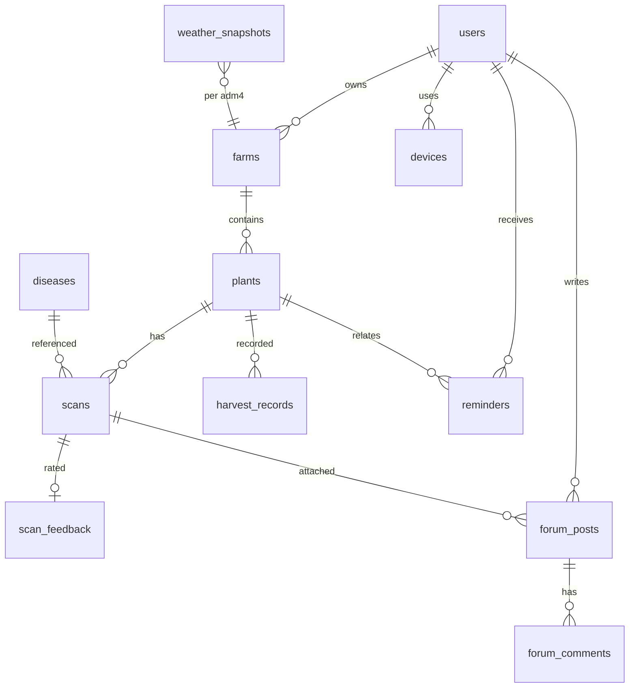

# Data model reference

Canonical source: `design.md` section 9. This document records what the
backend actually implements, including every constraint, index, and server
default, so the schema can be regenerated from it without reading the code.

## Conventions

- Every table has `id` (UUID, `gen_random_uuid()` default), `created_at` (timestamptz, `now()`), and usually `updated_at` (timestamptz, `now()`). `weather_snapshots` has no `updated_at` (append-only).
- **Every** timestamp column is `timestamptz`. `Base.type_annotation_map` maps `datetime` to `DateTime(timezone=True)`; migration `0002` converted the columns that `0001` had created as `timestamp without time zone` (asyncpg rejects timezone-aware values for those, so every scan, archive and reminder write failed).
- Column names are `snake_case`; JSONB columns hold `jsonb`.
- Foreign keys use `ON DELETE CASCADE` unless noted (`SET NULL` for `scans.plant_id`, `harvest_records.recorded_by`, `forum_posts.scan_id`, `forum_reports.resolved_by`).
- All enums are stored as `VARCHAR` with a `CHECK` constraint generated from `app.domain` (see `app/models/columns.py::enum_check`); the allowed values are the lowercase `snake_case` strings in `design.md` 8.2.

## Enumerations (stored values)

| Enum | Values |
|---|---|
| `UserRole` | `farmer`, `expert`, `moderator`, `admin` |
| `ScanType` | `disease`, `ripeness` |
| `ResultStatus` | `confident`, `uncertain`, `unknown`, `invalid_image` |
| `CauseCategory` | `healthy`, `fungus`, `bacteria`, `virus`, `pest`, `nutrient_deficiency`, `unknown` |
| `RipenessStage` | `unripe`, `turning`, `ripe`, `overripe` |
| `GrowthStage` | `seedling`, `vegetative`, `flowering`, `fruiting`, `harvesting`, `finished` |
| `HealthStatus` | `healthy`, `at_risk`, `sick`, `recovering`, `unknown` |
| `ReminderType` | `fungal_risk`, `heavy_rain_harvest`, `harvest_soon`, `heat_stress`, `scan_followup`, `general` |
| `ReminderPriority` | `low`, `normal`, `high` |
| `ReminderStatus` | `unread`, `read`, `done`, `dismissed` |
| `FeedbackValue` | `correct`, `incorrect` |
| `PostStatus` | `published`, `hidden`, `removed` |
| `ReportReason` | `spam`, `scam`, `abuse`, `wrong_info`, `other` |
| `ReportTargetType` | `post`, `comment` |
| `PushState` | `pending`, `sent`, `no_device`, `disabled`, `skipped_cap`, `failed`, `expired` |
| `Platform` | `android`, `ios`, `web` |
| `QualityStatus` | `ok`, `too_blurry`, `too_dark`, `too_bright` |
| `Severity` | `mild`, `moderate`, `severe` |
| `EstimateConfidence` | `low`, `medium`, `high` |

## Relationship diagram

## Tables

### `users`

| Column | Type | Null | Default | Notes |
|---|---|---|---|---|
| `id` | UUID | no | `gen_random_uuid()` | PK |
| `email` | VARCHAR(254) | no | | lower-cased, unique |
| `username` | VARCHAR(32) | no | | lower-cased, unique, `^[a-z0-9_.]{3,32}$` |
| `password_hash` | VARCHAR(255) | no | | Argon2 |
| `full_name` | VARCHAR(80) | no | | |
| `role` | VARCHAR(16) | no | `farmer` | `role` CHECK |
| `consent_training_data` | BOOLEAN | no | `false` | |
| `consent_at` | timestamptz | yes | | |
| `notification_settings` | JSONB | no | `'{}'` | per-type switches, quiet hours, `photo_reminder_days`, `monitoring_reminder_days` |
| `deleted_at` | timestamptz | yes | | soft delete |
| `created_at`, `updated_at` | timestamptz | no | `now()` | |

Constraints: `username_format` CHECK. Unique indexes `uq_users_email`, `uq_users_username` (migration `0004` dropped `phone` and the email-or-phone rule: requirement 6 identifies an account by email and username).

### `farms`

| Column | Type | Null | Default |
|---|---|---|---|
| `id` | UUID | no | gen |
| `user_id` | UUID | no | FK `users.id` ON DELETE CASCADE, indexed |
| `name` | VARCHAR(120) | no | |
| `adm4_code` | VARCHAR(16) | no | indexed (village code) |
| `lat` | NUMERIC(9,6) | yes | |
| `lon` | NUMERIC(9,6) | yes | |
| `area_m2` | NUMERIC(12,2) | yes | |
| `placement` | VARCHAR(16) | no | `outdoor`, CHECK `indoor`/`outdoor` |
| `archived_at` | timestamptz | yes | |
| `created_at`, `updated_at` | timestamptz | no | now() |

Constraints: `name_not_blank` (`length(trim(name)) > 0`), `lat_range`, `lon_range`, `area_positive`. Indexes `ix_farms_user_created (user_id, created_at)`, `ix_farms_user_id`, `ix_farms_adm4_code`.

### `plants`

| Column | Type | Null | Default |
|---|---|---|---|
| `id` | UUID | no | gen |
| `farm_id` | UUID | no | FK `farms.id` CASCADE, indexed |
| `commodity_code` | VARCHAR(32) | no | indexed |
| `variety` | VARCHAR(80) | yes | |
| `label` | VARCHAR(120) | no | |
| `planted_at` | date | no | |
| `growth_stage` | VARCHAR(16) | no | CHECK `growth_stage` |
| `health_status` | VARCHAR(16) | no | `unknown`, CHECK `health_status` |
| `expected_harvest_min` | date | yes | |
| `expected_harvest_max` | date | yes | |
| `irrigation_schedule` | VARCHAR(16) | no | `every_3_5_days`, CHECK |
| `ended_at` | timestamptz | yes | tracking ended (was `archived_at`) |
| `end_reason` | VARCHAR(16) | yes | CHECK `harvested`/`died`/`not_maintained`/`other` |
| `end_note` | TEXT | yes | |
| `final_result` | VARCHAR(16) | yes | CHECK `failed`/`suboptimal`/`normal`/`bumper` |
| `yield_percent` | NUMERIC(6,1) | yes | >= 0 |
| `created_at`, `updated_at` | timestamptz | no | now() |

Constraints: `harvest_range` (both null or both set with min <= max); `ended_with_reason` (`(ended_at IS NULL) = (end_reason IS NULL)`). Indexes `ix_plants_farm_ended (farm_id, ended_at)`, `ix_plants_health_status`, `ix_plants_farm_id`, `ix_plants_commodity_code`.

### `harvest_records`

| Column | Type | Null | Default |
|---|---|---|---|
| `id` | UUID | no | gen |
| `plant_id` | UUID | no | FK `plants.id` CASCADE, indexed |
| `recorded_by` | UUID | yes | FK `users.id` SET NULL |
| `harvested_at` | timestamptz | no | |
| `quality_note` | TEXT | yes | |
| `quantity_kg` | NUMERIC(10,2) | yes | |
| `created_at`, `updated_at` | timestamptz | no | now() |

Constraints: `quantity_non_negative`. Index `ix_harvest_records_plant_harvested (plant_id, harvested_at)`.

### `scans`

| Column | Type | Null | Default |
|---|---|---|---|
| `id` | UUID | no | gen |
| `user_id` | UUID | no | FK `users.id` CASCADE |
| `plant_id` | UUID | yes | FK `plants.id` SET NULL |
| `scan_type` | VARCHAR(16) | no | CHECK `scan_type` |
| `image_key` | VARCHAR(255) | no | object-storage key |
| `image_content_type` | VARCHAR(64) | no | |
| `detection_plant_id` | UUID | yes | FK `detection_plants.id` SET NULL |
| `client_uuid` | UUID | no | client-generated idempotency key |
| `captured_at` | timestamptz | no | time the photo was taken on device |
| `status` | VARCHAR(16) | no | CHECK `status` |
| `model_version` | VARCHAR(64) | no | |
| `result` | JSONB | no | vision result + backend enrichment |
| `disease_code` | VARCHAR(64) | yes | FK `diseases.code` RESTRICT |
| `quality` | JSONB | no | blur/brightness report |
| `confidence` | double precision | yes | |
| `commodity_code` | VARCHAR(32) | no | default `chili` |
| `inference_ms` | double precision | yes | |
| `created_at` | timestamptz | no | now() (no `updated_at`) |

Constraints: `uq_scans_user_client_uuid (user_id, client_uuid)`; `disease_code_only_when_named` (`status IN ('confident','uncertain') OR disease_code IS NULL`); `confidence_range`. Indexes `ix_scans_plant_captured (plant_id, captured_at DESC)`, `ix_scans_user_created (user_id, created_at DESC)`, `ix_scans_user_plant_created (user_id, plant_id, created_at DESC)`, `ix_scans_disease_code`, `ix_scans_status`.

### `scan_feedback`

| Column | Type | Null | Default |
|---|---|---|---|
| `id` | UUID | no | gen |
| `scan_id` | UUID | no | FK `scans.id` CASCADE, unique |
| `user_id` | UUID | no | FK `users.id` CASCADE, indexed |
| `value` | VARCHAR(16) | no | CHECK `feedback_value` |
| `comment` | TEXT | yes | |
| `correct_label` | VARCHAR(64) | yes | |
| `reviewed_at` | timestamptz | yes | |
| `reviewed_by` | UUID | yes | FK `users.id` SET NULL |
| `created_at` | timestamptz | no | now() |
| `updated_at` | timestamptz | no | `now()` (server default) |

Constraint: `enum_check('value', FeedbackValue)`.

### `diseases`

| Column | Type | Null | Default |
|---|---|---|---|
| `id` | UUID | no | gen |
| `code` | VARCHAR(64) | no | unique |
| `commodity_code` | VARCHAR(32) | no | indexed |
| `name_id` | VARCHAR(120) | no | |
| `name_latin` | VARCHAR(160) | yes | |
| `cause_category` | VARCHAR(32) | no | CHECK `cause_category` |
| `symptoms` | TEXT | no | |
| `causes_text` | TEXT | no | |
| `prevention` | TEXT | no | |
| `severity_note` | TEXT | yes | |
| `treatments` | JSONB | no | `'{}'` |
| `reviewed_by` | VARCHAR(120) | yes | |
| `reviewed_at` | date | yes | |
| `is_active` | BOOLEAN | no | `true` |
| `created_at`, `updated_at` | timestamptz | no | now() |

Constraints: `uq_diseases_commodity_code (commodity_code, code)`; `active_requires_review` (`NOT is_active OR (reviewed_by IS NOT NULL AND reviewed_at IS NOT NULL)`); `treatments_object` (`jsonb_typeof(treatments) = 'object'`). Index `ix_diseases_active_commodity (commodity_code, is_active)`.

`treatments` JSONB shape (design 9.3): `first_aid: string[]`, `organic: {title, how}[]`, `chemical: {title, how}[]`, `safety_note: string`, `when_to_call_expert: string`. No doses.

### `weather_snapshots`

| Column | Type | Null | Default |
|---|---|---|---|
| `id` | UUID | no | gen |
| `adm4_code` | VARCHAR(16) | no | |
| `fetched_at` | timestamptz | no | |
| `source` | VARCHAR(16) | no | `bmkg` (`bmkg`/`open_meteo`/`manual`) |
| `forecast` | JSONB | no | |
| `created_at` | timestamptz | no | now() (no `updated_at`) |

Constraints: `uq_weather_adm4_fetched (adm4_code, fetched_at)`; `source` CHECK. Index `ix_weather_adm4_fetched (adm4_code, fetched_at DESC)`.

### `reminders`

| Column | Type | Null | Default |
|---|---|---|---|
| `id` | UUID | no | gen |
| `user_id` | UUID | no | FK `users.id` CASCADE |
| `farm_id` | UUID | yes | FK `farms.id` CASCADE |
| `plant_id` | UUID | yes | FK `plants.id` CASCADE |
| `type` | VARCHAR(32) | no | CHECK `reminder_type` |
| `priority` | VARCHAR(16) | no | `normal`, CHECK `reminder_priority` |
| `status` | VARCHAR(16) | no | `unread`, CHECK `reminder_status` |
| `title` | VARCHAR(140) | no | |
| `body` | TEXT | no | |
| `payload` | JSONB | no | `'{}'` |
| `dedupe_key` | VARCHAR(160) | no | |
| `valid_until` | timestamptz | yes | |
| `sent_at` | timestamptz | yes | |
| `read_at` | timestamptz | yes | |
| `push_state` | VARCHAR(16) | no | `pending`, CHECK `push_state` |
| `created_at`, `updated_at` | timestamptz | no | now() |

Constraints: `has_target` (`farm_id IS NOT NULL OR plant_id IS NOT NULL OR type = 'general'`: a team broadcast concerns the user, not a field); `uq_reminders_user_dedupe (user_id, dedupe_key)`. Indexes `ix_reminders_user_status_created (user_id, status, created_at DESC)`, `ix_reminders_plant_created (plant_id, created_at DESC)`, `ix_reminders_valid_until`, `ix_reminders_push_state_created (push_state, created_at)`.

`push_state` is where the push stands (design 12.4). `pending` rows are retried by the hourly dispatcher, which is how quiet hours *defer* a normal/low push instead of dropping it; every other value is final. The daily cap counts `sent` rows since local midnight (`TANAMI_TIMEZONE`). `dedupe_key` uses the local date too.

### `devices`

| Column | Type | Null | Default |
|---|---|---|---|
| `id` | UUID | no | gen |
| `user_id` | UUID | no | FK `users.id` CASCADE, indexed |
| `fcm_token` | VARCHAR(512) | no | unique |
| `platform` | VARCHAR(16) | no | CHECK `platform` |
| `last_seen_at` | timestamptz | yes | |
| `created_at`, `updated_at` | timestamptz | no | now() |

Index `ix_devices_user_last_seen (user_id, last_seen_at DESC)`.

### `forum_posts`

| Column | Type | Null | Default |
|---|---|---|---|
| `id` | UUID | no | gen |
| `user_id` | UUID | no | FK `users.id` CASCADE |
| `commodity_code` | VARCHAR(32) | no | indexed |
| `title` | VARCHAR(120) | no | |
| `body` | TEXT | no | |
| `image_keys` | text[] | no | `'{}'` |
| `scan_id` | UUID | yes | FK `scans.id` SET NULL |
| `status` | VARCHAR(16) | no | `published`, CHECK `post_status` |
| `comment_count` | INTEGER | no | `0` |
| `report_count` | INTEGER | no | `0` |
| `like_count` | INTEGER | no | `0` |
| `created_at`, `updated_at` | timestamptz | no | now() |

Constraints: `title_length` (5..120), `body_length` (1..5000), `max_three_images` (`array_length(image_keys,1) IS NULL OR <= 3`), `comment_count_non_negative`. Indexes `ix_forum_posts_status_created (status, created_at DESC)`, `ix_forum_posts_commodity_status (commodity_code, status, created_at DESC)`, `ix_forum_posts_user_created (user_id, created_at DESC)`, `ix_forum_posts_commodity_code`.

### `forum_comments`

| Column | Type | Null | Default |
|---|---|---|---|
| `id` | UUID | no | gen |
| `post_id` | UUID | no | FK `forum_posts.id` CASCADE |
| `user_id` | UUID | no | FK `users.id` CASCADE |
| `body` | TEXT | no | |
| `status` | VARCHAR(16) | no | `published`, CHECK `post_status` |
| `created_at`, `updated_at` | timestamptz | no | now() |

Constraints: `body_length` (1..2000). Indexes `ix_forum_comments_post_created (post_id, created_at)`, `ix_forum_comments_user_created (user_id, created_at DESC)`.

### `forum_reports`

| Column | Type | Null | Default |
|---|---|---|---|
| `id` | UUID | no | gen |
| `reporter_id` | UUID | no | FK `users.id` CASCADE, indexed |
| `target_type` | VARCHAR(16) | no | CHECK `report_target_type` |
| `target_id` | UUID | no | |
| `reason` | VARCHAR(24) | no | CHECK `report_reason` |
| `note` | TEXT | yes | |
| `resolved_at` | timestamptz | yes | |
| `resolved_by` | UUID | yes | FK `users.id` SET NULL |
| `created_at`, `updated_at` | timestamptz | no | now() |

Constraints: `uq_forum_reports_reporter_target (reporter_id, target_type, target_id)`; `note_length` (<=1000). Indexes `ix_forum_reports_target (target_type, target_id)`, `ix_forum_reports_unresolved (resolved_at)`.

### `plant_photos` (R1)

`id`, `plant_id` (FK `plants` CASCADE), `user_id` (FK `users` CASCADE), `image_key` VARCHAR(255), `caption` VARCHAR(280) null, `taken_at` timestamptz, timestamps. Index `ix_plant_photos_plant_taken (plant_id, taken_at DESC)`.

### `care_logs` (R2)

`id`, `plant_id` (FK `plants` CASCADE), `user_id` (FK `users` SET NULL), `action` VARCHAR(16) CHECK `watering`/`fertilizing`/`pest_control`/`pruning`/`weeding`/`other`, `note` TEXT (<= 1000), `performed_at` timestamptz, timestamps. Indexes `(plant_id, performed_at DESC)`, `(plant_id, action, performed_at DESC)`. `watering` rows are the watering history and drive the watering reminder.

### `detection_plants` (R3, R4)

`id`, `user_id` (FK `users` CASCADE), `name` VARCHAR(120) (not blank), `commodity_code` VARCHAR(32) default `chili`, `plant_id` (FK `plants` SET NULL, optional link to a tracked plant), `ended_at` timestamptz null (history when set), `end_note` TEXT, timestamps. Index `(user_id, ended_at, created_at DESC)`.

### `forum_reactions` (R5)

`id`, `post_id` (FK `forum_posts` CASCADE), `user_id` (FK `users` CASCADE), `created_at`. Unique `uq_forum_reactions_post_user (post_id, user_id)`.

### `regions`

| Column | Type | Null | Default |
|---|---|---|---|
| `id` | UUID | no | gen |
| `adm4_code` | VARCHAR(16) | no | unique |
| `village` | VARCHAR(120) | no | |
| `district` | VARCHAR(120) | no | |
| `regency` | VARCHAR(120) | no | |
| `province` | VARCHAR(120) | no | |
| `lat` | double precision | yes | |
| `lon` | double precision | yes | |
| `created_at`, `updated_at` | timestamptz | no | now() |

Indexes `ix_regions_village_lower (lower(village))`, `ix_regions_regency`.

## Migration state

| Revision | Change |
|---|---|
| `0001_initial_schema` | 13 domain tables. |
| `0002_timestamptz` | 14 naive `timestamp` columns -> `timestamptz` (values reinterpreted as UTC). |
| `0003_reminder_push_state` | `reminders.push_state` (+ CHECK, index, backfill as final) and the relaxed `has_target`. |
| `0004_requirements_v1` | Requirements R0-R7: `farms.placement`; `plants` irrigation + end-of-tracking columns (`archived_at` renamed `ended_at`); `plant_photos`, `care_logs`, `detection_plants`, `forum_reactions`; `scans.detection_plant_id`; `users` email + username + `full_name` (renamed from `display_name`), `phone` dropped; reminder types `watering`, `photo`, `monitoring`. |

- `tests/integration/test_ops_and_schema.py::test_models_and_migrations_agree` runs Alembic autogenerate against the migrated test database and asserts **zero drift** on every test run.
- `upgrade head` -> `downgrade base` -> `upgrade head` has been exercised against PostgreSQL 16.
- `compare_type=True` and `compare_server_default=True` are enabled in `migrations/env.py`.
